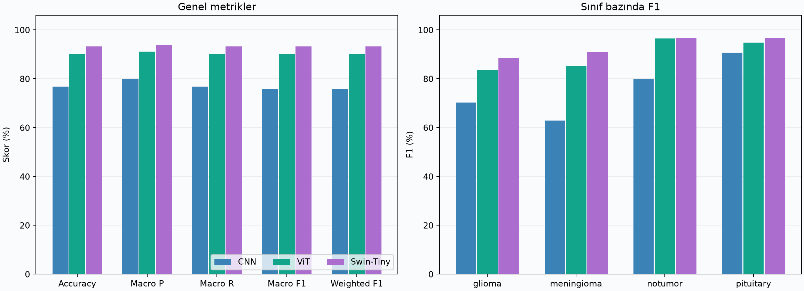
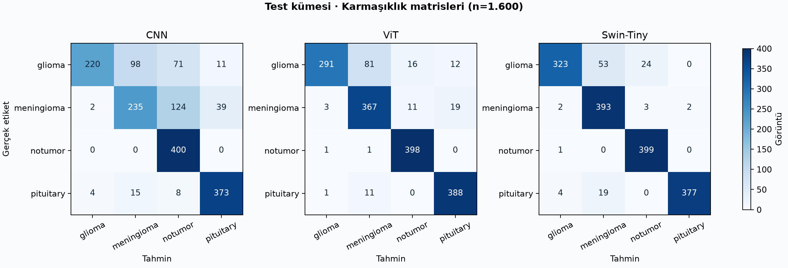
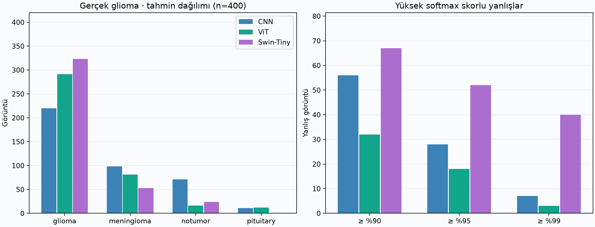

# NEURO AI LAB · Model performans analizi

**18 Kasım 2026 · 1.600 test görüntüsü · Her sınıftan 400 görüntü**

Swin-Tiny, aynı test kümesinde **%93,25 accuracy** ve **%93,19 macro F1** ile önde. Glioma için en yüksek recall da Swin-Tiny’de (%80,75). Buna rağmen, en az %99 softmax skoru verdiği 40 yanlışın 34’ü glioma. Veri denetiminde 114 test görüntüsünün eğitim veya doğrulama tarafında piksel düzeyinde aynısı bulundu. Bu nedenle yeniden eğitim kararından önce veri ve etiket denetimi öncelikli.

## Değerlendirme ve ön işleme

`Brain_Tumor_MRI_Dataset.zip` arşivindeki `Testing/` klasörünün tamamı değerlendirildi. Gerçek etiket, test alt klasöründen alındı. Sınıf sırası **0 glioma, 1 meningioma, 2 notumor, 3 pituitary**. `cnn_best.pth`, `vit_best.pth` ve `swin_tiny_best.pth` mevcut mimarilere `strict=True` ile yüklendi. Swin’in sınıf sırası checkpoint meta verisiyle de doğrulandı. RTX 3050 Laptop GPU, PyTorch 2.6.0+cu124, torchvision 0.21.0+cu124 ve timm 1.0.22 kullanıldı. Modeller `eval()` modunda, 16 görüntülük gruplarla sırayla çalıştı. Tahmin, dört logite uygulanan softmax’ın en büyük bileşeni olarak alındı.

| Notebook | Eğitim dönüşümleri | Test dönüşümleri |
| --- | --- | --- |
| CNN, hücre 9 | Gri tonlama (`L`), 224×224, `ToTensor`, ortalama ve standart sapma 0,5 | Aynı dönüşümler |
| ViT, hücreler 8–9 | RGB, 224×224, %50 yatay çevirme, ±10° döndürme, `ToTensor`, ImageNet normalizasyonu | RGB, 224×224, `ToTensor`, ImageNet normalizasyonu |
| Swin, hücreler 10 ve 12 | RGB, 224×224, ±10° döndürme, `ToTensor`, ImageNet normalizasyonu | RGB, 224×224, `ToTensor`, aynı normalizasyonu kullanan `val_transform` |

ImageNet ortalaması `[0.485, 0.456, 0.406]`, standart sapması `[0.229, 0.224, 0.225]`. Dönüşüm tanımları notebook hücrelerinden çıkarıldı. ViT ve Swin’in eğitim hatlarındaki ortak adımların testteki karşılıkları ve rastgele artırma ayarları kontrol edildi. Ayrıca notebook değerlendirme tensörü ile Canlı Demo’nun hazırladığı tensör **her model için 1.600/1.600 görüntüde eleman bazında birebir eşleşti**. Hücre numaraları sıfır tabanlıdır. [CNN](notebooks/CNN.ipynb) · [ViT](notebooks/ViT.ipynb) · [Swin](notebooks/Swin_Transformer_SAM.ipynb)

## Genel sonuçlar

| Model | Doğru / 1.600 | Accuracy | Macro precision | Macro recall | Macro F1 | Weighted F1 |
| --- | ---: | ---: | ---: | ---: | ---: | ---: |
| CNN | 1.228 | %76,75 | %79,85 | %76,75 | %75,88 | %75,88 |
| ViT | 1.444 | %90,25 | %91,09 | %90,25 | %90,05 | %90,05 |
| Swin-Tiny | 1.492 | **%93,25** | **%93,88** | **%93,25** | **%93,19** | **%93,19** |

Sınıf destekleri eşit olduğu için macro recall accuracy’ye, macro F1 weighted F1’a eşit. Swin-Tiny, ViT’den 48 ve CNN’den 264 daha fazla görüntüyü doğru sınıflandırdı.

## Sınıf bazında precision, recall ve F1

| Sınıf | Model | Precision | Recall | F1 |
| --- | --- | ---: | ---: | ---: |
| glioma | CNN | %97,35 | %55,00 | %70,29 |
| glioma | ViT | **%98,31** | %72,75 | %83,62 |
| glioma | Swin-Tiny | %97,88 | **%80,75** | **%88,49** |
| meningioma | CNN | %67,53 | %58,75 | %62,83 |
| meningioma | ViT | %79,78 | %91,75 | %85,35 |
| meningioma | Swin-Tiny | **%84,52** | **%98,25** | **%90,87** |
| notumor | CNN | %66,33 | **%100,00** | %79,76 |
| notumor | ViT | %93,65 | %99,50 | %96,48 |
| notumor | Swin-Tiny | **%93,66** | %99,75 | **%96,61** |
| pituitary | CNN | %88,18 | %93,25 | %90,64 |
| pituitary | ViT | %92,60 | **%97,00** | %94,75 |
| pituitary | Swin-Tiny | **%99,47** | %94,25 | **%96,79** |

Swin-Tiny dört sınıfta da en yüksek F1’ı verdi. ViT, glioma precision ve pituitary recall’da önde. CNN’in notumor recall’ı %100, ancak 203 tümör görüntüsünü de notumor olarak etiketlediği için bu sınıftaki precision’ı %66,33’e düşüyor.

## Karmaşıklık matrisleri ve glioma hataları

Satırlar gerçek test etiketini, sütunlar model tahminini gösterir. Her satırda 400 görüntü vardır.

| Gerçek etiket glioma (400) | Doğru glioma | meningioma | notumor | pituitary | Toplam yanlış |
| --- | ---: | ---: | ---: | ---: | ---: |
| CNN | 220 | 98 | 71 | 11 | 180 |
| ViT | 291 | 81 | 16 | 12 | 109 |
| Swin-Tiny | 323 | 53 | 24 | 0 | 77 |

- Glioma, üç modelde de en çok meningioma ile karıştı. Swin-Tiny bu karışmayı ViT’ye göre 28 görüntü azalttı. Glioma’yı notumor olarak tahmin etme sayısı ViT’de 16, Swin-Tiny’de 24 ve CNN’de 71.
- Üç modelin de yanıldığı 66 görüntünün 63’ü glioma. Bu ortak hata kümesi etiket ve görüntü kaynağı incelemesi için öncelikli.
- Eğitim veya doğrulama ile pikseli aynı glioma görüntüleri çıkarıldığında kalan 395 glioma üzerinde recall sırası korundu. CNN 216/395 (%54,68), ViT 287/395 (%72,66), Swin-Tiny 318/395 (%80,51).

## Yanlış ama yüksek olasılıklı tahminler

Her hücre, ilgili eşikte **yanlış tahmin / eşiği geçen tüm tahmin** sayısını gösterir. Eşikler en yüksek softmax skoruna uygulanır ve iç içedir.

| Model | ≥ %90 | ≥ %95 | ≥ %99 | Yanlışlarda ortalama en yüksek skor |
| --- | ---: | ---: | ---: | ---: |
| CNN | 56 / 828 | 28 / 581 | 7 / 210 | %72,27 |
| ViT | 32 / 1.198 | 18 / 1.051 | 3 / 645 | %72,57 |
| Swin-Tiny | 67 / 1.525 | 52 / 1.497 | 40 / 1.436 | %88,64 |

%90 eşiğindeki yanlışların glioma olanları CNN’de 32/56, ViT’de 27/32, Swin-Tiny’de 53/67. Swin-Tiny’nin %99 eşiğini geçen 40 yanlışının 28’i glioma → meningioma ve 6’sı glioma → notumor. ViT’nin aynı eşikteki üç yanlışının da gerçek etiketi glioma. CNN’de yedi yanlışın tamamı notumor tahminiydi. Yüksek softmax, bu örneklerde doğruluğu güvenceye almıyor. Eşik tablosu tanımlayıcıdır ve kalibrasyon iddiası içermez.

| Model | En yüksek skorlu yanlış | Test etiketi → tahmin | En yüksek skor |
| --- | --- | --- | ---: |
| CNN | Te-gl_43.jpg | glioma → notumor | %99,9493 |
| ViT | Te-gl_160.jpg | glioma → meningioma | %99,5806 |
| Swin-Tiny | Te-gl_68.jpg | glioma → meningioma | %99,9949 |

## Te-gl_1.jpg · Test etiketi glioma

| Model | glioma | meningioma | notumor | pituitary | Tahmin |
| --- | ---: | ---: | ---: | ---: | --- |
| CNN | %0,24091 | %36,84943 | **%40,30476** | %22,60491 | notumor |
| ViT | **%62,51064** | %5,77503 | %26,60835 | %5,10598 | glioma |
| Swin-Tiny | %0,00789 | **%99,98814** | %0,00348 | %0,00049 | meningioma |

Sınıf kararları Canlı Demo ile eşleşti. CNN’in tek görüntülük galeri çalıştırmasındaki %40,30975 notumor skoru, toplu değerlendirmedeki %40,30476’dan yaklaşık 0,005 yüzde puan farklıydı. Swin-Tiny’ye göre bu görüntü yüksek skorlu bir yanlış, ViT’ye göre doğru bir tahmin. Bu tekil sonuç genel glioma sıralamasını değiştirmiyor. Örnek, uygulanan içerik eşleme ölçütlerinde bölümler arası eşleşme vermedi.

## Eğitim/doğrulama örtüşmesi ve bağımsızlık

Yerelde özgün bölünme CSV’leri bulunmadı. Swin notebook’undaki sınıf sırası ve sıralı dosya yollarından, `test_size=0.20`, `random_state=42` ve sınıfa göre stratification ile **4.480 eğitim / 1.120 doğrulama** yolu yeniden oluşturuldu. CNN ve ViT notebook’ları Drive’daki aynı adlı listeleri okuyor. Yeniden oluşturulan üyeliğin özgün listelerle tek tek aynı olduğu veya bu listelerin her checkpoint’in eğitiminde aynen kullanıldığı doğrulanamadı. Birleşik 5.600 görüntülük `Training/` ile `Testing/` karşılaştırması bu ayrıma bağlı değildir.

Arşivdeki dosyalar baz ad, özgün baytların SHA-256 özeti ve boyutla birlikte çözümlenmiş RGB piksellerinin SHA-256 özetiyle karşılaştırıldı. Pikseli birebir aynı olmayan çiftlerde, 64 bit dHash Hamming uzaklığı ≤4 ve 64×64 gri tonlamalı önizleme ortalama mutlak piksel farkı ≤5/255 koşullarını sağlayanlar benzerlik adayı olarak kaydedildi.

| Karşılaştırma | Aynı baz ad, çift | Aynı bayt, çift | Aynı RGB pikseli, çift | Olası benzerlik, çift |
| --- | ---: | ---: | ---: | ---: |
| Test ↔ eğitim | 0 | 0 | 94 | 549 |
| Test ↔ doğrulama | 0 | 0 | 27 | 180 |
| Doğrulama ↔ eğitim | 0 | 78 | 88 | 436 |
| Test kümesi kendi içinde | 0 | 17 | 22 | 166 |

- Eğitim/doğrulama birleşimine karşı **114 benzersiz test görüntüsünün (%7,13)** çözümlenmiş pikselleri birebir aynı. Bunların 100’ü meningioma, 9’u notumor ve 5’i glioma. Test kümesinin kendi içinde 22 piksel-eş çiftine toplam 41 dosya katılıyor.
- Kesin eşler çıkarıldıktan sonra **330 ek test görüntüsünde** benzerlik adayı var. Bunların 308’i notumor, 19’u glioma ve 3’ü meningioma. Aday sayıları algoritmanın eşiğine bağlı.
- Sınırlar arasında farklı etiketli dört benzerlik çifti bulundu. İkisini görsel olarak yan yana inceledim. `Te-gl_68.jpg` ile `Tr-me_458.jpg` ve `Te-gl_160.jpg` ile `Tr-me_1122.jpg` görsel olarak neredeyse aynı kesitleri gösteriyor. İlki Swin-Tiny’nin, ikincisi ViT’nin en yüksek skorlu yanlışıyla örtüşüyor. Doğru klinik sınıf ve görüntülerin hasta kimliği bu analize dayanarak belirlenemiyor.
- Güvenilir hasta veya çalışma kimliği sağlanmadığı için **hasta düzeyinde bağımsızlık doğrulanamadı**. İçerik eşleme farklı kesitleri, kırpmaları ve diğer dönüşümleri kaçırabilir.

### Örtüşme hariç tutulduğunda

| Alt küme | Görüntü | CNN accuracy / macro F1 | ViT accuracy / macro F1 | Swin-Tiny accuracy / macro F1 |
| --- | ---: | ---: | ---: | ---: |
| Tam test | 1.600 | %76,75 / %75,88 | %90,25 / %90,05 | %93,25 / %93,19 |
| Eğitim/doğrulama ile piksel-eş olanları çıkar | 1.486 | %81,36 / %79,99 | %90,44 / %89,88 | %93,00 / %92,73 |
| Ek olarak benzerlik adaylarını çıkar | 1.156 | %76,56 / %72,99 | %87,89 / %87,87 | %91,18 / %90,16 |

Model sıralaması her iki alt kümede de korundu. Eleme sınıf dağılımını değiştirdi. İkinci elemede 400 notumor görüntüsünden 83’ü kaldı. Bu değerler duyarlılık analizi olarak okunmalı. Herhangi bir alt kümenin hasta düzeyinde bağımsız olduğunu göstermiyorlar.

## Yeniden eğitim kararı

**Araştırma demosu için hemen yeniden eğitim gerekli görünmüyor.** Swin-Tiny mevcut testte ve her iki örtüşme elemesinde genel metriklerde önde. ViT’nin pituitary recall üstünlüğü ve daha az yüksek skorlu yanlış üretmesi, iki modelin karşılaştırmalı olarak korunmasını destekliyor. CNN’in %55 glioma recall’u ve 71 glioma → notumor hatası, iyileştirme hedefi varsa ilk bakılacak modelin CNN olduğunu gösteriyor.

Model değiştirmeden önce, benzer ve çelişkili örnekleri kaynak veride inceleyip hasta düzeyinde ayrılmış bir test seti kurmak daha güçlü bir karar zemini sağlar. Bu bağımsız değerlendirmede glioma recall hedefin altında kalırsa yeniden eğitim gerekçesi oluşur. Sorun ağırlıkla yüksek softmax skorlarında kalırsa, bağımsız doğrulama kümesinde skor kalibrasyonunu değerlendirmek ayrı bir adımdır.

## Çıktılar

- [Tüm tahminler ve dört sınıf olasılıkları](performance_analysis/predictions.csv) · 4.800 satır
- [En az %90 skorlu yanlış tahminler](performance_analysis/high_confidence_errors.csv)
- [Örtüşme çiftleri, benzerlik ölçüleri ve etiket uyuşmazlıkları](performance_analysis/overlap_pairs.csv)
