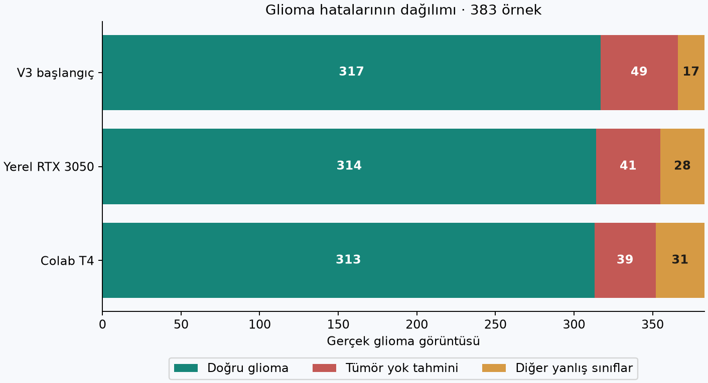
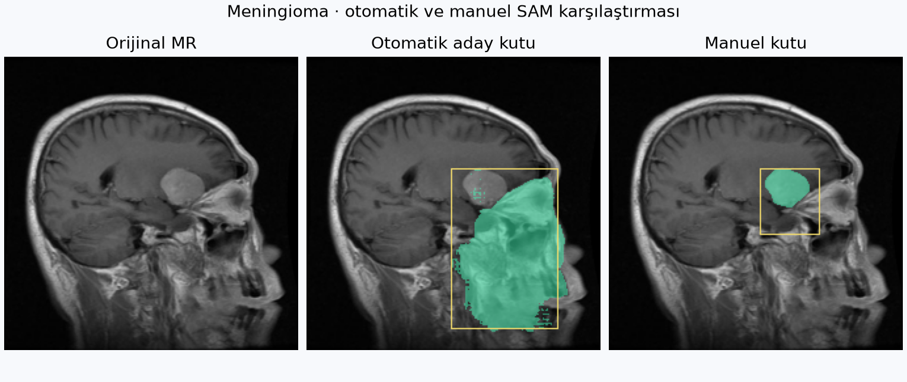

<div align="center">

# 🧠 Beyin Tümörü Analiz Sistemi

### CNN ve Swin Transformer ile Beyin MR Sınıflandırması · Grad-CAM ve SAM ile Görselleştirme

**Brain Tumor MRI Classification and Segmentation**


[Proje](#1-projenin-amacı) · [Modeller](#4-kullanılan-modeller) · [Sonuçlar](#5-model-performansları) · [Grafikler](#6-deney-görselleri) · [Kurulum](#9-kurulum-ve-çalıştırma) · [Google Drive](#11-google-drive-ve-model-dosyaları)

</div>

> [!IMPORTANT]
> Bu proje yalnızca **eğitim ve akademik araştırma** amacıyla geliştirilmiştir. Klinik tanı, tarama veya tedavi aracı değildir. Model skorları kalibre edilmiş tıbbi olasılıklar değildir; Grad-CAM haritaları ve SAM maskeleri uzman tarafından doğrulanmış tümör sınırları değildir.

## Hızlı başlangıç

- **Yerel uygulama (Windows):** Uygun Python ortamı ve model checkpoint'leri hazırsa `start.bat` dosyasını çalıştırın. Ayrıntılar için [kurulum](#9-kurulum-ve-çalıştırma) bölümüne bakın.
- **CNN:** [CNN sonuçları](#51-cnn-sınıflandırma-sonuçları), [CNN eğitim ve değerlendirme görselleri](#61-cnn-analiz-galerisi) ve modelin [Python kullanımı](#95-cnn-python-çıkarımı).
- **Swin Transformer eğitim/deneyleri:** [Colab notebook'u](https://colab.research.google.com/github/saglamkubra/Brain-Tumor-MRI-Classification-Segmentation/blob/main/notebooks/Swin_Tiny_V3_FineTuning_Colab.ipynb) ve [deney klasörü](experiments/swin_v3/).
- **Grad-CAM ve SAM:** Model açıklama haritaları ile otomatik ve manuel segmentasyon deneyleri [görsel analizler](#6-deney-görselleri) bölümünde sunulmuştur.
- **Veri seti:** [Brain Tumor MRI Dataset — Kaggle](https://www.kaggle.com/datasets/masoudnickparvar/brain-tumor-mri-dataset).
- **Model ağırlıkları ve araştırma materyalleri:** [Google Drive klasörü](https://drive.google.com/drive/folders/1aOvUcdAECIrp_yA3w9OtNYRz5jaUeej0?usp=drive_link).

## 1. Projenin amacı

**Beyin Tümörü Analiz Sistemi**, beyin MR görüntülerini dört sınıfa ayıran iki farklı derin öğrenme yaklaşımını inceleyen ve sonuçları açıklanabilir yapay zekâ ile görselleştiren bir üniversite projesidir.

Proje bileşenleri:

1. **CNN (Convolutional Neural Network)** ile görüntü sınıflandırması.
2. **Swin Transformer (Swin-Tiny)** ile görüntü sınıflandırması.
3. **Grad-CAM** ile model kararında etkili bölgelerin yaklaşık görselleştirilmesi.
4. **Segment Anything Model (SAM)** ile otomatik veya manuel kutu üzerinden aday bölge maskelenmesi.
5. **FastAPI** tabanlı yerel uygulamada modellerin ve analiz sonuçlarının sunulması.

### Sınıflar

| Sınıf | Model etiketi |
|---|---|
| Glioma | `glioma` |
| Meningioma | `meningioma` |
| Tümör yok | `notumor` |
| Hipofiz tümörü | `pituitary` |

## 2. Veri seti

Veri kaynağı: [Brain Tumor MRI Dataset — Kaggle](https://www.kaggle.com/datasets/masoudnickparvar/brain-tumor-mri-dataset).

### Swin Transformer için kullanılan veri bölünmesi

| Bölüm | Görüntü sayısı |
|---|---:|
| Eğitim | 3.870 |
| Doğrulama | 994 |
| Test | 1.579 |
| **Toplam** | **6.443** |

`train.csv`, `val.csv` ve `test.csv` dosyaları görüntülerin göreli yollarını (`dosya`) ve sınıf etiketlerini (`sinif`) içerir. **Görüntüler CSV dosyalarının içinde bulunmaz**; veri setinin `Training/` ve `Testing/` klasörlerinde saklanır.

Önceki deneylerde farklı bir veri bölünmesi de kullanılmıştır (4.480 eğitim, 1.120 doğrulama, 1.600 test). Farklı test listeleriyle elde edilen metrikler doğrudan aynı koşullarda yapılmış model karşılaştırması olarak yorumlanmamalıdır. Hasta düzeyinde bağımsızlık doğrulanmamıştır.

## 3. Görüntü ön işleme

| Özellik | CNN | Swin Transformer |
|---|---|---|
| Giriş biçimi | Gri tonlamalı | RGB |
| Görüntü boyutu | 224 × 224 | 224 × 224 |
| Normalizasyon | Eğitimde kullanılan 0.5 ortalama / 0.5 std | ImageNet mean / std |
| Sınıf sayısı | 4 | 4 |

Swin Transformer için ImageNet normalizasyonu:

```python
mean = [0.485, 0.456, 0.406]
std  = [0.229, 0.224, 0.225]
```

CNN ve Swin modellerine **kendi eğitimlerinde kullanılan dönüşümler ayrı ayrı uygulanmalıdır**.

## 4. Kullanılan modeller

### 4.1 CNN — Convolutional Neural Network

CNN, beyin MR görüntülerinin uzamsal özelliklerini evrişim katmanları aracılığıyla öğrenen sınıflandırma modelidir.

| Özellik | Değer |
|---|---|
| Giriş | 224 × 224, grayscale |
| Evrişim katmanı | 8 |
| Parametre sayısı | 3.337.764 |
| En iyi epoch | 33 |
| Test accuracy | **%89,61** |
| Macro precision | **%91,06** |
| Macro recall | **%89,49** |
| Macro F1-score | **%89,55** |

CNN dağıtım paketinde `inference.py` üzerinden sınıflandırma ve sınıf skorları üretilir. Araştırma notebook'unda Grad-CAM değerlendirilmiştir; mevcut CNN inference modülü yalnızca sınıflandırma ve sınıf skorlarını sunmaktadır.

Grad-CAM için belirtilen hedef katman: `features.3.block.3`.

Checkpoint, `torch.load(weights_only=True)` ile yüklenebilecek biçimde hazırlanmıştır ve SHA256 checksum kontrolü kullanır. Uyumluluk bilgileri CNN dağıtım paketindeki `deployment_config.json` dosyasındadır.

#### CNN modelinin değerlendirilmesi

CNN, **224 × 224 gri tonlamalı MR görüntülerini** dört sınıfta sınıflandırır. Modelin en iyi eğitim noktası 33. epoch olarak raporlanmıştır. Test doğruluğu **%89,61**, macro F1-score **%89,55** değerindedir. Modelin yüksek skorla hatalı tahminler yapabildiği gözlenmiştir; bu nedenle sınıf skorları tıbbi güven ölçütü olarak yorumlanmamalıdır.

CNN için eğitim, model mimarisi, hata analizi, sınıf bazlı metrikler ve Grad-CAM çalışmalarına ait **29 görsel** [CNN analiz galerisi](#61-cnn-analiz-galerisi) bölümünde sunulmuştur. Grafikler Sıla tarafından GitHub deposuna eklenmiştir. Görsellerin hangi checkpoint ve veri bölünmesine ait olduğu, ilgili deney kayıtlarıyla birlikte değerlendirilmelidir.

### 4.2 Swin Transformer (Swin-Tiny)

Swin Transformer, **Shifted Window** dikkat mekanizmasını kullanan bir Transformer mimarisidir. Bu projede **Swin-Tiny** varyantı kullanılmıştır.

```python
timm.create_model(
    "swin_tiny_patch4_window7_224",
    pretrained=False,
    num_classes=4
)
```

Bu kod, kayıtlı ağırlıkları yüklemek için mimariyi oluşturma örneğidir. Modelin eğitim başlangıcında ImageNet ön eğitimli ağırlıklar kullanılmıştır.

Sınıf sırası: `glioma`, `meningioma`, `notumor`, `pituitary`.

### 4.3 Grad-CAM — Açıklanabilir yapay zekâ

Grad-CAM, sınıflandırma kararında etkili olan bölgeleri yaklaşık bir **ısı haritası** ile görselleştirir. Swin Transformer için **Stage 3** ve **Stage 4** çıktıları incelenmiştir.

Isı haritasının lezyon bölgesine denk gelmesi garanti değildir; kafatası, kenar veya arka plan alanlarına da odaklanabilir. **Grad-CAM bir segmentasyon yöntemi değildir.**

### 4.4 Segment Anything Model (SAM)

SAM, görüntü ve konum kutusu girdilerinden segmentasyon maskesi üreten bir modeldir.

- **Otomatik kutu:** Görüntü işleme veya Grad-CAM üzerinden aday bölge belirlenmesi.
- **Manuel kutu:** Kullanıcının görüntü üzerinde kutu çizmesi.
- **Maske:** SAM'ın önerdiği bölgenin görselleştirilmesi.

SAM'ın kalite skoru, gerçek segmentasyon doğruluğu değildir. Uyumlu referans maskeler olmadığı için **Dice ve IoU hesaplanmamıştır**.

## 5. Model performansları

### 5.1 CNN sınıflandırma sonuçları

| CNN ölçümü | Sonuç |
|---|---:|
| Test accuracy | **%89,61** |
| Macro precision | **%91,06** |
| Macro recall | **%89,49** |
| Macro F1-score | **%89,55** |
| En iyi epoch | **33** |
| Evrişim katmanı | **8** |
| Parametre sayısı | **3.337.764** |

CNN'in sınıf bazlı precision, recall ve F1 değerleri burada ayrıca verilmemiştir; güncel değerlendirme çıktılarıyla doğrulandığında eklenebilir.

### 5.2 CNN ve Swin Transformer sonuçlarına genel bakış

| Metrik | CNN | Swin Transformer (ilk V3 değerlendirmesi) |
|---|---:|---:|
| Test accuracy | **%89,61** | **%93,86** |
| Macro precision | %91,06 | — |
| Macro recall | %89,49 | — |
| Macro F1-score | %89,55 | — |
| Glioma recall | — | %82,77 |

> **Karşılaştırma notu:** CNN ve Swin sonuçlarının aynı test örnekleri üzerinde hesaplandığı doğrulanmadığından, tabloda gösterilen değerler doğrudan adil bir mimari üstünlük karşılaştırması değildir. `—` doğrulanmış değer sağlanmadığını belirtir.

### 5.3 Swin Transformer eğitim deneyleri

| Deney | Test görüntüsü | Accuracy | Glioma recall | Glioma → `notumor` |
|---|---:|---:|---:|---:|
| İlk Swin/SAM çalışması | 1.600 | %93,25 | %80,75 | 24 |
| Temel Swin değerlendirmesi | 1.579 | %93,86 | %82,77 | 49 |
| Ek eğitim sonrası — önceki çalışma | 1.579 | %94,11 | %81,98 | 39 |
| Ek eğitim sonrası — yerel RTX 3050 | 1.579 | %94,05 | %81,98 | 41 |
| Ek eğitim sonrası — Colab T4 | 1.579 | %93,98 | %81,72 | 39 |

Ek eğitim bazı deneylerde genel doğruluğu artırmış ve glioma → `notumor` hata sayısını azaltmıştır; ancak glioma recall değeri düşmüştür. Sonuçlar birlikte değerlendirilmelidir.

**Colab T4 notu:** 383 glioma örneğinin 313'ü doğru, 39'u `notumor`, 31'i diğer sınıflar olarak tahmin edilmiştir. Colab T4'ün tam karmaşıklık matrisi ve görüntü bazlı skorları yerel kayıtlarda bulunmadığı için tüm grafikler aynı checkpoint'ten üretilmemiştir.

### 5.4 Swin Transformer temel değerlendirme karmaşıklık matrisi

Satırlar gerçek, sütunlar tahmin edilen sınıftır.

| Gerçek \ Tahmin | Glioma | Meningioma | No Tumor | Pituitary |
|---|---:|---:|---:|---:|
| Glioma | 317 | 15 | 49 | 2 |
| Meningioma | 2 | 367 | 22 | 5 |
| No Tumor | 0 | 0 | 400 | 0 |
| Pituitary | 0 | 2 | 0 | 398 |

## 6. Deney görselleri

CNN grafiklerinin GitHub yolu `results/CNN_V2_sonuclar/`, Swin ve SAM grafiklerinin yolu `results/swin_v3/swin_sam_grafikleri/` olarak kullanılmıştır. Görsellerin depoda bu yollarda bulunması gerekir. Paylaşılan örnek MR görsellerinin lisans ve gizlilik uygunluğu ayrıca kontrol edilmelidir.

### 6.1 CNN analiz galerisi

Sıla tarafından yüklenen **29 CNN analiz grafiği** aşağıda temalarına göre sunulmuştur. Bu görsellerin başlıkları dosya adlarına göre verilmiştir; her grafikteki sayısal değerler için görselin kendisi ve deney kaydı esas alınmalıdır.

#### Veri hazırlama, mimari ve eğitim

**01. Veri artırma örnekleri**


**02. Sınıf dağılımı ve ağırlıklar**


**03. CNN mimari analizi**


**04. Accuracy ve loss eğrileri**


**05. Sınıflandırma metriklerinin değişimi**


**06. Öğrenme oranı analizi**


#### Test sonuçları ve sınıf bazlı analizler

**07. Karmaşıklık matrisi**


**08. Yanlış sınıflandırma örüntüleri**


**09. Sınıf bazlı performans**


**10. Duyarlılık ve özgüllük analizi**


**11. İkili tümör tespit analizi**


**12. ROC eğrileri**


**13. Precision–recall eğrileri**


**14. AUC ve AP karşılaştırması**


#### Doğru ve yanlış tahmin örnekleri

**15. Doğru tahmin örnekleri**


**16. Yanlış tahmin örnekleri**


**17. Yüksek skorlu yanlış tahminler**


**18. Tahmin skorlarının analizi**


#### CNN Grad-CAM analizleri

**19. İlk Grad-CAM denemesi**


**20. Doğru tahminlerde Grad-CAM**


**21. Yanlış tahminlerde Grad-CAM**


**22. Yüksek skorlu hatalarda Grad-CAM**


**23. Sınıflar arası Grad-CAM karşılaştırması**


#### Genel performans ve deney karşılaştırmaları

**24. Veri seti performans özeti**


**25. Genelleme farkı analizi**


**26. CNN deneyleri arası performans karşılaştırması**


**27. Sınıf bazlı deney karşılaştırması**


**28. Genel performans paneli**


**29. Son model doğrulama grafiği**


> **Not:** CNN sınıflandırma modülü ile araştırma amaçlı Grad-CAM analizleri ayrı bileşenlerdir. Grad-CAM, doğrulanmış tümör sınırlarını göstermez.

### 6.2 Swin Transformer deney karşılaştırması


*Başlangıç, yerel RTX 3050 ve Colab T4 deneylerinin accuracy, glioma recall ve glioma → notumor hata sayıları.*

### 6.3 Glioma hatalarının analizi



*383 glioma örneğindeki doğru ve yanlış sınıflandırmaların dağılımı.*

### 6.4 Dört sınıfta Grad-CAM ve SAM


*Özgün MR görüntüleri, Stage 3 ve Stage 4 Grad-CAM haritaları ve otomatik SAM maskeleri.*

### 6.5 Otomatik ve manuel SAM karşılaştırması



*Aynı meningioma örneğinde iki farklı kutu yönlendirme yaklaşımı.*

### 6.6 Diğer analiz grafikleri

| Grafik | Bağlantı |
|---|---|
| Sınıf bazında precision, recall ve F1 | [03 — Sınıf bazlı metrikler](results/swin_v3/swin_sam_grafikleri/03_sinif_bazinda_precision_recall_f1.png) |
| Karmaşıklık matrisleri | [04 — Matrisler ve farklar](results/swin_v3/swin_sam_grafikleri/04_karisiklik_matrisi_ve_fark.png) |
| Epoch bazında accuracy ve glioma recall | [05 — Eğitim süreci](results/swin_v3/swin_sam_grafikleri/05_epoch_accuracy_ve_glioma_recall.png) |
| ROC ve AUC | [06 — ROC/AUC](results/swin_v3/swin_sam_grafikleri/06_roc_auc.png) |
| Precision–recall | [07 — PR eğrileri](results/swin_v3/swin_sam_grafikleri/07_precision_recall.png) |
| Softmax skor dağılımları | [08 — Doğru ve yanlış tahminler](results/swin_v3/swin_sam_grafikleri/08_dogru_yanlis_softmax_dagilimi.png) |
| Softmax kalibrasyonu | [09 — Güvenilirlik grafiği](results/swin_v3/swin_sam_grafikleri/09_softmax_kalibrasyonu.png) |
| SAM maske alanı ve kalite skoru | [12 — SAM analizi](results/swin_v3/swin_sam_grafikleri/12_sam_maske_alani_ve_kalite_skoru.png) |

**Grafiklerin kaynakları:** 01–02 numaralı görseller Colab T4 özet metriklerini de içerir. 03, 04 ve 06–09 numaralı görseller başlangıç ve yerel RTX 3050 checkpoint'lerinin gerçek çıkarımlarına; 05 numara yerel eğitim kaydına; 10–12 numaralar dört örnek üzerinde Swin Transformer ve SAM çıktısına dayanır. Referans maskeler bulunmadığından Dice/IoU raporlanmamıştır.

## 7. Grad-CAM ve SAM deneyleri

Otomatik konumlandırma, Grad-CAM haritasından veya görüntüdeki yerel kontrast/parlaklık özelliklerinden kutu üretebilir. Kutu SAM'a verilerek maske elde edilir.

Bununla birlikte:
- Grad-CAM bazı görüntülerde tümör yerine ilgisiz bölgelere odaklanabilir.
- Parlaklık tabanlı yöntem normal anatomiyi veya artefaktları lezyon adayı sanabilir.
- Sınıflandırma sonucu `notumor` olsa bile görüntü işleme yöntemi aday bölge bulabilir.
- Manuel kutu bazı örneklerde görsel olarak daha uygun maske üretebilir.
- Uzman referans maskesi olmadan segmentasyon başarısı sayısal olarak doğrulanamaz.

Bu nedenle otomatik kutu ve SAM çıktıları **araştırma amaçlı görsel öneriler** olarak ele alınmalıdır.

## 8. Proje dosya yapısı

Aşağıdaki yapı, önceki README'de belgelenen proje düzenini özetler; güncel depoda dosyaların varlığı ayrıca kontrol edilmelidir.

```text
backend/                FastAPI ve model servisleri
frontend/               Yerel web arayüzü
notebooks/              Model eğitimleri ve araştırma notebook'ları
experiments/swin_v3/    Swin ek eğitim ve değerlendirme kodları
results/                Grafikler ve deney çıktıları
tests/                  API testleri
models/                 Yerel checkpoint dosyaları (GitHub'a yüklenmez)
start.bat               Windows başlatıcısı
requirements.txt        Python bağımlılıkları
```

Eski notebook dosya adlarında sürüm numaraları bulunabilir. Bunlar teknik dosya isimleridir; model mimarilerinin isimleri değildir.

## 9. Kurulum ve çalıştırma

### 9.1 Depoyu klonlayın

```bash
git clone https://github.com/saglamkubra/Brain-Tumor-MRI-Classification-Segmentation.git
cd Brain-Tumor-MRI-Classification-Segmentation
```

### 9.2 Python bağımlılıkları

Uygun Python ve PyTorch ortamında:

```bash
pip install -r requirements.txt
```

CNN dağıtımına özel test edilmiş paket sürümleri `deployment_config.json` içinde belirtilmiştir.

### 9.3 Checkpoint dosyaları

Model ağırlıklarını uygulamanın beklediği `models/` klasörüne yerleştirin. Eski uygulama sürümlerindeki dosya adları ile yeni checkpoint adları farklı olabilir; gerçek yükleme yollarını `backend/` kodundan doğrulayın.

Örnek mevcut Swin ağırlık adları:

```text
swin_tiny_v3_best.pth
swin_tiny_v3_finetuned_best.pth
```

CNN ve SAM checkpoint dosyalarının gerçek adları dağıtım paketinden ve backend yapılandırmasından doğrulanmalıdır.

**Model ağırlıklarını ve ham MR veri setini GitHub'a yüklemeyin.**

### 9.4 Yerel web uygulaması

Windows ortamında, gerekli checkpoint'ler ve bağımlılıklar hazırsa:

```powershell
.\start.bat
```

Önceki uygulama sürümünün yerel adresi: <http://127.0.0.1:8000/>.

Mevcut backend ve `start.bat` dosyalarının **CNN + Swin + SAM** düzenine göre güncellenmiş olması gerekir. Bu entegrasyon doğrulanmadan uygulamanın eksiksiz çalıştığı varsayılmamalıdır.

### 9.5 CNN Python çıkarımı

CNN dağıtım paketinde:

```python
from inference import predict_image

result = predict_image("example.jpg")
print(result)
```

## 10. Web uygulaması ve hedeflenen özellikler

Projenin web arayüzü aşağıdaki modülleri bir araya getirmeyi hedeflemektedir:

| Modül | İşlev |
|---|---|
| MR Analizi | Yüklenen görüntü için CNN ve Swin tahminleri |
| Model Karşılaştırma | Sınıf skorları ve iki modelin sonuçları |
| Açıklanabilir AI | Swin Grad-CAM görselleri |
| SAM Segmentasyon | Otomatik ve manuel kutu ile maske |
| Performans Paneli | Gerçek deney grafikleri ve metrikler |
| Akademik Kaynaklar | Tahmin edilen sınıfla ilgili PubMed makaleleri (planlanan) |
| Analiz Raporu | Görsel ve sonuçlardan PDF raporu (planlanan) |

**Durum notu:** Tablo, önceki uygulamada bulunan araştırma işlevlerini ve geliştirilmesi planlanan özellikleri birlikte listeler. PubMed entegrasyonu ve PDF raporu bu README hazırlanırken çalışır durumda doğrulanmamıştır. Sınıflandırma ve segmentasyonun güncel backend'deki çalışma durumu da uygulama testleriyle doğrulanmalıdır.

### Önceki yerel API uç noktaları

| Uç nokta | Açıklama |
|---|---|
| `GET /health` | Model ve cihaz durumu |
| `POST /predict` | Sınıflandırma çıktıları |
| `POST /segment?mode=auto` | Otomatik konumlandırma ve segmentasyon |
| `POST /segment?mode=manual` | Kullanıcının seçtiği kutu ile segmentasyon |

Bunlar önceki uygulama sürümünde belgelenen adreslerdir; güncel API'de kontrol edilmelidir.

## 11. Google Drive ve model dosyaları

📁 **[Beyin Tümörü Projesi — Google Drive klasörünü aç](https://drive.google.com/drive/folders/1aOvUcdAECIrp_yA3w9OtNYRz5jaUeej0?usp=drive_link)**

Google Drive, model checkpoint'leri, deney sonuçları ve büyük araştırma dosyaları için kullanılır. Erişim, klasörün paylaşım izinlerine bağlıdır.

> Bu README'de kullanılan grafik isimleri proje tarafından paylaşılan dosya listesine dayanmaktadır. Drive içindeki dosyaların bire bir konumu ve erişim izinleri ayrıca doğrulanmalıdır.

## 12. Sınırlılıklar ve etik kullanım

- Modeller klinik olarak doğrulanmamıştır.
- Model skorları kalibre edilmiş tıbbi olasılıklar değildir.
- Yüksek skorlu yanlış tahminler gözlenmiştir.
- Glioma görüntülerinin `notumor` olarak tahmin edilmesi kritik bir hata türüdür.
- CNN ve Swin sonuçları farklı test listelerine dayanıyorsa doğrudan kıyaslanamaz.
- Veri bölünmesinin hasta düzeyinde bağımsızlığı doğrulanmamıştır.
- Grad-CAM, tümör sınırlarını belirleyen bir segmentasyon yöntemi değildir.
- SAM maskeleri uzman etiketli referanslarla doğrulanmamıştır.
- Görüntülerdeki kişisel/sağlık bilgileri korunmalıdır.

## 13. Ekip ve görev dağılımı

| Ekip üyesi | Çalışma alanı |
|---|---|
| **Sıla** | CNN modelinin geliştirilmesi, eğitimi ve değerlendirilmesi |
| **Kübra** | Swin Transformer, Grad-CAM, SAM ve ilgili deneyler |
| **Ortak** | Web arayüzü, sonuçların sunumu, raporlama |

## 14. Proje durumu

- [x] CNN sınıflandırma modelinin eğitilmesi ve test edilmesi
- [x] Swin Transformer modelinin eğitilmesi ve test edilmesi
- [x] Grad-CAM deneylerinin gerçekleştirilmesi
- [x] SAM ile otomatik ve manuel segmentasyon deneylerinin yapılması
- [x] Model performans grafiklerinin hazırlanması
- [ ] CNN + Swin + SAM güncel web entegrasyonunun uçtan uca doğrulanması
- [ ] PubMed makale entegrasyonunun tamamlanması
- [ ] PDF analiz raporunun tamamlanması
- [ ] Son sunum ve tüm dosya bağlantılarının kontrolü

---

<div align="center">

**Beyin Tümörü Analiz Sistemi**

*CNN · Swin Transformer · Grad-CAM · SAM*

**Yalnızca eğitim ve akademik araştırma amaçlıdır.**

</div>
