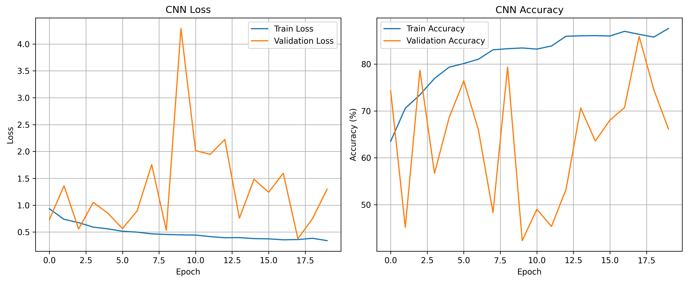
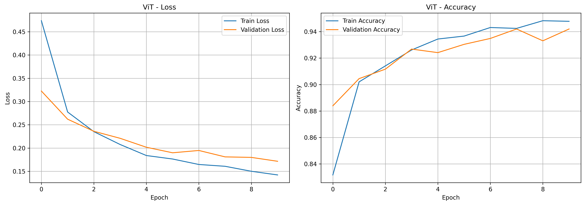
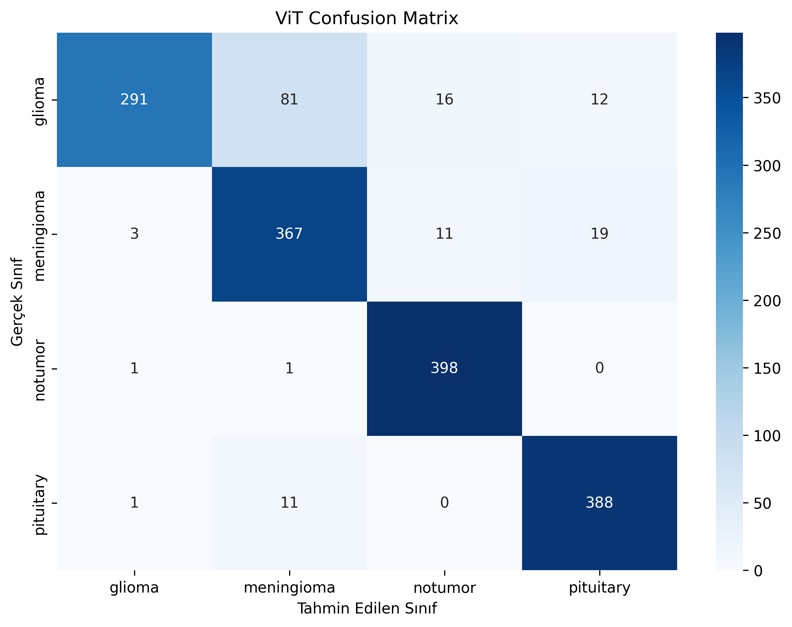
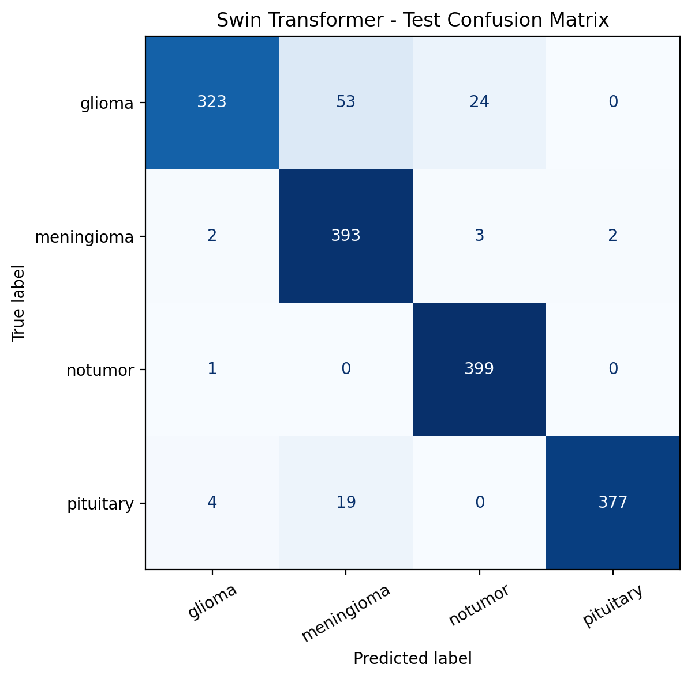
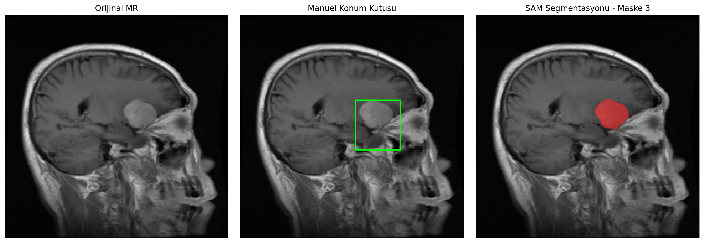

# Beyin MR Görüntülerinde Tümör Sınıflandırma ve Segmentasyon

**Brain Tumor MRI Classification and Segmentation**

Bu proje, beyin MRI görüntülerini dört sınıfta sınıflandırmayı;
sınıflandırma kararlarını Grad-CAM ile görselleştirmeyi ve yaklaşık
konum bilgilerini Segment Anything Model (SAM) ile segmentasyon
denemelerinde kullanmayı amaçlar.

> **Uyarı:** Çalışma eğitim ve araştırma amaçlıdır. Klinik tanı veya
> tedavi amacıyla kullanılamaz. Grad-CAM haritaları ve SAM maskeleri
> uzman tarafından doğrulanmış tümör sınırları değildir.

## 1. Projenin amacı

CNN (Convolutional Neural Network), Vision Transformer (ViT-B/16) ve
Swin Transformer modelleriyle dört sınıflı MRI sınıflandırması
yapılmıştır. Swin Transformer çıktıları üzerinden Grad-CAM
açıklanabilirlik haritaları üretilmiş; otomatik ve manuel konum kutuları
SAM ViT-B modeline verilerek segmentasyon sonuçları görsel olarak
incelenmiştir.

Sınıflar: `glioma`, `meningioma`, `notumor`, `pituitary`.

## 2. Veri seti

[Brain Tumor MRI Dataset --
Kaggle](https://www.kaggle.com/datasets/masoudnickparvar/brain-tumor-mri-dataset)

  Bölüm          Görüntü sayısı   Sınıf başına
  ------------ ---------------- --------------
  Train                   4.480          1.120
  Validation              1.120            280
  Test                    1.600            400
  **Toplam**          **7.200**      **1.800**

CNN ve ViT deneyleri `train.csv`, `val.csv` ve `test.csv` dosyalarıyla
aynı veri bölünmesi üzerinde değerlendirilmiştir. Ham veri seti büyük
boyutu nedeniyle GitHub deposuna eklenmemiştir.

## 3. Görüntü ön işleme

### CNN

-   Gri tonlamalı görüntüler, `224 × 224` piksele yeniden
    boyutlandırılmıştır.
-   Tensöre dönüştürme ve ortalama/standart sapması `0.5` olan
    normalizasyon uygulanmıştır.

### ViT

-   Görüntüler RGB ve `224 × 224` boyutundadır.
-   Eğitimde `%50` olasılıkla yatay çevirme ve `±10°` rastgele döndürme
    uygulanmıştır.
-   ImageNet ortalaması `(0.485, 0.456, 0.406)` ve standart sapması
    `(0.229, 0.224, 0.225)` ile normalize edilmiştir.
-   Validation ve testte rastgele artırma kullanılmamıştır.

### Swin Transformer

Swin veri hazırlama ve dönüşüm adımları ilgili Colab notebook'unda
uygulanmıştır. Bu README'de notebook tarafından doğrulanmamış ek
parametre varsayılmamıştır.

## 4. Modeller

### CNN

Üç evrişim bloğu (32, 64, 128 kanal), Batch Normalization, ReLU ve Max
Pooling kullanılmıştır. Ardından Adaptive Average Pooling, 128 nöronlu
tam bağlantılı katman, Dropout (0.4) ve dört sınıflı çıkış katmanı yer
alır.

  Parametre                Değer
  ------------------------ ------------------
  Loss                     CrossEntropyLoss
  Optimizer                Adam
  Learning rate            0.001
  Epoch                    20
  Batch size               32
  Dropout                  0.4
  Eğitilebilir parametre   110.148

En iyi CNN modeli 18. epoch'ta kaydedilmiştir (validation loss:
`0.3770`, validation accuracy: `%85.89`).

### Vision Transformer (ViT)

Torchvision ImageNet ön eğitimli ViT-B/16 kullanılmıştır. Sınıflandırma
başlığı dört sınıfa uyarlanmış; önceden eğitilmiş gövde dondurularak
yalnızca yeni sınıflandırma katmanı eğitilmiştir (feature extraction /
linear probing).

  Parametre                Değer
  ------------------------ ------------------
  Loss                     CrossEntropyLoss
  Optimizer                AdamW
  Learning rate            0.001
  Weight decay             0.01
  Epoch                    10
  Batch size               16
  Toplam parametre         85.801.732
  Eğitilebilir parametre   3.076

En iyi doğrulama sonucu 10. epoch'tadır (validation loss: `0.1715`,
validation accuracy: `%94.20`).

### Swin Transformer

Önceden eğitilmiş Swin Transformer ağırlıkları dört sınıflı göreve
uyarlanmıştır. Kayıtlı deney çıktısında 3 epoch sonunda validation
accuracy `%97.68` ve kullanılan cihaz CUDA GPU olarak belirtilmiştir.

## 5. Test sonuçları

  Metrik                   CNN      ViT   Swin Transformer
  ------------------- -------- -------- ------------------
  Accuracy              %76.75   %90.25             %93.25
  Precision (Macro)     %79.85   %91.09             %93.88
  Recall (Macro)        %76.75   %90.25             %93.25
  F1-score (Macro)      %75.88   %90.05             %93.19

CNN ve ViT aynı 1.600 görüntülük test kümesinde değerlendirilmiştir.
ViT, CNN'den 13.50 yüzde puan daha yüksek test doğruluğu elde etmiştir.
Ancak CNN sıfırdan eğitilirken ViT ImageNet ön eğitimli ağırlıklarla
kullanılmıştır; bu nedenle transfer öğrenme etkisi de dikkate
alınmalıdır. Swin için raporlanan test doğruluğu `%93.25`'tir. Swin
validation doğruluğu `%97.68` olup test metriğinden farklı bir veri
bölümüne aittir.

### CNN sınıf bazlı metrikleri

  Sınıf          Precision   Recall       F1   Support
  ------------ ----------- -------- -------- ---------
  Glioma            0.9735   0.5500   0.7029       400
  Meningioma        0.6753   0.5875   0.6283       400
  No Tumor          0.6633   1.0000   0.7976       400
  Pituitary         0.8818   0.9325   0.9064       400

### ViT sınıf bazlı metrikleri

  Sınıf          Precision   Recall       F1   Support
  ------------ ----------- -------- -------- ---------
  Glioma            0.9831   0.7275   0.8362       400
  Meningioma        0.7978   0.9175   0.8535       400
  No Tumor          0.9365   0.9950   0.9648       400
  Pituitary         0.9260   0.9700   0.9475       400

### Swin Transformer karmaşıklık matrisi

Satırlar gerçek, sütunlar tahmin edilen sınıflardır.

  Gerçek  Tahmin     Glioma   Meningioma   No Tumor   Pituitary
  ---------------- -------- ------------ ---------- -----------
  Glioma                323           53         24           0
  Meningioma              2          393          3           2
  No Tumor                1            0        399           0
  Pituitary               4           19          0         377

## 6. Deney görselleri

Görsellerin GitHub'da `results/` klasöründe bulunması ve dosya adlarının
aşağıdakilerle aynı olması gerekir.

### CNN

 *CNN eğitim ve
doğrulama loss/accuracy grafikleri.*

 *CNN test
karmaşıklık matrisi.*

### ViT

 *ViT eğitim ve
doğrulama loss/accuracy grafikleri.*

 *ViT test
karmaşıklık matrisi.*

### Swin Transformer

 *Swin
Transformer test karmaşıklık matrisi.*


*Örnek MRI görüntüsü ve Grad-CAM/SAM işlem çıktısı.*

## 7. Grad-CAM ve SAM segmentasyon deneyleri

Grad-CAM, Swin Transformer'ın belirli bir sınıf tahmininde hangi görüntü
bölgelerine ağırlık verdiğini görselleştirmek için kullanılmıştır.
Aktivasyon haritası kesin tümör sınırı değildir.

Önceden eğitilmiş SAM ViT-B modeline MRI görüntüsüyle birlikte konum
kutusu verilmiştir. İki yönlendirme yaklaşımı incelenmiştir:

1.  **Otomatik kutu:** Grad-CAM aktivasyonundan yaklaşık konum kutusu
    türetilmesi.
2.  **Manuel kutu:** Görüntü üzerinde elle belirlenen kutunun SAM'a
    verilmesi.


*Orijinal görüntü, otomatik Grad-CAM + SAM ve manuel kutu + SAM
karşılaştırması.*


*Manuel kutu ile yönlendirilen SAM maskesi.*


*Glioma, meningioma ve pituitary örneklerinde otomatik SAM çıktıları.*

İlk deneylerde otomatik kutuların bazı görüntülerde geniş kaldığı ve
SAM'ın tümör yerine daha geniş anatomik alanları maskeleyebildiği
görülmüştür. Manuel kutularla bazı örneklerde lezyona görsel olarak daha
uygun maskeler elde edilmiştir. Veri setinde uzmanlarca hazırlanmış
referans segmentasyon maskeleri bulunmadığından Dice veya IoU gibi
referans maske gerektiren nicel segmentasyon metrikleri
hesaplanamamıştır. Bu nedenle SAM çıktıları görsel/niteliksel olarak
değerlendirilmiştir.

## 8. Proje dosya yapısı

``` text
Brain-Tumor-MRI-Classification-Segmentation/
├── notebooks/
│   ├── CNN.ipynb
│   ├── Swin_Transformer_SAM.ipynb
│   └── ViT.ipynb
├── results/
│   ├── cnn_training_curves.png
│   ├── cnn_confusion_matrix.png
│   ├── vit_training_curves.png
│   ├── vit_confusion_matrix.png
│   ├── swin_confusion_matrix.png
│   ├── ornek_01_swin_sam_sonuc.png
│   ├── meningioma_manuel_sam_sonuc.png
│   ├── meningioma_otomatik_manuel_karsilastirma.png
│   └── uc_tumor_otomatik_sam_karsilastirma.png
├── requirements.txt
└── README.md
```

Bu ağaç hedeflenen düzeni gösterir. Dosyaların depoda gerçekten bulunup
bulunmadığı ayrıca kontrol edilmelidir. Dosya adları farklıysa README
içindeki görsel yolları gerçek adlarla eşleştirilmelidir.

## 9. Kurulum ve çalıştırma

Başlıca kullanılan kütüphaneler: Python, PyTorch, Torchvision, timm,
NumPy, Pandas, Matplotlib, Seaborn, Scikit-learn, OpenCV,
pytorch-grad-cam ve segment-anything.

1.  Depoyu klonlayın:

    ``` bash
    git clone https://github.com/saglamkubra/Brain-Tumor-MRI-Classification-Segmentation.git
    ```

2.  Veri setini Kaggle bağlantısından indirip Google Drive'a yükleyin.

3.  İlgili notebook'u Google Colab'da açın.

4.  Colab çalışma zamanında uygun GPU'yu seçin.

5.  Notebook içindeki Drive ve veri seti yollarını kendi ortamınıza göre
    düzenleyin.

6.  Gerekli kütüphaneleri kurup hücreleri sırasıyla çalıştırın.

Veri seti ve eğitilmiş ağırlık dosyaları büyük oldukları için GitHub
deposunda tutulmayabilir. Notebook'ların çalışması için veri ve model
ağırlığı yolları ayrıca ayarlanmalıdır.

## 10. Sınırlılıklar

-   Sonuçlar kullanılan veri seti ve deney düzeniyle sınırlıdır; farklı
    merkez ve cihazlarda genellenebilirlik ayrıca doğrulanmamıştır.
-   CNN ve ViT'nin ön işleme ve eğitim stratejileri farklıdır. ViT'de
    ImageNet ön eğitimi kullanılmıştır.
-   Grad-CAM açıklanabilirlik haritasıdır; segmentasyon maskesi
    değildir.
-   SAM maskeleri verilen görüntü ve konum istemine bağlıdır.
-   Uzman etiketli segmentasyon maskeleri olmadığından Dice/IoU
    değerlendirmesi yapılamamıştır.
-   Görsel olarak uygun maske klinik doğruluk anlamına gelmez.

## 11. Ekip ve görev dağılımı

Proje iki kişilik ekip tarafından yürütülmüştür.

-   **Ekip üyesi 1:** CNN ve ViT modellerinin geliştirilmesi, eğitimi ve
    değerlendirilmesi.
-   **Ekip üyesi 2:** Swin Transformer, Grad-CAM ve SAM çalışmalarının
    yürütülmesi; otomatik ve manuel kutu deneyleri.
-   **Ortak:** Sonuçların karşılaştırılması, raporlama ve sunum.

## 12. Proje durumu

-   [x] Veri setinin hazırlanması ve veri bölünmesi
-   [x] CNN modelinin eğitimi ve testi
-   [x] ViT modelinin eğitimi ve testi
-   [x] Swin Transformer modelinin eğitimi ve testi
-   [x] Üç sınıflandırma modelinin sonuçlarının karşılaştırılması
-   [x] Grad-CAM deneyleri
-   [x] SAM ViT-B ile segmentasyon deneyleri
-   [x] Otomatik ve manuel konum yönlendirmelerinin incelenmesi
-   [ ] GitHub'daki tüm notebook ve görsel adlarının son kontrolü
-   [ ] Nihai rapor ve sunumun tamamlanması

## Veri seti kaynağı

[Brain Tumor MRI Dataset --
Kaggle](https://www.kaggle.com/datasets/masoudnickparvar/brain-tumor-mri-dataset)

------------------------------------------------------------------------

**Bu proje üniversite dersi kapsamında eğitim ve araştırma amacıyla
hazırlanmıştır.**
