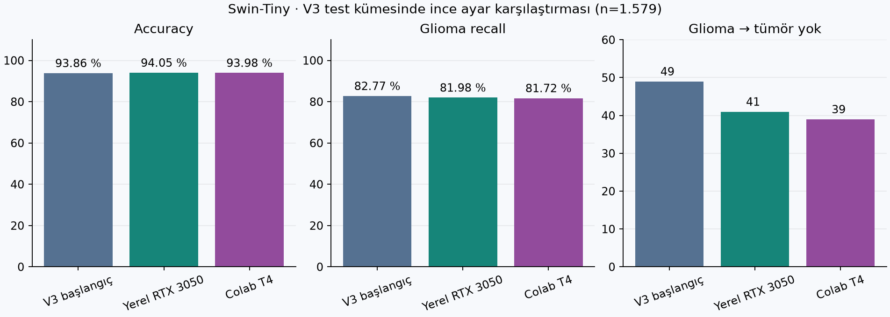
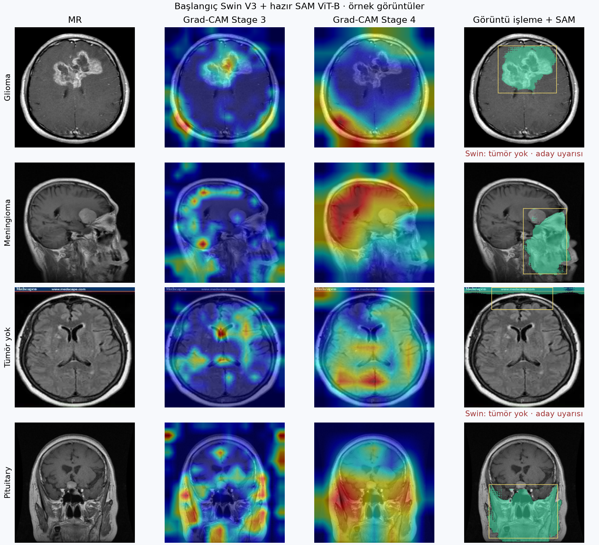

<div align="center">

# 🧠 Beyin Tümörü Analiz Sistemi

### CNN ve Swin Transformer ile Beyin MR Sınıflandırması · Grad-CAM ve SAM ile Görselleştirme

**Brain Tumor MRI Classification and Segmentation**


[Görüntü işleme](#görüntü-işleme-hattı) · [Proje](#1-projenin-amacı) · [Modeller](#4-kullanılan-modeller) · [Sonuçlar](#5-model-performansları) · [Grafikler](#6-deney-görselleri) · [Kurulum](#9-kurulum-ve-çalıştırma) · [Google Drive](#11-google-drive-ve-model-dosyaları)

</div>

> [!IMPORTANT]
> Bu proje yalnızca **eğitim ve akademik araştırma** amacıyla geliştirilmiştir. Klinik tanı, tarama veya tedavi aracı değildir. Model skorları kalibre edilmiş tıbbi olasılıklar değildir; Grad-CAM haritaları ve SAM maskeleri uzman tarafından doğrulanmış tümör sınırları değildir.

## Hızlı başlangıç

[Rapor dizini](docs/README.md) · [Deney grafikleri ve görselli raporlar](results/README.md)

- **Yerel uygulama (Windows):** Uygun Python ortamı ve model checkpoint'leri hazırsa `start.bat --port 8011` komutunu çalıştırın. Ayrıntılar için [kurulum](#9-kurulum-ve-çalıştırma) bölümüne bakın.
- **CNN:** [CNN sonuçları](#51-cnn-sınıflandırma-sonuçları), [CNN eğitim ve değerlendirme görselleri](#61-cnn--seçilmiş-analiz-görselleri) ve modelin [Python kullanımı](#95-cnn-python-çıkarımı).
- **Swin Transformer eğitim/deneyleri:** [Colab notebook'u](https://colab.research.google.com/github/saglamkubra/Brain-Tumor-MRI-Classification-Segmentation/blob/main/notebooks/Swin_Tiny_V3_FineTuning_Colab.ipynb) ve [deney klasörü](experiments/swin_v3/).
- **Grad-CAM ve SAM:** Model açıklama haritaları ile otomatik ve manuel segmentasyon deneyleri [görsel analizler](#6-deney-görselleri) bölümünde sunulmuştur.
- **Veri seti:** [Brain Tumor MRI Dataset — Kaggle](https://www.kaggle.com/datasets/masoudnickparvar/brain-tumor-mri-dataset).
- **Model ağırlıkları ve araştırma materyalleri:** [Google Drive klasörü](https://drive.google.com/drive/folders/1aOvUcdAECIrp_yA3w9OtNYRz5jaUeej0?usp=drive_link).

## Görüntü işleme hattı

| Adım | Uygulanan yöntem | Kod ve deney |
| --- | --- | --- |
| Veri hazırlığı | Görüntü tekrarları ve benzerlik kontrolü, sınıf dağılımı ve veri bölme | [Veri hazırlama notebook’u](Data_Preprocessing/01_Data_Preprocessing.ipynb) · [Veri sızıntısı denetimi](docs/veri-denetimi/DATA_LEAKAGE_AUDIT.md) |
| Model girişleri | 224 × 224 boyutlandırma, CNN için gri ton ve paket normalizasyonu, Swin için RGB ve ImageNet normalizasyonu | [Ön işleme ve model yükleme](backend/models.py) · [CNN V2](notebooks/CNN_V2.ipynb) |
| MR önizlemesi | En-boy oranını koruyan ölçekleme ve dolgu, önizleme ile özgün koordinatlar arasında kutu dönüşümü | [Önizleme geometrisi ve SAM](backend/segmentation.py) |
| Kontrastla aday bölge | Gri ton dönüşümü, Gauss bulanıklaştırma, morfolojik kapama ve erozyon, bağlı bileşen analizi | [Kontrastla kutu üretimi](backend/lesion_candidate.py) |
| Grad-CAM | Hedef sınıf logitinin gradyanıyla aktivasyon kanallarını ağırlıklandırma, pozitif haritayı ölçekleme ve değişken görünümlerle yumuşatma | [Swin ve SAM notebook’u](notebooks/Swin_Transformer_SAM.ipynb) · [Aşama 3 katman karşılaştırması](results/gradcam_diagnostics/summary_asama3.md) |
| SAM ViT-B | Grad-CAM’den veya manuel kutudan maske adayları, kutu ve maskenin aynı önizlemeye geri izdüşümü | [Otomatik ve manuel SAM örnekleri](results/swin_v3/swin_sam_grafikleri/11_sam_otomatik_manuel_kutu.png) |
| Bölge müdahalesi | Ortalama gri veya Gauss dolgusu ve aynı alanlı, sabit tohumlu rastgele kontrol. CNN ve Swin yeniden çalıştırılarak skor ve logit marjı karşılaştırılır | [Müdahale kodu](backend/explanation_lab.py) · [Arayüz doğrulama görselleri](results/explanation_ui_validation/) |

Aşama 3 varsayılanı `layers[2]`. Notebook grafikleri son bloğun `norm1` çıkışını kullanır. Uygulamadaki varsayılan seçimi, seçilmiş örneklerde tek gözlemcili görsel incelemeye dayanır. Referans maske ve anatomik isabet oranı yoktur. [Görsel karşılaştırma](results/gradcam_diagnostics/stage3_gorsel_karsilastirma/ozet.md)

## 1. Projenin amacı

**Beyin Tümörü Analiz Sistemi**, beyin MR görüntülerini dört sınıfa ayıran iki farklı derin öğrenme yaklaşımını inceleyen ve sonuçları açıklanabilir yapay zekâ ile görselleştiren bir üniversite projesidir.

Proje bileşenleri:

1. **CNN (Convolutional Neural Network)** ile görüntü sınıflandırması.
2. **Swin Transformer (Swin-Tiny)** ile görüntü sınıflandırması.
3. **Grad-CAM** ile model kararında etkili bölgelerin yaklaşık görselleştirilmesi.
4. **Segment Anything Model (SAM)** ile otomatik veya manuel kutu üzerinden aday bölge maskelenmesi.
5. **FastAPI** tabanlı yerel uygulamada modellerin ve analiz sonuçlarının sunulması.

### Sınıflar

| Sınıf | Model etiketi |
|---|---|
| Glioma | `glioma` |
| Meningioma | `meningioma` |
| Tümör yok | `notumor` |
| Hipofiz tümörü | `pituitary` |

## 2. Veri seti

Veri kaynağı: [Brain Tumor MRI Dataset — Kaggle](https://www.kaggle.com/datasets/masoudnickparvar/brain-tumor-mri-dataset).

### Swin Transformer için kullanılan veri bölünmesi

| Bölüm | Görüntü sayısı |
|---|---:|
| Eğitim | 3.870 |
| Doğrulama | 994 |
| Test | 1.579 |
| **Toplam** | **6.443** |

`train.csv`, `val.csv` ve `test.csv` dosyaları görüntülerin göreli yollarını (`dosya`) ve sınıf etiketlerini (`sinif`) içerir. **Görüntüler CSV dosyalarının içinde bulunmaz**; veri setinin `Training/` ve `Testing/` klasörlerinde saklanır.

Önceki deneylerde farklı bir veri bölünmesi de kullanılmıştır (4.480 eğitim, 1.120 doğrulama, 1.600 test). Farklı test listeleriyle elde edilen metrikler doğrudan aynı koşullarda yapılmış model karşılaştırması olarak yorumlanmamalıdır. Hasta düzeyinde bağımsızlık doğrulanmamıştır.

## 3. Görüntü ön işleme

| Özellik | CNN | Swin Transformer |
|---|---|---|
| Giriş biçimi | Gri tonlamalı | RGB |
| Görüntü boyutu | 224 × 224 | 224 × 224 |
| Normalizasyon | CNN V2 dağıtım paketindeki ortalama ve standart sapma | ImageNet ortalama ve standart sapması |
| Sınıf sayısı | 4 | 4 |

Swin Transformer için ImageNet normalizasyonu:

```python
mean = [0.485, 0.456, 0.406]
std  = [0.229, 0.224, 0.225]
```

CNN ve Swin modellerine **kendi eğitimlerinde kullanılan dönüşümler ayrı ayrı uygulanmalıdır**.

## 4. Kullanılan modeller

### 4.1 CNN — Convolutional Neural Network

CNN, beyin MR görüntülerinin uzamsal özelliklerini evrişim katmanları aracılığıyla öğrenen sınıflandırma modelidir.

| Özellik | Değer |
|---|---|
| Giriş | 224 × 224, grayscale |
| Evrişim katmanı | 8 |
| Parametre sayısı | 3.337.764 |
| En iyi epoch | 33 |
| Test accuracy | **%89,61** |
| Macro precision | **%91,06** |
| Macro recall | **%89,49** |
| Macro F1-score | **%89,55** |

CNN dağıtım paketinde `inference.py` üzerinden sınıflandırma ve sınıf skorları üretilir. Araştırma notebook'unda Grad-CAM değerlendirilmiştir; mevcut CNN inference modülü yalnızca sınıflandırma ve sınıf skorlarını sunmaktadır.

Grad-CAM için belirtilen hedef katman: `features.3.block.3`.

Checkpoint, `torch.load(weights_only=True)` ile yüklenebilecek biçimde hazırlanmıştır ve SHA256 checksum kontrolü kullanır. Uyumluluk bilgileri CNN dağıtım paketindeki `deployment_config.json` dosyasındadır.

#### CNN modelinin değerlendirilmesi

CNN, **224 × 224 gri tonlamalı MR görüntülerini** dört sınıfta sınıflandırır. Modelin en iyi eğitim noktası 33. epoch olarak raporlanmıştır. Test doğruluğu **%89,61**, macro F1-score **%89,55** değerindedir. Modelin yüksek skorla hatalı tahminler yapabildiği gözlenmiştir; bu nedenle sınıf skorları tıbbi güven ölçütü olarak yorumlanmamalıdır.

CNN için model mimarisi, eğitim, sınıf bazlı performans ve Grad-CAM çalışmalarından seçilen **6 önemli görsel** [CNN analiz galerisi](#61-cnn--seçilmiş-analiz-görselleri) bölümünde sunulmuştur. Diğer grafikler GitHub klasöründe bulunmaktadır. Grafikler Sıla tarafından GitHub deposuna eklenmiştir. Görsellerin hangi checkpoint ve veri bölünmesine ait olduğu, ilgili deney kayıtlarıyla birlikte değerlendirilmelidir.

### 4.2 Swin Transformer (Swin-Tiny)

Swin Transformer, **Shifted Window** dikkat mekanizmasını kullanan bir Transformer mimarisidir. Bu projede **Swin-Tiny** varyantı kullanılmıştır.

```python
timm.create_model(
    "swin_tiny_patch4_window7_224",
    pretrained=False,
    num_classes=4
)
```

Bu kod, kayıtlı ağırlıkları yüklemek için mimariyi oluşturma örneğidir. Modelin eğitim başlangıcında ImageNet ön eğitimli ağırlıklar kullanılmıştır.

Sınıf sırası: `glioma`, `meningioma`, `notumor`, `pituitary`.

### 4.3 Grad-CAM — Açıklanabilir yapay zekâ

Grad-CAM, sınıflandırma kararında etkili olan bölgeleri yaklaşık bir **ısı haritası** ile görselleştirir. Swin Transformer için **Stage 3** ve **Stage 4** çıktıları incelenmiştir.

Isı haritasının lezyon bölgesine denk gelmesi garanti değildir; kafatası, kenar veya arka plan alanlarına da odaklanabilir. **Grad-CAM bir segmentasyon yöntemi değildir.**

### 4.4 Segment Anything Model (SAM)

SAM, görüntü ve konum kutusu girdilerinden segmentasyon maskesi üreten bir modeldir.

- **Otomatik kutu:** Görüntü işleme veya Grad-CAM üzerinden aday bölge belirlenmesi.
- **Manuel kutu:** Kullanıcının görüntü üzerinde kutu çizmesi.
- **Maske:** SAM'ın önerdiği bölgenin görselleştirilmesi.

SAM'ın kalite skoru, gerçek segmentasyon doğruluğu değildir. Uyumlu referans maskeler olmadığı için **Dice ve IoU hesaplanmamıştır**.

## 5. Model performansları

### 5.1 CNN sınıflandırma sonuçları

| CNN ölçümü | Sonuç |
|---|---:|
| Test accuracy | **%89,61** |
| Macro precision | **%91,06** |
| Macro recall | **%89,49** |
| Macro F1-score | **%89,55** |
| En iyi epoch | **33** |
| Evrişim katmanı | **8** |
| Parametre sayısı | **3.337.764** |

CNN'in sınıf bazlı precision, recall ve F1 değerleri burada ayrıca verilmemiştir; güncel değerlendirme çıktılarıyla doğrulandığında eklenebilir.

### 5.2 CNN ve Swin Transformer sonuçlarına genel bakış

İki model aynı **1.579 görüntülük V3 test listesinde** değerlendirildi. [Kayıtlı metrikler ve matrisler](results/web_v3_performance.json)

| Metrik | CNN V2 | Swin-Tiny V3 |
|---|---:|---:|
| Doğruluk | %89,61 | %93,86 |
| Makro kesinlik | %91,06 | %94,54 |
| Makro duyarlılık | %89,49 | %93,74 |
| Makro F1 | %89,55 | %93,79 |
| Glioma duyarlılığı | %80,94 | %82,77 |
| Tümör olup tümör yok denen | 119/1.179 (%10,1) | 71/1.179 (%6,0) |

Hasta düzeyinde bağımsızlık doğrulanmadı. Ağırlıklar ve eğitim koşulları farklıdır. 1.600 görüntülük ilk testin sonuçları ayrı bir deney olarak okunmalıdır. İlk CNN testinde doğruluk %76,75 ve glioma duyarlılığı %55,00 idi. [İlk test raporu](docs/deneyler/MODEL_PERFORMANCE_ANALYSIS.md)

### 5.3 Swin Transformer eğitim deneyleri

| Deney | Test görüntüsü | Accuracy | Glioma recall | Glioma → `notumor` |
|---|---:|---:|---:|---:|
| İlk Swin/SAM çalışması | 1.600 | %93,25 | %80,75 | 24 |
| Temel Swin değerlendirmesi | 1.579 | %93,86 | %82,77 | 49 |
| Ek eğitim sonrası — önceki çalışma | 1.579 | %94,11 | %81,98 | 39 |
| Ek eğitim sonrası — yerel RTX 3050 | 1.579 | %94,05 | %81,98 | 41 |
| Ek eğitim sonrası — Colab T4 | 1.579 | %93,98 | %81,72 | 39 |

Ek eğitim bazı deneylerde genel doğruluğu artırmış ve glioma → `notumor` hata sayısını azaltmıştır; ancak glioma recall değeri düşmüştür. Sonuçlar birlikte değerlendirilmelidir.

**Colab T4 notu:** 383 glioma örneğinin 313'ü doğru, 39'u `notumor`, 31'i diğer sınıflar olarak tahmin edilmiştir. Colab T4'ün tam karmaşıklık matrisi ve görüntü bazlı skorları yerel kayıtlarda bulunmadığı için tüm grafikler aynı checkpoint'ten üretilmemiştir.

### 5.4 Swin Transformer temel değerlendirme karmaşıklık matrisi

Satırlar gerçek, sütunlar tahmin edilen sınıftır.

| Gerçek \ Tahmin | Glioma | Meningioma | No Tumor | Pituitary |
|---|---:|---:|---:|---:|
| Glioma | 317 | 15 | 49 | 2 |
| Meningioma | 2 | 367 | 22 | 5 |
| No Tumor | 0 | 0 | 400 | 0 |
| Pituitary | 0 | 2 | 0 | 398 |

## 6. Deney görselleri

CNN grafiklerinin GitHub yolu `results/CNN_V2 sonuçlar/`, Swin ve SAM grafiklerinin yolu `results/swin_v3/swin_sam_grafikleri/` olarak kullanılmıştır. Görsellerin depoda bu yollarda bulunması gerekir. Paylaşılan örnek MR görsellerinin lisans ve gizlilik uygunluğu ayrıca kontrol edilmelidir.

### 6.1 CNN — Seçilmiş analiz görselleri

CNN için en önemli altı grafik aşağıda gösterilmiştir. [Tüm CNN grafiklerine GitHub klasöründen ulaşabilirsiniz](results/CNN_V2%20sonu%C3%A7lar/).

#### 1. CNN mimari analizi


*CNN mimarisinin katmanları ve model yapısı.*

#### 2. CNN eğitim ve doğrulama eğrileri


*Eğitim sürecindeki doğruluk ve kayıp eğrileri.*

#### 3. CNN karmaşıklık matrisi


*Dört sınıfta doğru ve yanlış sınıflandırmalar.*

#### 4. CNN sınıf bazlı performans


*Sınıf bazlı değerlendirme metrikleri.*

#### 5. CNN Grad-CAM


*Doğru sınıflandırılmış örneklerde açıklanabilirlik haritaları.*

#### 6. CNN genel performans paneli


*CNN değerlendirmesinin görsel özeti.*

### 6.2 Swin Transformer deney karşılaştırması



*Başlangıç, yerel RTX 3050 ve Colab T4 deneylerinin accuracy, glioma recall ve glioma → notumor hata sayıları.*

### 6.3 Glioma hatalarının analizi


*383 glioma örneğindeki doğru ve yanlış sınıflandırmaların dağılımı.*

### 6.4 Dört sınıfta Grad-CAM ve SAM



*Özgün MR görüntüleri, Stage 3 ve Stage 4 Grad-CAM haritaları ve otomatik SAM maskeleri.*

### 6.5 Otomatik ve manuel SAM karşılaştırması


*Aynı meningioma örneğinde iki farklı kutu yönlendirme yaklaşımı.*

### 6.6 Diğer analiz grafikleri

| Grafik | Bağlantı |
|---|---|
| Sınıf bazında precision, recall ve F1 | [03 — Sınıf bazlı metrikler](results/swin_v3/swin_sam_grafikleri/03_sinif_bazinda_precision_recall_f1.png) |
| Karmaşıklık matrisleri | [04 — Matrisler ve farklar](results/swin_v3/swin_sam_grafikleri/04_karisiklik_matrisi_ve_fark.png) |
| Epoch bazında accuracy ve glioma recall | [05 — Eğitim süreci](results/swin_v3/swin_sam_grafikleri/05_epoch_accuracy_ve_glioma_recall.png) |
| ROC ve AUC | [06 — ROC/AUC](results/swin_v3/swin_sam_grafikleri/06_roc_auc.png) |
| Precision–recall | [07 — PR eğrileri](results/swin_v3/swin_sam_grafikleri/07_precision_recall.png) |
| Softmax skor dağılımları | [08 — Doğru ve yanlış tahminler](results/swin_v3/swin_sam_grafikleri/08_dogru_yanlis_softmax_dagilimi.png) |
| Softmax kalibrasyonu | [09 — Güvenilirlik grafiği](results/swin_v3/swin_sam_grafikleri/09_softmax_kalibrasyonu.png) |
| SAM maske alanı ve kalite skoru | [12 — SAM analizi](results/swin_v3/swin_sam_grafikleri/12_sam_maske_alani_ve_kalite_skoru.png) |

**Grafiklerin kaynakları:** 01–02 numaralı görseller Colab T4 özet metriklerini de içerir. 03, 04 ve 06–09 numaralı görseller başlangıç ve yerel RTX 3050 checkpoint'lerinin gerçek çıkarımlarına; 05 numara yerel eğitim kaydına; 10–12 numaralar dört örnek üzerinde Swin Transformer ve SAM çıktısına dayanır. Referans maskeler bulunmadığından Dice/IoU raporlanmamıştır.

## 7. Grad-CAM ve SAM deneyleri

Otomatik konumlandırma, Grad-CAM haritasından veya görüntüdeki yerel kontrast/parlaklık özelliklerinden kutu üretebilir. Kutu SAM'a verilerek maske elde edilir.

Bununla birlikte:
- Grad-CAM bazı görüntülerde tümör yerine ilgisiz bölgelere odaklanabilir.
- Parlaklık tabanlı yöntem normal anatomiyi veya artefaktları lezyon adayı sanabilir.
- Sınıflandırma sonucu `notumor` olsa bile görüntü işleme yöntemi aday bölge bulabilir.
- Manuel kutu bazı örneklerde görsel olarak daha uygun maske üretebilir.
- Uzman referans maskesi olmadan segmentasyon başarısı sayısal olarak doğrulanamaz.

Bu nedenle otomatik kutu ve SAM çıktıları **araştırma amaçlı görsel öneriler** olarak ele alınmalıdır.

## 8. Proje dosya yapısı

Güncel yapı ve giriş noktaları:

```text
Data_Preprocessing/     Veri hazırlama notebook’u ve grafikleri
docs/                   Uygulama, deney ve veri denetimi raporları
backend/                FastAPI ve model servisleri
frontend/               Yerel web arayüzü
notebooks/              Model eğitimleri ve araştırma notebook'ları
experiments/swin_v3/    Swin ek eğitim ve değerlendirme kodları
results/                Grafikler ve deney çıktıları
tests/                  Birim ve gerçek MR uçtan uca testleri
models/                 Yerel checkpoint dosyaları (GitHub'a yüklenmez)
start.bat               Windows başlatıcısı
requirements.txt        Python bağımlılıkları
```

Eski notebook dosya adlarında sürüm numaraları bulunabilir. Bunlar teknik dosya isimleridir; model mimarilerinin isimleri değildir.

## 9. Kurulum ve çalıştırma

### 9.1 Depoyu klonlayın

```bash
git clone https://github.com/saglamkubra/Brain-Tumor-MRI-Classification-Segmentation.git
cd Brain-Tumor-MRI-Classification-Segmentation
```

### 9.2 Python bağımlılıkları

Uygun Python ve PyTorch ortamında:

```bash
pip install -r requirements.txt
```

CNN dağıtımına özel test edilmiş paket sürümleri `deployment_config.json` içinde belirtilmiştir.

### 9.3 Checkpoint dosyaları

[Drive klasöründen](#11-google-drive-ve-model-dosyaları) edinilen model dosyalarını yerel `models/` klasörüne yerleştirin.

| Model | Yerel dosyalar |
| --- | --- |
| CNN V2 | `models/CNN_V2/` altında `cnn_v2_best.pth`, `deployment_config.json`, `cnn_v2_architecture.py` ve `inference.py` |
| Swin-Tiny | `models/swin_tiny_v3_best.pth` |
| SAM ViT-B | `models/sam_vit_b_01ec64.pth` |

CNN paketi yüklenirken SHA-256 ve model yapılandırması kontrol edilir. Ağırlıklar ve ham MR verileri yerelde tutulur.

### 9.4 Yerel web uygulaması

```powershell
.\start.bat --port 8011
```

[Uygulama](http://127.0.0.1:8011/) ve [model durumu](http://127.0.0.1:8011/health) aynı bilgisayardan açılır. CUDA varsa GPU, aksi halde CPU kullanılır.

Notebook katmanını denemek için aynı PowerShell oturumunda `$env:NEURO_SWIN_STAGE3_TARGET='block_norm1'` ayarlayıp sunucuyu yeniden başlatın. Varsayılan aşama çıkışına dönmek için `Remove-Item Env:NEURO_SWIN_STAGE3_TARGET -ErrorAction SilentlyContinue` çalıştırıp yeniden başlatın.

### 9.5 CNN Python çıkarımı

CNN dağıtım paketinde:

```python
from inference import predict_image

result = predict_image("example.jpg")
print(result)
```

## 10. Web uygulaması ve doğrulama

Arayüz CNN ve Swin tahminlerini, Grad-CAM ve otomatik veya manuel SAM görsellerini, gerçek deney metriklerini ve grafiklerini gösterir. Eşzamanlı görüntüleyici aynı önizleme koordinatlarında katman karşılaştırması yapar. Açıklamayı sına bölümü gerçek model girişlerini ve bölge müdahalelerini gösterir. PubMed’e sınıf ve arama terimi gönderilir. PDF raporu analiz sonuçlarını ve seçilen görselleri içerir.

Modelin gördüğü bölümünü açınca CNN ve Swin giriş görselleri otomatik yüklenir. Müdahale deneyinde çizilen kutunun rastgele kontrolü aynı sayıda pikseli kutuyla kesişmeden gizler. Kullanılan konum özgün MR piksel koordinatlarıyla gösterilir. Manuel SAM, kutu eksik veya geçersiz olduğunda yönlendirme gösterir. Arayüz ve PDF, Türkçe ve İngilizce sayı biçimlerini kullanır.

| Uç nokta | İşlev |
| --- | --- |
| `GET /health` | Yüklenen modeller, cihaz ve aktif Swin hedefi |
| `POST /predict` | CNN ve Swin sınıf skorları |
| `POST /explain` · `POST /segment` | Grad-CAM ve kutu istemli SAM |
| `POST /model-inputs` · `POST /intervene` | Gerçek model girişleri ve müdahale sonucu |
| `GET /performance` · `GET /research` · `POST /report` | Kayıtlı test metrikleri, gerçek PubMed kayıtları ve PDF |

[Test raporu](docs/uygulama/WEB_TEST_REPORT.md) · [Gerçek MR ile ekranlar](results/NEURO_AI_LAB_uygulama_ekranlari.pdf)

## 11. Google Drive ve model dosyaları

📁 **[Beyin Tümörü Projesi — Google Drive klasörünü aç](https://drive.google.com/drive/folders/1aOvUcdAECIrp_yA3w9OtNYRz5jaUeej0?usp=drive_link)**

Google Drive, model checkpoint'leri, deney sonuçları ve büyük araştırma dosyaları için kullanılır. Erişim, klasörün paylaşım izinlerine bağlıdır.

> Bu README'de kullanılan grafik isimleri proje tarafından paylaşılan dosya listesine dayanmaktadır. Drive içindeki dosyaların bire bir konumu ve erişim izinleri ayrıca doğrulanmalıdır.

## 12. Sınırlılıklar ve etik kullanım

- Modeller klinik olarak doğrulanmamıştır.
- Model skorları kalibre edilmiş tıbbi olasılıklar değildir.
- Yüksek skorlu yanlış tahminler gözlenmiştir.
- Glioma görüntülerinin `notumor` olarak tahmin edilmesi kritik bir hata türüdür.
- CNN ve Swin sonuçları farklı test listelerine dayanıyorsa doğrudan kıyaslanamaz.
- Veri bölünmesinin hasta düzeyinde bağımsızlığı doğrulanmamıştır.
- Grad-CAM, tümör sınırlarını belirleyen bir segmentasyon yöntemi değildir.
- SAM maskeleri uzman etiketli referanslarla doğrulanmamıştır.
- Görüntülerdeki kişisel/sağlık bilgileri korunmalıdır.

## 13. Ekip ve görev dağılımı

| Ekip üyesi | Çalışma alanı |
|---|---|
| **Sıla** | CNN modelinin geliştirilmesi, eğitimi ve değerlendirilmesi |
| **Kübra** | Swin Transformer, Grad-CAM, SAM ve ilgili deneyler |
| **Ortak** | Web arayüzü, sonuçların sunumu, raporlama |

## 14. Proje durumu

- [x] CNN sınıflandırma modelinin eğitilmesi ve test edilmesi
- [x] Swin Transformer modelinin eğitilmesi ve test edilmesi
- [x] Grad-CAM deneylerinin gerçekleştirilmesi
- [x] SAM ile otomatik ve manuel segmentasyon deneylerinin yapılması
- [x] Model performans grafiklerinin hazırlanması
- [x] CNN + Swin + SAM güncel web entegrasyonunun uçtan uca doğrulanması
- [x] PubMed makale entegrasyonunun tamamlanması
- [x] PDF analiz raporunun tamamlanması

Son yerel doğrulamada 15 birim testi ve gerçek MR smoke testi geçti. [Uygulama doğrulama raporları](docs/uygulama/)

---

<div align="center">

**Beyin Tümörü Analiz Sistemi**

*CNN · Swin Transformer · Grad-CAM · SAM*

**Yalnızca eğitim ve akademik araştırma amaçlıdır.**

</div>
