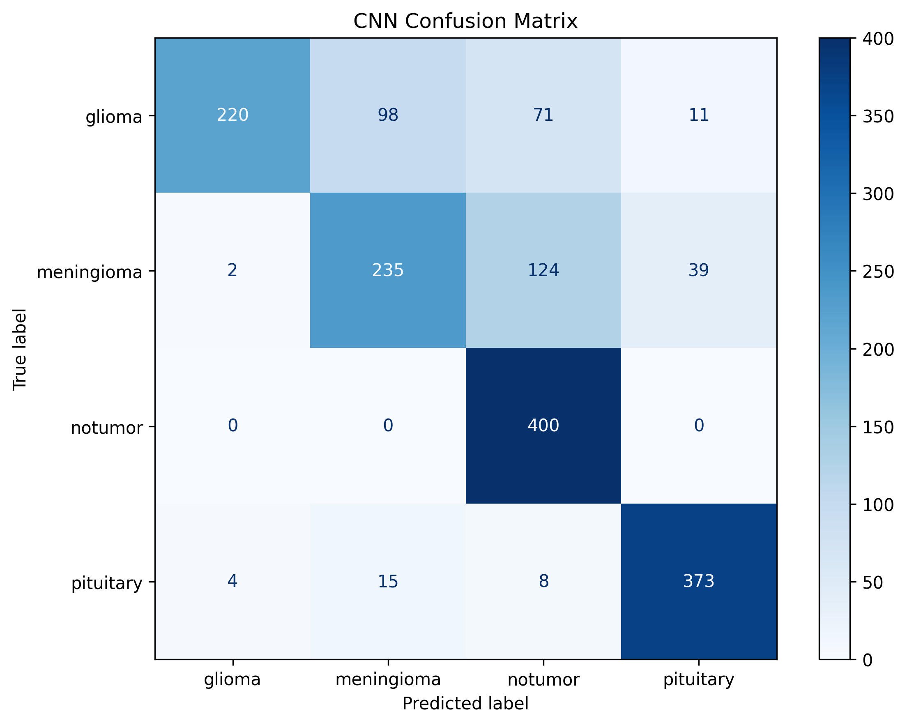
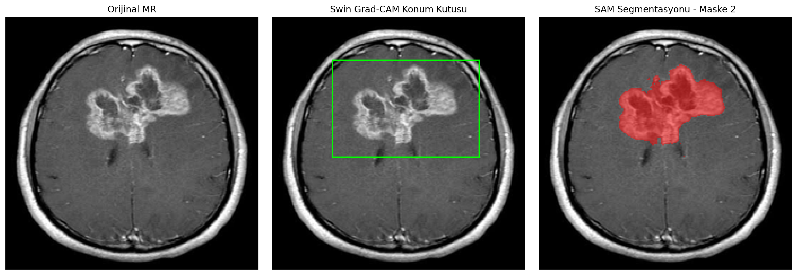

# Beyin MR Görüntülerinde Tümör Sınıflandırma ve Segmentasyon

**Brain Tumor MRI Classification and Segmentation**

Bu proje, beyin MRI görüntülerini dört sınıfta sınıflandırmayı;
sınıflandırma kararlarını Grad-CAM ile görselleştirmeyi ve yaklaşık
konum bilgilerini Segment Anything Model (SAM) ile segmentasyon
denemelerinde kullanmayı amaçlar.

> **Uyarı:** Çalışma eğitim ve araştırma amaçlıdır. Klinik tanı veya
> tedavi amacıyla kullanılamaz. Grad-CAM haritaları ve SAM maskeleri
> uzman tarafından doğrulanmış tümör sınırları değildir.

## Hızlı başlangıç

- **Yerel demo (Windows):** Python 3.12 ve model checkpoint’leri hazırsa `start.bat` dosyasına çift tıklayın. [Kurulum ve yerel API](#13-neuro-ai-lab-yerel-web-uygulaması)
- **Swin V3 fine-tuning (Colab):** Notebook’u açın, GPU çalışma zamanı seçin ve **Tümünü çalıştır**’a basın. Drive iznini verince eğitim betikleri sırayla çalışır. [Colab’da aç](https://colab.research.google.com/github/saglamkubra/Brain-Tumor-MRI-Classification-Segmentation/blob/main/notebooks/Swin_Tiny_V3_FineTuning_Colab.ipynb)
- **Sonuçlar:** Eski deneyler orijinal bölmeyi, Swin V3 deneyleri temizlenmiş V3 bölmesini kullanır. [Swin deneyleri](#swin-deneyleri)

## 1. Projenin amacı

CNN (Convolutional Neural Network), Vision Transformer (ViT-B/16) ve
Swin Transformer modelleriyle dört sınıflı MRI sınıflandırması
yapılmıştır. Swin Transformer çıktıları üzerinden Grad-CAM
açıklanabilirlik haritaları üretilmiş; otomatik ve manuel konum kutuları
SAM ViT-B modeline verilerek segmentasyon sonuçları görsel olarak
incelenmiştir.

Sınıflar: `glioma`, `meningioma`, `notumor`, `pituitary`.

## 2. Veri seti

[Brain Tumor MRI Dataset --
Kaggle](https://www.kaggle.com/datasets/masoudnickparvar/brain-tumor-mri-dataset)

  Bölüm          Görüntü sayısı   Sınıf başına
  ------------ ---------------- --------------
  Train                   4.480          1.120
  Validation              1.120            280
  Test                    1.600            400
  **Toplam**          **7.200**      **1.800**

CNN ve ViT deneyleri `train.csv`, `val.csv` ve `test.csv` dosyalarıyla
aynı veri bölünmesi üzerinde değerlendirilmiştir. Ham veri seti büyük
boyutu nedeniyle GitHub deposuna eklenmemiştir.

## 3. Görüntü ön işleme

### CNN

-   Gri tonlamalı görüntüler, `224 × 224` piksele yeniden
    boyutlandırılmıştır.
-   Tensöre dönüştürme ve ortalama/standart sapması `0.5` olan
    normalizasyon uygulanmıştır.

### ViT

-   Görüntüler RGB ve `224 × 224` boyutundadır.
-   Eğitimde `%50` olasılıkla yatay çevirme ve `±10°` rastgele döndürme
    uygulanmıştır.
-   ImageNet ortalaması `(0.485, 0.456, 0.406)` ve standart sapması
    `(0.229, 0.224, 0.225)` ile normalize edilmiştir.
-   Validation ve testte rastgele artırma kullanılmamıştır.

### Swin Transformer

Swin veri hazırlama ve dönüşüm adımları ilgili Colab notebook'unda
uygulanmıştır. Bu README'de notebook tarafından doğrulanmamış ek
parametre varsayılmamıştır.

## 4. Modeller

### CNN

Üç evrişim bloğu (32, 64, 128 kanal), Batch Normalization, ReLU ve Max
Pooling kullanılmıştır. Ardından Adaptive Average Pooling, 128 nöronlu
tam bağlantılı katman, Dropout (0.4) ve dört sınıflı çıkış katmanı yer
alır.

  Parametre                Değer
  ------------------------ ------------------
  Loss                     CrossEntropyLoss
  Optimizer                Adam
  Learning rate            0.001
  Epoch                    20
  Batch size               32
  Dropout                  0.4
  Eğitilebilir parametre   110.148

En iyi CNN modeli 18. epoch'ta kaydedilmiştir (validation loss:
`0.3770`, validation accuracy: `%85.89`).

### Vision Transformer (ViT)

Torchvision ImageNet ön eğitimli ViT-B/16 kullanılmıştır. Sınıflandırma
başlığı dört sınıfa uyarlanmış; önceden eğitilmiş gövde dondurularak
yalnızca yeni sınıflandırma katmanı eğitilmiştir (feature extraction /
linear probing).

  Parametre                Değer
  ------------------------ ------------------
  Loss                     CrossEntropyLoss
  Optimizer                AdamW
  Learning rate            0.001
  Weight decay             0.01
  Epoch                    10
  Batch size               16
  Toplam parametre         85.801.732
  Eğitilebilir parametre   3.076

En iyi doğrulama sonucu 10. epoch'tadır (validation loss: `0.1715`,
validation accuracy: `%94.20`).

### Swin Transformer

Önceden eğitilmiş Swin Transformer ağırlıkları dört sınıflı göreve
uyarlanmıştır. Kayıtlı deney çıktısında 3 epoch sonunda validation
accuracy `%97.68` ve kullanılan cihaz CUDA GPU olarak belirtilmiştir.

## 5. Orijinal veri bölmesi test sonuçları

  Metrik                   CNN      ViT   Swin Transformer
  ------------------- -------- -------- ------------------
  Accuracy              %76.75   %90.25             %93.25
  Precision (Macro)     %79.85   %91.09             %93.88
  Recall (Macro)        %76.75   %90.25             %93.25
  F1-score (Macro)      %75.88   %90.05             %93.19

CNN ve ViT aynı 1.600 görüntülük test kümesinde değerlendirilmiştir.
ViT, CNN'den 13.50 yüzde puan daha yüksek test doğruluğu elde etmiştir.
Ancak CNN sıfırdan eğitilirken ViT ImageNet ön eğitimli ağırlıklarla
kullanılmıştır; bu nedenle transfer öğrenme etkisi de dikkate
alınmalıdır. Swin için raporlanan test doğruluğu `%93.25`'tir. Swin
validation doğruluğu `%97.68` olup test metriğinden farklı bir veri
bölümüne aittir.

### CNN sınıf bazlı metrikleri

  Sınıf          Precision   Recall       F1   Support
  ------------ ----------- -------- -------- ---------
  Glioma            0.9735   0.5500   0.7029       400
  Meningioma        0.6753   0.5875   0.6283       400
  No Tumor          0.6633   1.0000   0.7976       400
  Pituitary         0.8818   0.9325   0.9064       400

### ViT sınıf bazlı metrikleri

  Sınıf          Precision   Recall       F1   Support
  ------------ ----------- -------- -------- ---------
  Glioma            0.9831   0.7275   0.8362       400
  Meningioma        0.7978   0.9175   0.8535       400
  No Tumor          0.9365   0.9950   0.9648       400
  Pituitary         0.9260   0.9700   0.9475       400

### Swin Transformer karmaşıklık matrisi

Satırlar gerçek, sütunlar tahmin edilen sınıflardır.

  Gerçek  Tahmin     Glioma   Meningioma   No Tumor   Pituitary
  ---------------- -------- ------------ ---------- -----------
  Glioma                323           53         24           0
  Meningioma              2          393          3           2
  No Tumor                1            0        399           0
  Pituitary               4           19          0         377

## 6. Deney görselleri

Görsellerin GitHub'da `results/` klasöründe bulunması ve dosya adlarının
aşağıdakilerle aynı olması gerekir.

### CNN

 *CNN eğitim ve
doğrulama loss/accuracy grafikleri.*

 *CNN test
karmaşıklık matrisi.*

### ViT

 *ViT eğitim ve
doğrulama loss/accuracy grafikleri.*

 *ViT test
karmaşıklık matrisi.*

### Swin Transformer

 *Swin
Transformer test karmaşıklık matrisi.*


*Örnek MRI görüntüsü ve Grad-CAM/SAM işlem çıktısı.*

## 7. Grad-CAM ve SAM segmentasyon deneyleri

Grad-CAM, Swin Transformer'ın belirli bir sınıf tahmininde hangi görüntü
bölgelerine ağırlık verdiğini görselleştirmek için kullanılmıştır.
Aktivasyon haritası kesin tümör sınırı değildir.

Önceden eğitilmiş SAM ViT-B modeline MRI görüntüsüyle birlikte konum
kutusu verilmiştir. İki yönlendirme yaklaşımı incelenmiştir:

1.  **Otomatik kutu:** Grad-CAM aktivasyonundan yaklaşık konum kutusu
    türetilmesi.
2.  **Manuel kutu:** Görüntü üzerinde elle belirlenen kutunun SAM'a
    verilmesi.


*Orijinal görüntü, otomatik Grad-CAM + SAM ve manuel kutu + SAM
karşılaştırması.*


*Manuel kutu ile yönlendirilen SAM maskesi.*


*Glioma, meningioma ve pituitary örneklerinde otomatik SAM çıktıları.*

İlk deneylerde otomatik kutuların bazı görüntülerde geniş kaldığı ve
SAM'ın tümör yerine daha geniş anatomik alanları maskeleyebildiği
görülmüştür. Manuel kutularla bazı örneklerde lezyona görsel olarak daha
uygun maskeler elde edilmiştir. Veri setinde uzmanlarca hazırlanmış
referans segmentasyon maskeleri bulunmadığından Dice veya IoU gibi
referans maske gerektiren nicel segmentasyon metrikleri
hesaplanamamıştır. Bu nedenle SAM çıktıları görsel/niteliksel olarak
değerlendirilmiştir.

## 8. Proje dosya yapısı

```text
backend/              FastAPI, model yükleme ve segmentasyon
frontend/             Yerel demo arayüzü
notebooks/            CNN, ViT, ilk Swin/SAM ve Swin V3 notebook’ları
experiments/swin_v3/  Fine-tuning, doğrulama ve sonuç dışa aktarımı
results/              İlk deneylerin grafikleri ve Swin V3 sonuçları
tests/                Yerel API duman testi
start.bat             Windows başlatıcısı
requirements.txt      Python bağımlılıkları
```

## 9. Kurulum ve çalıştırma

Başlıca kullanılan kütüphaneler: Python, PyTorch, Torchvision, timm,
NumPy, Pandas, Matplotlib, Seaborn, Scikit-learn, OpenCV,
pytorch-grad-cam ve segment-anything.

1.  Depoyu klonlayın:

    ``` bash
    git clone https://github.com/saglamkubra/Brain-Tumor-MRI-Classification-Segmentation.git
    ```

2.  Veri setini Kaggle bağlantısından indirip Google Drive'a yükleyin.

3.  İlgili notebook'u Google Colab'da açın.

4.  Colab çalışma zamanında uygun GPU'yu seçin.

5.  Notebook içindeki Drive ve veri seti yollarını kendi ortamınıza göre
    düzenleyin.

6.  Gerekli kütüphaneleri kurup hücreleri sırasıyla çalıştırın.

Veri seti ve eğitilmiş ağırlık dosyaları büyük oldukları için GitHub
deposunda tutulmayabilir. Notebook'ların çalışması için veri ve model
ağırlığı yolları ayrıca ayarlanmalıdır.

## 10. Sınırlılıklar

-   Sonuçlar kullanılan veri seti ve deney düzeniyle sınırlıdır; farklı
    merkez ve cihazlarda genellenebilirlik ayrıca doğrulanmamıştır.
-   CNN ve ViT'nin ön işleme ve eğitim stratejileri farklıdır. ViT'de
    ImageNet ön eğitimi kullanılmıştır.
-   Grad-CAM açıklanabilirlik haritasıdır; segmentasyon maskesi
    değildir.
-   SAM maskeleri verilen görüntü ve konum istemine bağlıdır.
-   Uzman etiketli segmentasyon maskeleri olmadığından Dice/IoU
    değerlendirmesi yapılamamıştır.
-   Görsel olarak uygun maske klinik doğruluk anlamına gelmez.

## 11. Ekip ve görev dağılımı

Proje iki kişilik ekip tarafından yürütülmüştür.

-   **Ekip üyesi 1:** CNN ve ViT modellerinin geliştirilmesi, eğitimi ve
    değerlendirilmesi.
-   **Ekip üyesi 2:** Swin Transformer, Grad-CAM ve SAM çalışmalarının
    yürütülmesi; otomatik ve manuel kutu deneyleri.
-   **Ortak:** Sonuçların karşılaştırılması, raporlama ve sunum.

## 12. Proje durumu

-   [x] Veri setinin hazırlanması ve veri bölünmesi
-   [x] CNN modelinin eğitimi ve testi
-   [x] ViT modelinin eğitimi ve testi
-   [x] Swin Transformer modelinin eğitimi ve testi
-   [x] Üç sınıflandırma modelinin sonuçlarının karşılaştırılması
-   [x] Grad-CAM deneyleri
-   [x] SAM ViT-B ile segmentasyon deneyleri
-   [x] Otomatik ve manuel konum yönlendirmelerinin incelenmesi
-   [ ] GitHub'daki tüm notebook ve görsel adlarının son kontrolü
-   [ ] Nihai rapor ve sunumun tamamlanması

## Veri seti kaynağı

[Brain Tumor MRI Dataset --
Kaggle](https://www.kaggle.com/datasets/masoudnickparvar/brain-tumor-mri-dataset)

------------------------------------------------------------------------

**Bu proje üniversite dersi kapsamında eğitim ve araştırma amacıyla
hazırlanmıştır.**


## 13. NEURO AI LAB yerel web uygulaması

### Windows'ta başlatma

1. Python 3.12'yi PATH'e ekleyin. İlk kurulum için internet bağlantısı gerekir.
2. Dört checkpoint'i proje kökündeki `models/` klasörüne koyun: `cnn_best.pth`, `vit_best.pth`, `swin_tiny_best.pth` ve `sam_vit_b_01ec64.pth`.
3. `start.bat` dosyasına çift tıklayın. Başlatıcı eksik paketleri `.venv` içine kurar ve modeller yüklenince varsayılan tarayıcıyı açar. Yerel adres [127.0.0.1:8000](http://127.0.0.1:8000/) şeklindedir. Sunucuyu durdurmak için konsolda Ctrl+C kullanın.

NVIDIA sürücüsü ve CUDA destekli PyTorch varsa modeller GPU'da çalışır. Ağırlıklar CPU belleğinde tutulur, her çıkarım için tek model GPU'ya taşınır ve işlem sonunda CPU'ya alınır. CUDA bellek hatasında ilgili model CPU üzerinde yeniden denenir. Kullanılan cihaz, sonuç kartlarında ve `GET /health` çıktısında gösterilir. Kurulum sırasında başlatıcı, `nvidia-smi` bulunursa PyTorch CUDA 12.4 paketini, aksi halde CPU paketini seçer.

Canlı Demo'da en fazla 10 MiB ve 4096 × 4096 piksel boyutunda PNG/JPG yükleyin. Swin-Tiny `notumor` tahmini yaparsa otomatik SAM atlanır. Otomatik kutu bulunamazsa veya sonuç uygun görünmezse MR üzerinde kutu çizip manuel maske üretin. SAM kalite skoru modelin kendi tahminidir. Maskeler uzman tarafından doğrulanmış tümör sınırları değildir.

### Yerel API ve test

| Yöntem ve adres | İşlev |
| --- | --- |
| `GET /health` | Model yükleme durumu, sınıf sırası ve çalışma cihazı |
| `POST /predict` | Üç modelin sınıf olasılıkları, çalışma cihazı ve önizleme |
| `POST /segment?mode=auto` | Swin Grad-CAM ve uygun kutu bulunursa SAM maskesi |
| `POST /segment?mode=manual&box=115,85,160,135` | 224 × 224 önizlemeye göre x1,y1,x2,y2 koordinatlarıyla SAM maskesi |

POST isteklerinde görüntünün ham baytlarını `image/jpeg` veya `image/png` içerik türüyle gönderin. Görüntüler bellekte işlenir. Model ve SAM çıktılarındaki cihaz alanı `cuda` ya da `cpu` değerini alır.

Sunucu açıkken gerçek veri seti arşiviyle duman testi çalıştırılabilir. CPU sunucusu için `--device cpu` kullanın.

```powershell
.\.venv\Scripts\python.exe tests/smoke_web.py "C:\veri\Brain_Tumor_MRI_Dataset.zip"
```

Çalıştırılan kontroller ve örnek çıktılar [uygulama test raporunda](WEB_TEST_REPORT.md) yer alır.

## Swin deneyleri

| Deney | Test kümesi | Accuracy | Glioma recall | Glioma → notumor | Kod ve sonuçlar |
| --- | ---: | ---: | ---: | ---: | --- |
| İlk Swin-Tiny ve SAM deneyi | Orijinal · 1.600 | %93,25 | %80,75 | 24 | [İlk notebook](notebooks/Swin_Transformer_SAM.ipynb) · [Test matrisi](results/swin_confusion_matrix.png) |
| Swin-Tiny V3 başlangıç | V3 · 1.579 | %93,86 | %82,77 | 49 | [V3 notebook](notebooks/Swin_Tiny_V3_Notebook_V2.ipynb) · [V3 sonuçları](results/swin_v3/README.md) |
| V3 fine-tuning, önceki paylaşılan çalışma | V3 · 1.579 | %94,11 | %81,98 | 39 | [Karşılaştırma raporu](SWIN_V3_TRAINING_REPORT.md) |
| V3 fine-tuning, yerel çalışma | V3 · 1.579 | %94,05 | %81,98 | 41 | [Eğitim betiği](experiments/swin_v3/train.py) · [Yerel sonuçlar](results/swin_v3/finetuning/local_run/comparison.csv) |
| V3 fine-tuning, Colab T4 | V3 · 1.579 | %93,98 | %81,72 | 39 | [Colab notebook](notebooks/Swin_Tiny_V3_FineTuning_Colab.ipynb) · Çıktılar Drive’da |

`Swin_Tiny_V3_Notebook_V2.ipynb` adındaki **V3** veri bölmesini, **Notebook_V2** notebook sürümünü belirtir. Web uygulamasında varsayılan Swin profili ilk deneyin `legacy` checkpoint’idir. V3 ile ilk deney farklı test listelerine sahiptir. V3 testinin hasta düzeyinde bağımsızlığı doğrulanmadı. Colab T4 satırı 18 Kasım 2026 tarihli Colab çıktısından alındı. Fine-tuning, başlangıç V3’e göre glioma → notumor hatasını azalttı ve glioma recall’ı düşürdü.

## Swin-Tiny V3 fine-tuning ve otomatik SAM

Yerel uygulamanın varsayılan Swin profili `legacy`. V3 ağırlıkları ayrı dosyalarda saklanıyor. Yerel inceleme için PowerShell'de aşağıdaki profil seçeneklerinden birini başlatmadan önce ayarlayabilirsiniz.

```powershell
$env:NEURO_SWIN_PROFILE = 'v3'
.\start.bat
```

`v3` profili `models/swin_tiny_v3_best.pth` dosyasını, `v3-finetuned` profili `models/swin_tiny_v3_finetuned_best.pth` dosyasını açar. Profil veya ağırlık hatası `/health` ve tahmin yanıtlarında görünür. Sınıf sırası glioma, meningioma, notumor, pituitary. V3 ham ağırlık dışa aktarımının sınıf sırası eğitim notebook’undaki sıraya dayanır.

### Colab girdileri ve çıktıları

Drive’da `MyDrive/Beyin_Tumoru_Projesi/` altında `Brain_Tumor_MRI_Dataset.zip`, `veri_bolunmesi_v3/` ve `modeller/swin_tiny_v3_best.pth` bulunmalıdır. ZIP görüntüleri sağlar, V3 CSV’leri kullanılacak örnekleri belirler. Her çalıştırma ağırlığı `modeller/swin_v3_runs/colab_.../` ve raporları `results/swin_v3/finetuning/colab_.../` altında saklar. İki klasördeki aynı çalıştırma adı, ağırlık ve raporu eşleştirir.

Notebook `train.py` ile eğitimi ve değerlendirmeyi, `export_results.py` ile tablo ve grafik üretimini çalıştırır. `check_segmentation.py` bağımsız Grad-CAM/SAM kontrolüdür. Canlı Demo için `start.bat` yeterli.

### İsteğe bağlı yerel fine-tuning

Fine-tuning betiği mevcut V3 checkpoint’inden başlar. Eğitim ve doğrulamayı kendi CSV listelerinden yürütür, en iyi epoch’u doğrulama verisiyle seçer ve test listesini bundan sonra açar. Var olan bir fine-tuned checkpoint’i korumak için tekrar çalıştırırken yeni bir çıktı klasörü seçin.

```powershell
.\.venv\Scripts\python.exe -m experiments.swin_v3.train --archive "C:\veri\Brain_Tumor_MRI_Dataset.zip" --splits "C:\veri\veri_bolunmesi_v3" --output models/yeni_deney --results results/swin_v3/finetuning/yeni_deney
.\.venv\Scripts\python.exe -m experiments.swin_v3.export_results results/swin_v3/finetuning/yeni_deney
```

Metrikler için [Swin deneyleri tablosuna](#swin-deneyleri) ve [yerel eğitim raporuna](SWIN_V3_TRAINING_REPORT.md) bakın.

Canlı Demo, varsayılan olarak gri tonlamalı görüntüdeki parlak ve yerel kontrastı yüksek bir bölgeden kutu üretip SAM’e gönderir. Kullanıcı Grad-CAM kutusu yöntemini ve Stage 3 veya Stage 4 ısı haritasını seçebilir. Manuel kutu seçeneği de kullanılabilir. API’de `POST /segment?mode=auto&method=intensity&stage=4` görüntü işleme kutusu ve Stage 4 haritası döndürür. Parametresiz otomatik API çağrısı Stage 3 Grad-CAM kutusunu kullanır.

Parlak bölge yöntemi anatomi, kenar veya görüntü artefaktlarını da seçebilir. Sınıflandırıcı ile kutu yöntemi çelişirse arayüz bunu bildirir. SAM skoru, modelin maske kalite tahminidir. Yerel denemelerde referans maskeler eşleştirilmediği için Dice/IoU raporlanmadı. V3 hasta düzeyi bağımsızlığı doğrulanmadı.
