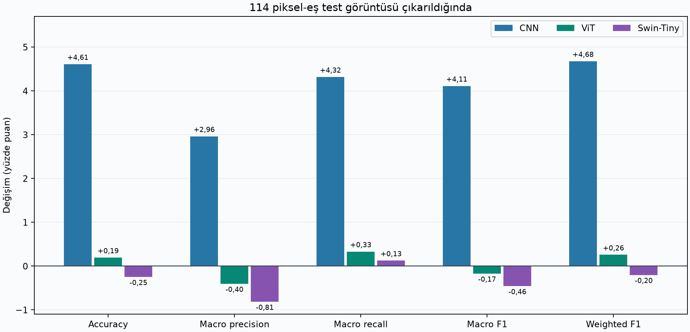
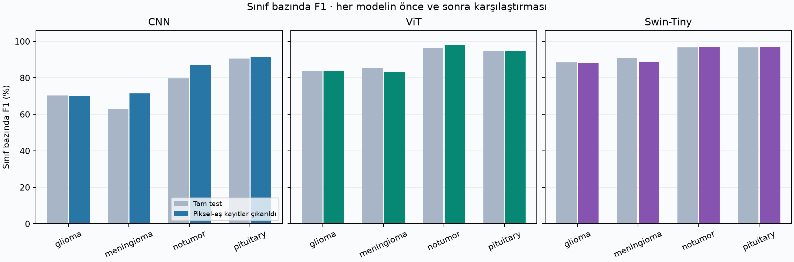
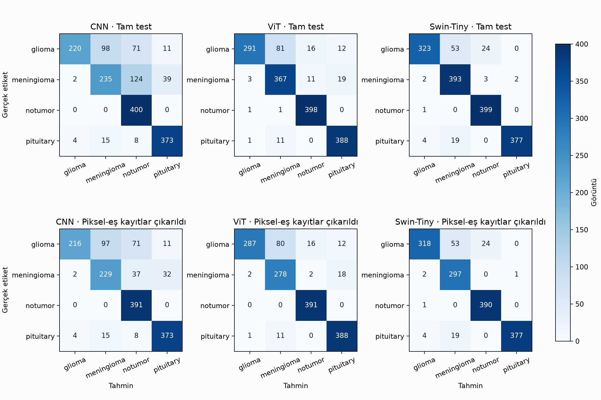

# NEURO AI LAB · Kesin görüntü tekrarlarının performans karşılaştırmasına etkisi

**18 Kasım 2026**

**Sonuç:** Kesin piksel eşleşmeleri çıkarıldığında accuracy CNN’de **+4,61**, ViT’de **+0,19** ve Swin-Tiny’de **−0,25 yüzde puan** değişti. Swin-Tiny, kalan 1.486 görüntüde de **%93,00 accuracy** ve **%92,73 macro F1** ile önde. Sonuçlar, aynı sabit checkpoint’lerin iki farklı değerlendirme listesindeki ölçümünü gösterir. Hasta düzeyinde bağımsızlık ve veri sızıntısının nedensel etkisi bu karşılaştırmayla doğrulanamaz.

## Karşılaştırma yöntemi

- Önceki çalıştırmada CNN, ViT ve Swin-Tiny checkpoint’lerinden kaydedilen **4.800 gerçek tahmin** kullanıldı. Üç modelin aynı 1.600 test yolunu kullandığı ve kaydedilen sınıfın en yüksek softmax bileşenine karşılık geldiği doğrulandı. Tam test metrikleri tekrar hesaplandı ve [önceki raporla](../deneyler/MODEL_PERFORMANCE_ANALYSIS.md) uyumu kontrol edildi. Yeni çıkarım veya eğitim yapılmadı.
- Yerel ZIP içinden çözümlenmiş RGB pikselleri ve görüntü boyutu SHA‑256 ile yeniden karşılaştırıldı. Birleşik `Training/` klasöründe, yani eğitim ve doğrulamanın oluşturulduğu 5.600 görüntülük kaynakta, kesin eşi bulunan **114 benzersiz test görüntüsü** değerlendirme listesinden çıkarıldı. Swin notebook’undan yeniden oluşturulan ayrımda bunlar 94 eğitim–test ve 27 doğrulama–test **çiftine** karşılık geliyor. Bazı test görüntülerinin birden fazla eşi var. Yalnızca yeniden oluşturulmuş 4.480 eğitim görüntüsünü kullanmak aynı 114’lü listeyi vermez. Özgün bölme CSV’leri yerelde bulunmadı. [Eşleşme denetimi](DATA_LEAKAGE_AUDIT.md)
- Yalnızca pHash adayı olan **323 ek test görüntüsü** alt kümede kaldı. Test içi tekrarlar için ayrıca bir çıkarma yapılmadı. Veri dosyaları silinmedi veya taşınmadı.

| Sınıf | Orijinal destek | Çıkarılan | Kalan destek |
| --- | ---: | ---: | ---: |
| glioma | 400 | 5 | 395 |
| meningioma | 400 | 100 | 300 |
| notumor | 400 | 9 | 391 |
| pituitary | 400 | 0 | 400 |
| **Toplam** | **1.600** | **114** | **1.486** |

Macro ortalamalar dört sınıfa eşit ağırlık verir. Weighted F1, ilgili değerlendirme listesindeki gerçek sınıf sayılarıyla ağırlıklandırılır. Farklar yuvarlamadan önce hesaplanıp iki ondalık basamakla gösterildi.

## Genel metrikler

| Model | Metrik | Tam test · 1.600 | Piksel-eş kayıtlar çıkarıldı · 1.486 | Δ (yüzde puan) |
| --- | --- | ---: | ---: | ---: |
| CNN | Accuracy | %76,75 | %81,36 | +4,61 |
| CNN | Macro precision | %79,85 | %82,81 | +2,96 |
| CNN | Macro recall | %76,75 | %81,07 | +4,32 |
| CNN | Macro F1 | %75,88 | %79,99 | +4,11 |
| CNN | Weighted F1 | %75,88 | %80,56 | +4,68 |
| ViT | Accuracy | %90,25 | %90,44 | +0,19 |
| ViT | Macro precision | %91,09 | %90,68 | -0,40 |
| ViT | Macro recall | %90,25 | %90,58 | +0,33 |
| ViT | Macro F1 | %90,05 | %89,88 | -0,17 |
| ViT | Weighted F1 | %90,05 | %90,31 | +0,26 |
| Swin-Tiny | Accuracy | %93,25 | %93,00 | -0,25 |
| Swin-Tiny | Macro precision | %93,88 | %93,07 | -0,81 |
| Swin-Tiny | Macro recall | %93,25 | %93,38 | +0,13 |
| Swin-Tiny | Macro F1 | %93,19 | %92,73 | -0,46 |
| Swin-Tiny | Weighted F1 | %93,19 | %92,99 | -0,20 |

## Sınıf bazında metrikler

Her hücre tam test → 1.486 görüntülük alt küme (yüzde puan farkı) biçimindedir.

| Model | Sınıf | Precision | Recall | F1 |
| --- | --- | ---: | ---: | ---: |
| CNN | glioma | %97,35 → %97,30 (-0,05) | %55,00 → %54,68 (-0,32) | %70,29 → %70,02 (-0,27) |
| CNN | meningioma | %67,53 → %67,16 (-0,37) | %58,75 → %76,33 (+17,58) | %62,83 → %71,45 (+8,62) |
| CNN | notumor | %66,33 → %77,12 (+10,79) | %100,00 → %100,00 (+0,00) | %79,76 → %87,08 (+7,32) |
| CNN | pituitary | %88,18 → %89,66 (+1,48) | %93,25 → %93,25 (+0,00) | %90,64 → %91,42 (+0,78) |
| ViT | glioma | %98,31 → %98,97 (+0,65) | %72,75 → %72,66 (-0,09) | %83,62 → %83,80 (+0,17) |
| ViT | meningioma | %79,78 → %75,34 (-4,44) | %91,75 → %92,67 (+0,92) | %85,35 → %83,11 (-2,24) |
| ViT | notumor | %93,65 → %95,60 (+1,95) | %99,50 → %100,00 (+0,50) | %96,48 → %97,75 (+1,27) |
| ViT | pituitary | %92,60 → %92,82 (+0,22) | %97,00 → %97,00 (+0,00) | %94,75 → %94,87 (+0,12) |
| Swin-Tiny | glioma | %97,88 → %97,85 (-0,03) | %80,75 → %80,51 (-0,24) | %88,49 → %88,33 (-0,16) |
| Swin-Tiny | meningioma | %84,52 → %80,49 (-4,03) | %98,25 → %99,00 (+0,75) | %90,87 → %88,79 (-2,08) |
| Swin-Tiny | notumor | %93,66 → %94,20 (+0,54) | %99,75 → %99,74 (-0,01) | %96,61 → %96,89 (+0,28) |
| Swin-Tiny | pituitary | %99,47 → %99,74 (+0,26) | %94,25 → %94,25 (+0,00) | %96,79 → %96,92 (+0,12) |

## Karmaşıklık matrisleri

Satırlar gerçek etiket, sütunlar model tahmini. Her hücre tam test → 1.486 görüntülük alt küme sayısını gösterir.

### CNN

| Gerçek ↓ / Tahmin → | glioma | meningioma | notumor | pituitary |
| --- | ---: | ---: | ---: | ---: |
| glioma | 220 → 216 | 98 → 97 | 71 → 71 | 11 → 11 |
| meningioma | 2 → 2 | 235 → 229 | 124 → 37 | 39 → 32 |
| notumor | 0 → 0 | 0 → 0 | 400 → 391 | 0 → 0 |
| pituitary | 4 → 4 | 15 → 15 | 8 → 8 | 373 → 373 |

### ViT

| Gerçek ↓ / Tahmin → | glioma | meningioma | notumor | pituitary |
| --- | ---: | ---: | ---: | ---: |
| glioma | 291 → 287 | 81 → 80 | 16 → 16 | 12 → 12 |
| meningioma | 3 → 2 | 367 → 278 | 11 → 2 | 19 → 18 |
| notumor | 1 → 0 | 1 → 0 | 398 → 391 | 0 → 0 |
| pituitary | 1 → 1 | 11 → 11 | 0 → 0 | 388 → 388 |

### Swin-Tiny

| Gerçek ↓ / Tahmin → | glioma | meningioma | notumor | pituitary |
| --- | ---: | ---: | ---: | ---: |
| glioma | 323 → 318 | 53 → 53 | 24 → 24 | 0 → 0 |
| meningioma | 2 → 2 | 393 → 297 | 3 → 0 | 2 → 1 |
| notumor | 1 → 1 | 0 → 0 | 399 → 390 | 0 → 0 |
| pituitary | 4 → 4 | 19 → 19 | 0 → 0 | 377 → 377 |

## Çıkarılan ve kalan görüntüler

| Model | Doğru / 1.600 | Çıkarılanlarda doğru / 114 | Kalanlarda doğru / 1.486 |
| --- | ---: | ---: | ---: |
| CNN | 1.228 | 19 | 1.209 |
| ViT | 1.444 | 100 | 1.344 |
| Swin-Tiny | 1.492 | 110 | 1.382 |

## Grafikler

## Sonuçların yorumu

- **CNN** çıkarılan 114 görüntünün 19’unu doğru sınıflandırdı. Bunların 100’ü meningiomaydı ve CNN bu 100 örneğin yalnızca 6’sını doğru bildi. Dolayısıyla çıkarılan grubun düşük doğruluğu, kalan listedeki accuracy artışını açıklıyor. Meningioma recall **+17,58 puan** değişirken glioma recall **−0,32 puan** değişti. Checkpoint sabit kaldığı için artış, modelin öğrenmesinde bir iyileşme göstermiyor.
- **ViT** çıkarılan 114 görüntünün 100’ünü doğru sınıflandırdı. Accuracy **+0,19 puan**, macro F1 **−0,17 puan** değişti. Meningioma F1 düştü (**−2,24 puan**), notumor F1 yükseldi (**+1,27 puan**). Tek bir toplu skor bu sınıf farklarını gizleyebilir.
- **Swin-Tiny** çıkarılan 114 görüntünün 110’unu doğru sınıflandırdı. Accuracy **−0,25**, macro F1 **−0,46 puan** değişti. Meningioma F1 **−2,08 puan** düşerken glioma recall **%80,75’ten %80,51’e** indi. Genel model sıralaması korundu.

Çıkarılan grubun sınıf dağılımı tam testten farklı. Bu nedenle ölçülen değişimler hem örnek bileşimini hem de çıkarılan görüntülerdeki performansı yansıtır. Ölçüm, sızıntı nedeniyle eğitimin ne kadar avantaj sağladığını tek başına belirleyemez. Test içi tekrarlar, doğrulanmamış pHash adayları ve olası hasta/kesit ilişkileri kaldığı için 1.486 görüntülük sonuç **tamamen bağımsız test performansı olarak yorumlanamaz**. Hasta düzeyinde bağımsızlık doğrulanamadı.

## Eğitim–doğrulama tekrarları ve checkpoint seçimi

Notebook koduyla yeniden oluşturulan bölmede, **88 kesin eğitim–doğrulama çifti** 78 bayt-eş çiftten ve 10 ek piksel-eş çiftten oluşuyor. Bu çiftlerde **64 benzersiz doğrulama görüntüsü (%5,71)** yer alıyor. Bu görüntüler eğitimdeki içerikle aynıysa, doğrulama kaybı veya doğruluğu görülmemiş görüntülerdeki performanstan daha iyimser olabilir. Etki epochtan epocha değişirse checkpoint sırası da değişebilir.

| Model | Notebook’ta checkpoint ölçütü | Olası etki |
| --- | --- | --- |
| CNN | En düşük doğrulama kaybı | Tekrar görüntülerindeki düşük kayıp bir epoch’u öne çıkarabilir. |
| ViT | En düşük doğrulama kaybı | Tekrar görüntülerine verilen yüksek doğru sınıf skoru doğrulama kaybını düşürebilir. |
| Swin-Tiny | En yüksek doğrulama accuracy | Tekrar görüntülerinde doğru tahmin sayısı seçilen epoch’u değiştirebilir. |

Bu analiz, geçmişteki checkpoint seçiminin değişip değişmeyeceğini ölçmedi. Özgün CSV üyeliği ve her epoch’un tekrarlar hariç doğrulama tahminleri olmadan etki nicelleştirilemez. Test listesini filtrelemek geçmiş doğrulama sürecini değiştirmez. [Notebook denetimi](DATA_LEAKAGE_AUDIT.md)

## Mevcut modelleri koruyan yeni eğitim ve değerlendirme planı

1. **Mevcut sürümü sabitle.** Üç checkpoint’in SHA‑256 özetini, sınıf sırasını, ön işleme tanımlarını ve bu raporun referans metriklerini sürüm kaydına al. Yeni çalışmaları ayrı bir deney klasöründe tut ve mevcut web uygulamasının model yollarını koru.
2. **Salt okunur bir veri manifesti hazırla.** Görüntü başına göreli yol, kaynak koleksiyon, etiket, RGB SHA‑256 ve varsa doğrulanmış anonim hasta/çalışma grubu kaydet. Kesin tekrarları tek içerik grubunda birleştir. pHash adaylarını elle doğrula, çelişkili etiketleri kaynakta çöz ve belirsiz olanları bağımsız değerlendirme dışında ayrı kaydet. Ham dosyaları yerinde tut.
3. **Hasta ve içerik gruplarına göre ayır.** Bir hasta veya doğrulanmış tekrar grubu yalnızca bir bölmede yer alsın. Eğitim/doğrulama/test arasında hasta grubu ve kesin görüntü eşleşmesi bulunmadığını manifest üzerinde otomatik kontrol et. Hasta kimliği güvenilir biçimde üretilemiyorsa, nihai ölçüm için hasta ayrımı belgelenmiş ayrı bir kaynak kullan. Sınıf ve kaynak dağılımlarını yayımla.
4. **Mevcut checkpoint’leri önce sabit ağırlıkla ölç.** Yeni nihai kümeyi model kıyasından önce kilitle. Mevcut CNN, ViT ve Swin-Tiny’yi aynı örneklerde çalıştır. Sınıf bazında metrikleri, glioma → notumor hata sayısını ve yeterli hasta sayısı varsa hasta düzeyinde güven aralıklarını raporla. Model veya eşik seçimini doğrulama kümesinde tut.
5. **Yeniden eğitimi ayrı bir karar olarak ele al.** Bağımsız değerlendirmede önceden belirlenen sınıf hedefleri karşılanmazsa yeni eğitim deneyi tasarla. Artırmayı yalnızca eğitimde, varsa veriyle öğrenilen normalizasyonu yalnızca eğitim verisine göre uygula. Checkpoint ve eşik seçimlerini doğrulamada yap. Yeni çıktıları ayrı checkpoint adlarıyla kaydet ve mevcut modellere ancak değerlendirme sonrası geçiş kararı ver.

Kaynak veri dosyaları, notebook’lar, checkpoint’ler ve çalışan web uygulaması bu çalışma kapsamında değiştirilmedi.
