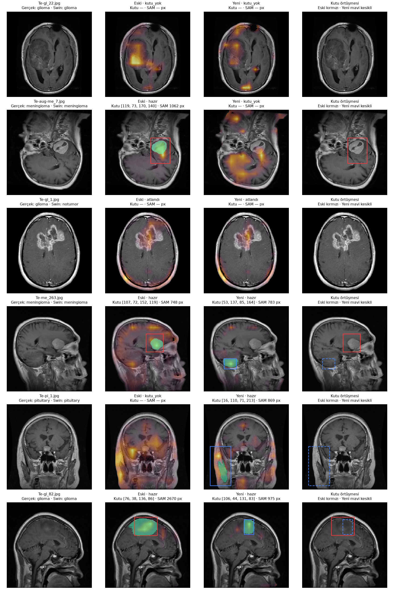
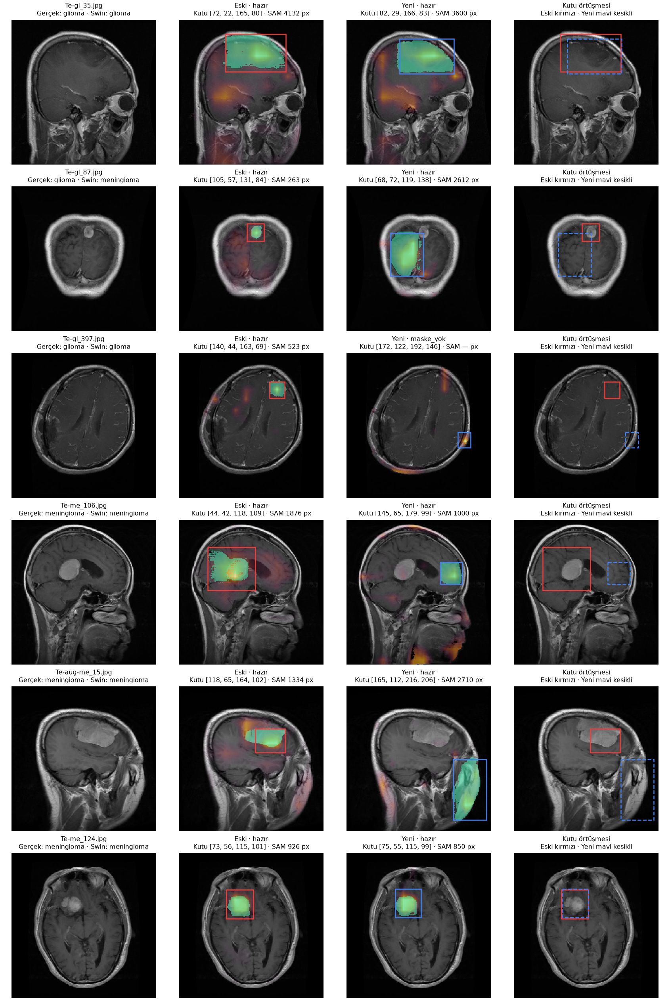
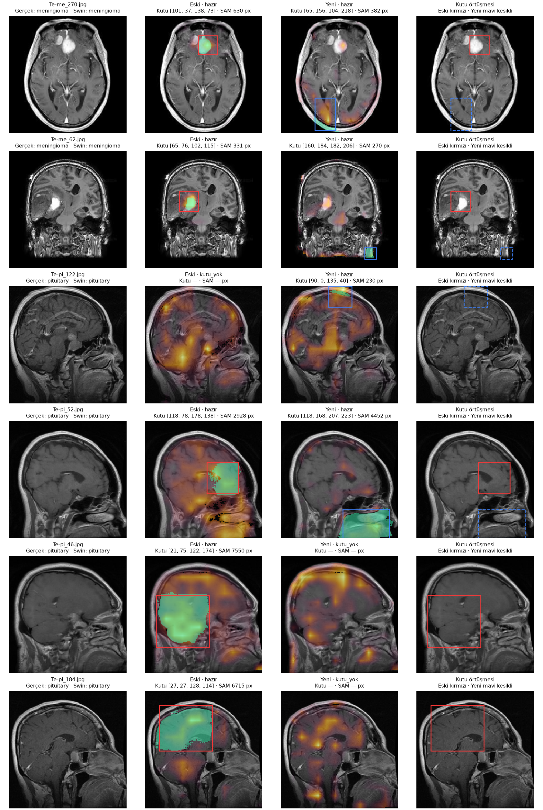
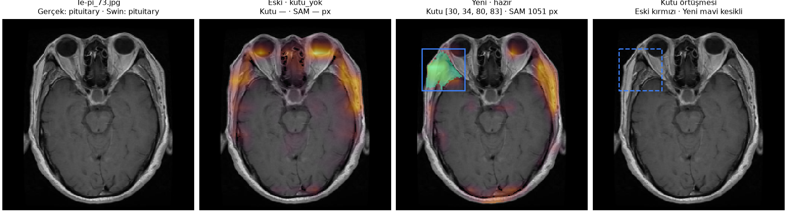

# Swin Aşama 3 görsel karşılaştırması

Son regresyonda durum, kutu veya maske alanı değişen 17 görüntü ile Te-gl_22 ve Te-gl_1 birlikte gösterildi. Bu seçim değişim vakalarını fazla temsil eder. 19 görüntüde iki hedef yeniden çalıştırıldı ve 38 çıktı önceki regresyonun tahmin, durum, kutu ve maske pikseliyle eşleşti.

| Sayfa | Görüntü sayısı |
|---|---:|
| [Sayfa 1](sayfa_01.png) | 6 |
| [Sayfa 2](sayfa_02.png) | 6 |
| [Sayfa 3](sayfa_03.png) | 6 |
| [Sayfa 4](sayfa_04.png) | 1 |

Orijinal görüntüler, uygulamayla aynı 224×224 önizleme geometrisinde en-boy oranı korunarak gösterildi. CAM katmanı üretimden alındı, varsa SAM maskesi aynı renk ve %50 opaklıkla üstüne eklendi. Son sütunda eski kırmızı düz, yeni mavi kesiklidir. Boş kutu ve maskeler çıktı durumuyla birlikte gösterildi.

## Görsel karşılaştırma sayfaları

### Sayfa 1 · Görüntüler 1–6

### Sayfa 2 · Görüntüler 7–12

### Sayfa 3 · Görüntüler 13–18

### Sayfa 4 · Görüntü 19

## Kutu merkezinin dikey dağılımı

y=0 üst kenardır. Yalnızca kutu üretilen satırlar sayısal dağılıma dahil. Bantlar [0, 0,25), [0,25, 0,50), [0,50, 0,75) ve [0,75, 1]. Örnek standart sapması kullanıldı.

| Hedef | Kutu / 19 | Ortalama ± SS | Medyan | Min–maks | Dört bantta adet |
|---|---:|---:|---:|---:|---|
| stage_output | 14/19 | 0.361 ± 0.100 | 0.344 | 0.228–0.556 | [2, 11, 1, 0] |
| block_norm1 | 14/19 | 0.524 ± 0.262 | 0.533 | 0.089–0.873 | [1, 6, 4, 3] |

İki kutunun da çıktığı 11 görüntüde yeni eksi eski ortalama merkez farkı +0.233. [Görüntü bazında CSV](kutu_konumlari.csv).

## Görsel değerlendirme

Sunum için A (stage_output) seçildi. Te-me_263, Te-me_106, Te-aug-me_15, Te-me_270 ve Te-me_62’de A’nın kutusu görünen belirgin anormallikle daha iyi örtüşüyor. B, bu örneklerde kutuyu farklı bir bölgeye taşıyor. Te-aug-me_7’de A görünen anormalliği kutuluyor, B kutu üretmiyor. Te-me_124’te iki kutu benzer görünüyor. Te-pi_1 ve Te-pi_73’te yalnızca B kutu üretiyor ancak kutu yan bölgede kalıyor. Te-gl_22’de iki yöntem de kutu üretmedi. Te-gl_1’de Swin her iki koşuda notumor seçti ve otomatik SAM atlandı.

Bu değerlendirme, değişen vakaların ağırlıklı olduğu örneklemde yapılmış tek gözlemcili görsel incelemedir. Referans lezyon maskesi ve doğrulanmış anatomik isabet oranı bulunmuyor. Kutu merkezinin yüksekliği tek başına isabet ölçüsü değildir.

## Önceki uygulama değişikliği denetimi

| Kalem | Dosyalar | Durum |
|---|---|---|
| Ortam değişkeni | backend/models.py, backend/segmentation.py | block_norm1 varsayılan, stage_output ile eski hedef seçilebilir |
| Sağlık yanıtı | backend/main.py | swin_stage3_target ve swin_stage3_layer alanları var. 8011 canlı kontrolü önceki raporda kayıtlı |
| Arayüz ve PDF | frontend/index.html, frontend/app.js, frontend/messages.json, backend/report.py | Aktif katman ve iki dilde açıklama arayüzde, aktif katman PDF’te |
| Kullanım notu | README.md | İki dilde notebook ve yumuşatma açıklaması ile eski hedefe dönüş komutu var |
| Testler | tests/smoke_web.py, tests/test_segmentation_candidates.py, stage3_b_regression.md | Önceki koşuda 4 birim testi ve smoke testi geçti. Önceki değişiklikte yeni kalıcı test dosyası eklenmedi. Gerçek MR TR/EN ekran görüntüleri ve 12 harita hash çifti raporda |
| Doğrulanmadı | stage3_b_regression.md | Eski hedefle ayrı tarayıcı koşusu ve anatomik kutu doğruluğu |

[Önceki uygulama ve test raporu](../stage3_b_regression.md). Bu turda kaynak dosyaları yazılmadı. 48 dosyanın SHA-256 değeri yedekle eşleşti. GitHub’a push yapılmadı.

## Yerel sunucu seçimi

8011 üzerindeki yerel sunucu bu oturum için `NEURO_SWIN_STAGE3_TARGET=stage_output` ile yeniden başlatıldı. [Canlı sağlık yanıtı](http://127.0.0.1:8011/health) CUDA üzerinde `stage_output` ve `layers[2]` döndürdü. Çevre değişkeni yalnızca başlatılan süreç için ayarlandı.
