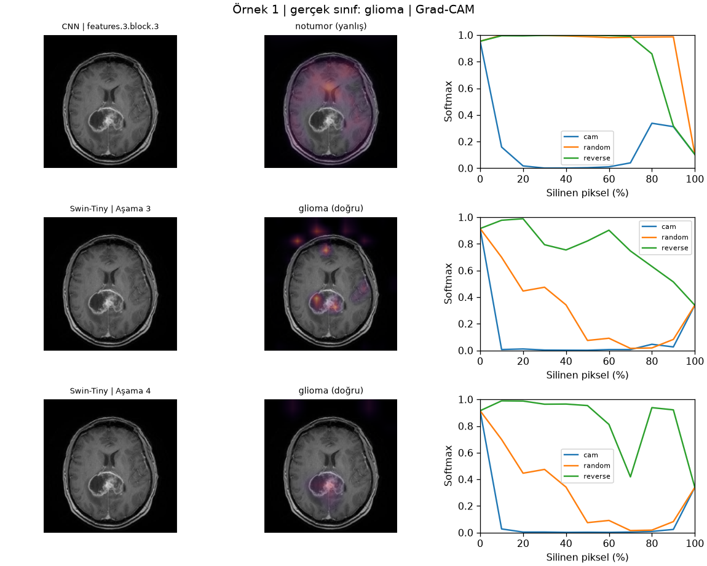
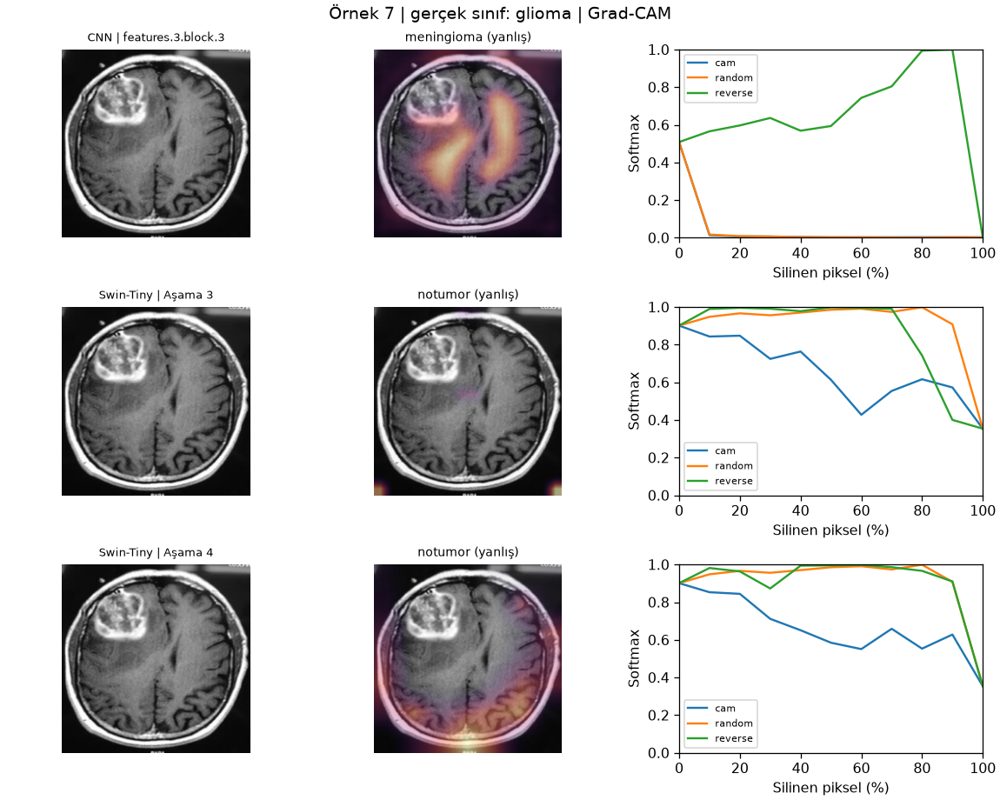
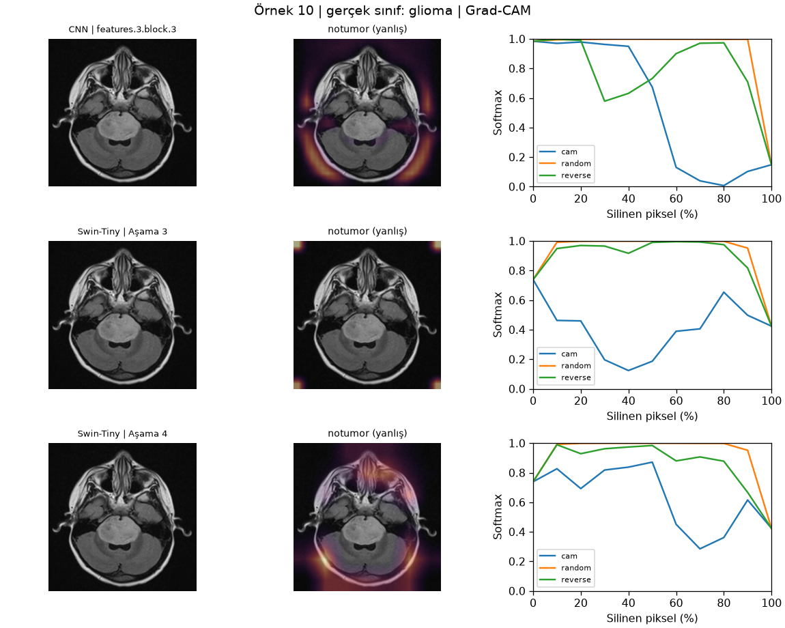
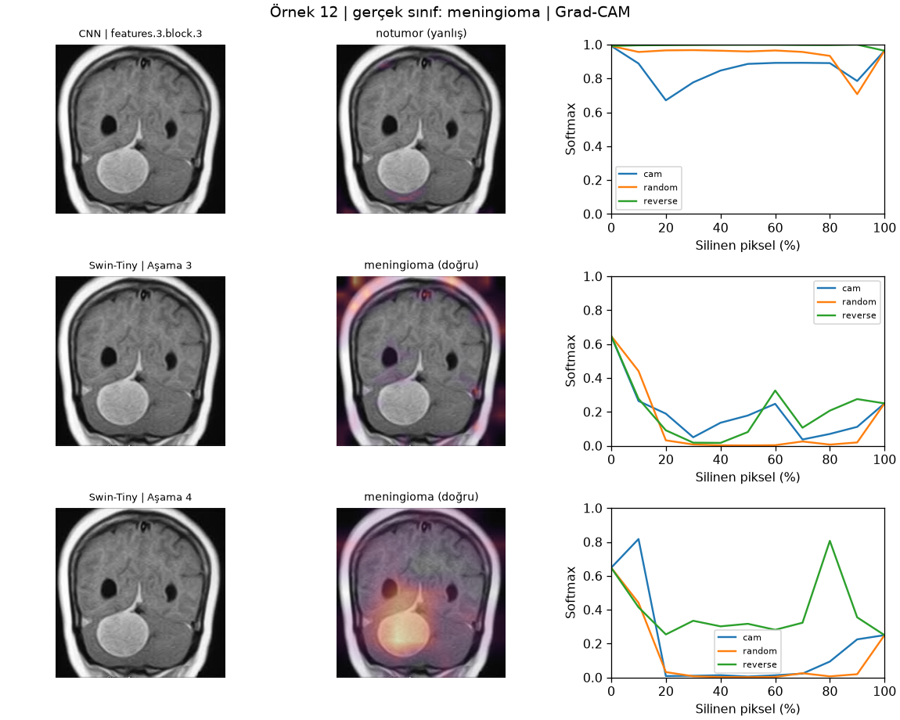
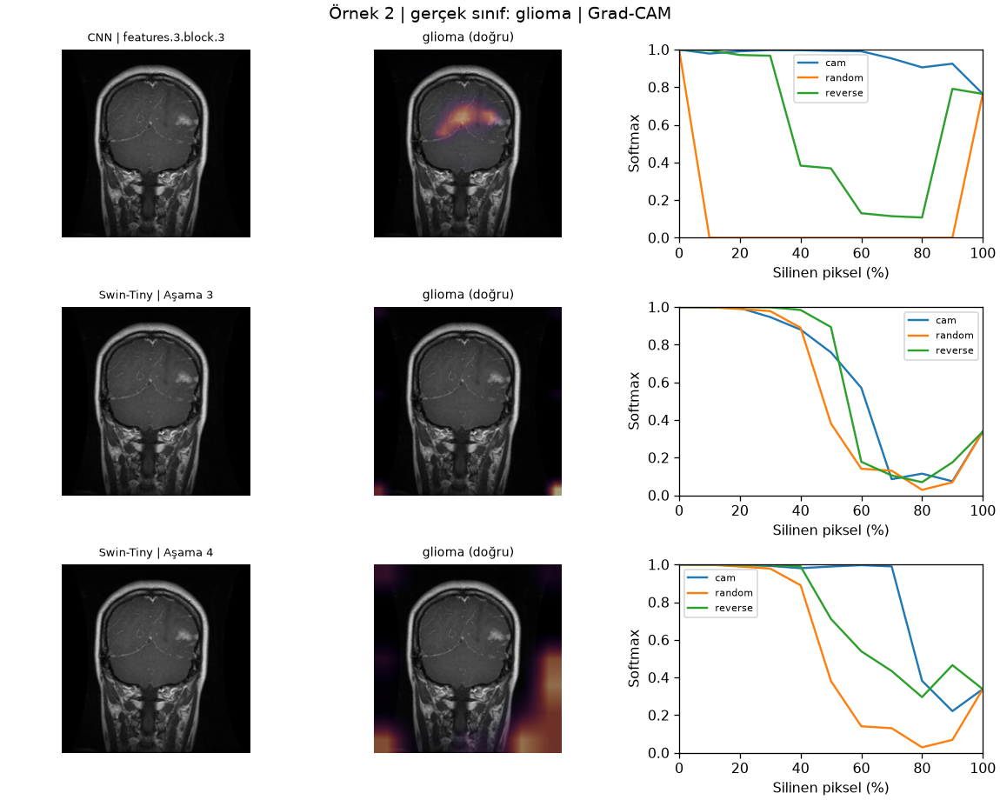
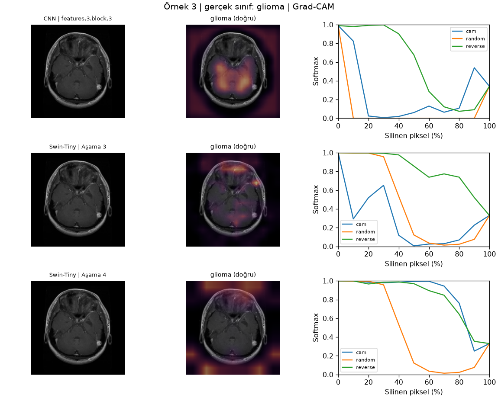
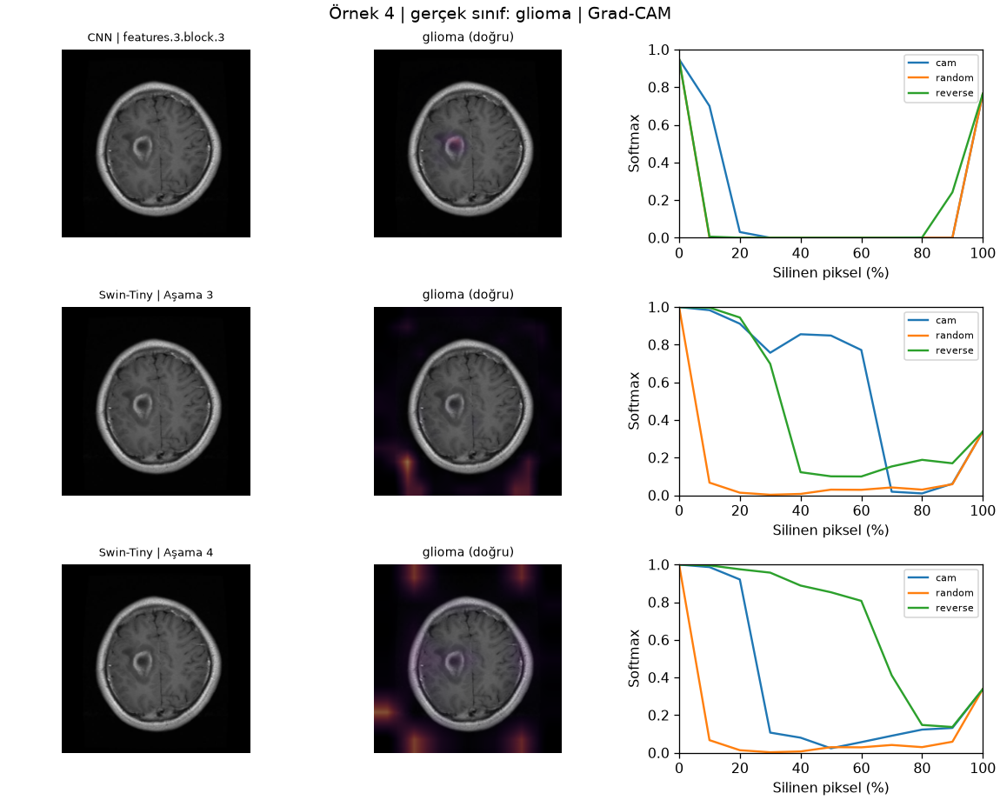
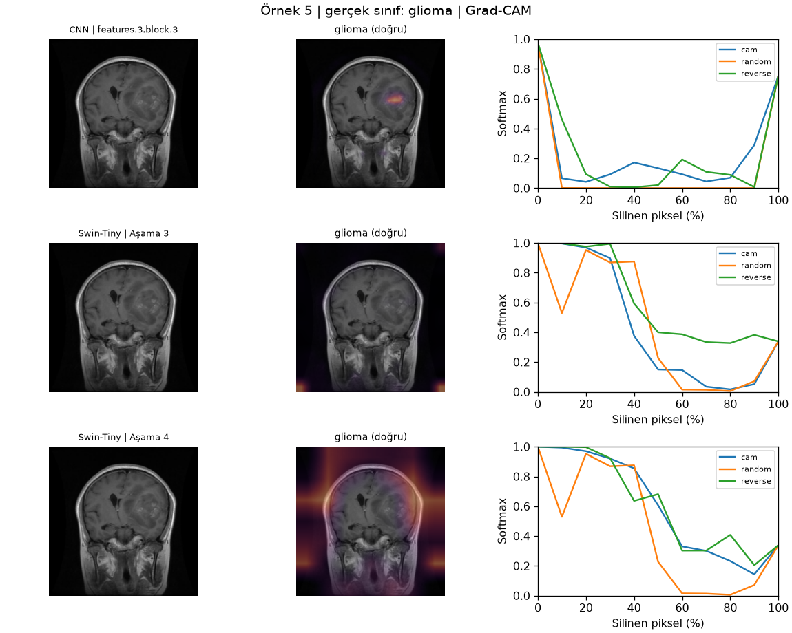

# Grad-CAM tanı çalışması

Komut `.venv/Scripts/python.exe -B -m experiments.swin_v3.gradcam_diagnostics --archive ../Beyin_Tumoru_Projesi-20261119T203803Z-1-001/Beyin_Tumoru_Projesi/Brain_Tumor_MRI_Dataset.zip --split ../Beyin_Tumoru_Projesi-20261119T203803Z-1-001/Beyin_Tumoru_Projesi/veri_bolunmesi_v3/test.csv --out results/gradcam_diagnostics`.
Cihaz: cuda. PyTorch: 2.6.0+cu124. GPU: NVIDIA GeForce RTX 3050 Laptop GPU.
Test CSV SHA-256: `4ff4c223894f90ed298f3c0be4b798fb13e919fadf096b1ffaae4ac150bcb51e`. Veri kaynağı: Brain_Tumor_MRI_Dataset.zip.
CNN V2 kaynağı: dağıtım paketi. Swin: swin_tiny_v3_best.pth. İki modelin kendi eğitimden gelen tahmini sabit hedef.

## Örneklem ve yöntem

V3 test listesinin 1.579 benzersiz dosya yolundan sınıf başına 10 görüntü seçildi. Sınıf içinde dosya yolları sıralandı, 20261119 ile karıştırıldı, boyut ve RGB piksel hash’i aynı olan görüntüler atlandı. Tahmine göre eleme yapılmadı.
Üretimdeki model yükleyici ve ön işleme doğrudan kullanıldı. Hedefler CNN features.3.block.3, Swin layers[2] ve Swin layers[3].blocks[-1].norm1. Üç yöntemde de üretimdeki gibi aug_smooth=True. Ölçümler dolgusuz 224×224 model girişinde yapıldı.
a. Sınıflandırıcıdan başlayarak grupların ağırlıkları aynı mimarinin sabit tohumla yeni başlatılmış ağırlıklarıyla kümülatif değiştirildi. CNN batch norm durumları da yeni başlangıçtandır. Tüm öğrenilebilir parametrelerin değişim kapsamına girdiği denetlendi. Spearman sabit haritalarda tanımsızdır ve ortalamaya girmez. SSIM [0,1] aralıklı giriş haritalarında 11×11 Gauss penceresi (σ=1,5) ile hesaplandı.
b/e. Deletion ve insertion, %0–100 arasında 10 puanlık adımlarla, görüntünün kanal başına uzamsal ortalaması kullanılarak hesaplandı. En yüksek, rastgele ve en düşük aktivasyon sıraları karşılaştırıldı. Aynı görüntünün aynı rastgele sırası tüm yöntemlerde kullanıldı. Eşit sıralar aynı rastgele sıra ile çözülür. Eğri uçları gerçek özgün ve sabit ortalama görüntünün tekil ileri geçişleriyle ölçüldü ve sıralamalar arasında yeniden kullanıldı. AUC trapez integrali, küçük deletion ve büyük insertion lehine.
c. Kafa ön planı üretimdeki foreground_region işleviyle hesaplandı. 5×5 Gauss, max(5, %95 yüzdelik × 0,09) eşiği, 7×7 kapama, en büyük dış konturun dolgusu ve 5×5 erozyon kullanıldı. Alt bant son 56 satırdır. Toplam aktivasyon sıfırsa enerji oranı tanımsızdır.
d. Kafa dışı, alt bant ve bunların birleşimi ayrı ayrı ortalamayla değiştirildi. Böylece birleşim testinde sadece kafa maskesinin üst %75 içindeki kısmı korundu. Ters kontrolde sadece birleşim korundu. Bu bölgeler anatomik beyin maskesi değildir, alt bant beyin dokusu içerebilir. Farklar orijinal hedef skoru eksi müdahale sonrası skordur.
f. Swin aşamaları için tüm piksellerde Spearman ve kafa ön planında her haritanın kendi tepesinin %70’ine ulaşan pozitif odakların kesişim/birleşim oranı kullanıldı.

## Çıktı özeti ve doğrulama

Başarılı koşudan önce PowerShell'de `$env:OPENBLAS_NUM_THREADS='1'`, `$env:OMP_NUM_THREADS='1'` ve `$env:MKL_NUM_THREADS='1'` ayarlandı. İlk denemelerde SVD başlatma hatası ve ayrı hesaplanan ortak eğri uçlarının doğrulama hatası görüldü. Nihai koşu aynı örneklem ve CAM ayarlarıyla tamamlandı. Ortak uç noktalar ilgili özgün ve sabit ortalama girdi üzerinde bir kez ölçüldü.

Son kontrolde dokuz kombinasyonun her birinde 40 kayıt, 2.160 eğri ve 23.760 eğri noktası doğrulandı. Betik her eğrinin 11 adımını, ortak uç noktalarını ve AUC hesabını denetledi. Sekiz PNG ve 46 korunan dosyanın SHA-256 eşleşmesi ayrıca kontrol edildi.

Yukarıdaki komut a–f ölçümlerini tek çalıştırmada üretti. 360 görüntü/model/aşama/yöntem kaydı, 40 görüntü ve 8 panel. Eğri başına 11 skor. Ölçüm ayrıntıları CSV dosyalarında.
Profil veya checkpoint değişiklikleri ve küçük deney örneklemi dışında daha geniş veri setine genelleme doğrulanmadı. Hasta düzeyinde ayrım doğrulanmadı. Referans segmentasyon maskesi bulunmuyor.

## a. Kümülatif rastgeleleştirme

| Model | Katman | Yöntem | Son grup | Spearman | SSIM | Sabit rastgele harita |
|---|---|---|---|---:|---:|---:|
| CNN | features.3.block.3 | GradCAM | head | -0.110 ± 0.335 (n=40) | 0.292 ± 0.175 (n=40) | 0 |
| CNN | features.3.block.3 | GradCAM | classifier | 0.131 ± 0.343 (n=40) | 0.300 ± 0.168 (n=40) | 0 |
| CNN | features.3.block.3 | GradCAM | features.3 | 0.029 ± 0.275 (n=40) | 0.297 ± 0.182 (n=40) | 0 |
| CNN | features.3.block.3 | GradCAM | features.2 | 0.075 ± 0.221 (n=40) | 0.314 ± 0.163 (n=40) | 0 |
| CNN | features.3.block.3 | GradCAM | features.1 | 0.022 ± 0.251 (n=40) | 0.319 ± 0.147 (n=40) | 0 |
| CNN | features.3.block.3 | GradCAM | features.0 | -0.041 ± 0.198 (n=40) | 0.304 ± 0.159 (n=40) | 0 |
| CNN | features.3.block.3 | GradCAM++ | head | 0.168 ± 0.265 (n=40) | 0.258 ± 0.253 (n=40) | 0 |
| CNN | features.3.block.3 | GradCAM++ | classifier | 0.213 ± 0.244 (n=40) | 0.573 ± 0.150 (n=40) | 0 |
| CNN | features.3.block.3 | GradCAM++ | features.3 | 0.146 ± 0.218 (n=40) | 0.521 ± 0.166 (n=40) | 0 |
| CNN | features.3.block.3 | GradCAM++ | features.2 | 0.140 ± 0.259 (n=40) | 0.487 ± 0.164 (n=40) | 0 |
| CNN | features.3.block.3 | GradCAM++ | features.1 | 0.136 ± 0.272 (n=40) | 0.475 ± 0.158 (n=40) | 0 |
| CNN | features.3.block.3 | GradCAM++ | features.0 | 0.156 ± 0.256 (n=40) | 0.399 ± 0.168 (n=40) | 0 |
| CNN | features.3.block.3 | EigenGradCAM | head | 0.222 ± 0.249 (n=40) | 0.574 ± 0.153 (n=40) | 0 |
| CNN | features.3.block.3 | EigenGradCAM | classifier | 0.251 ± 0.187 (n=40) | 0.620 ± 0.109 (n=40) | 0 |
| CNN | features.3.block.3 | EigenGradCAM | features.3 | 0.140 ± 0.192 (n=40) | 0.592 ± 0.095 (n=40) | 0 |
| CNN | features.3.block.3 | EigenGradCAM | features.2 | 0.149 ± 0.143 (n=40) | 0.564 ± 0.099 (n=40) | 0 |
| CNN | features.3.block.3 | EigenGradCAM | features.1 | 0.128 ± 0.137 (n=40) | 0.538 ± 0.095 (n=40) | 0 |
| CNN | features.3.block.3 | EigenGradCAM | features.0 | 0.053 ± 0.144 (n=40) | 0.492 ± 0.088 (n=40) | 0 |
| Swin-Tiny | Aşama 3 | GradCAM | head | -0.144 ± 0.268 (n=40) | 0.281 ± 0.117 (n=40) | 0 |
| Swin-Tiny | Aşama 3 | GradCAM | norm+stage4 | 0.113 ± 0.269 (n=40) | 0.297 ± 0.175 (n=40) | 0 |
| Swin-Tiny | Aşama 3 | GradCAM | stage3 | 0.107 ± 0.226 (n=40) | 0.323 ± 0.097 (n=40) | 0 |
| Swin-Tiny | Aşama 3 | GradCAM | stage2 | 0.012 ± 0.199 (n=40) | 0.327 ± 0.101 (n=40) | 0 |
| Swin-Tiny | Aşama 3 | GradCAM | stage1 | -0.136 ± 0.269 (n=40) | 0.276 ± 0.093 (n=40) | 0 |
| Swin-Tiny | Aşama 3 | GradCAM | patch_embed | 0.102 ± 0.285 (n=40) | 0.319 ± 0.129 (n=40) | 0 |
| Swin-Tiny | Aşama 3 | GradCAM++ | head | 0.214 ± 0.272 (n=40) | 0.435 ± 0.239 (n=40) | 0 |
| Swin-Tiny | Aşama 3 | GradCAM++ | norm+stage4 | 0.287 ± 0.218 (n=40) | 0.501 ± 0.206 (n=40) | 0 |
| Swin-Tiny | Aşama 3 | GradCAM++ | stage3 | 0.099 ± 0.243 (n=40) | 0.263 ± 0.126 (n=40) | 0 |
| Swin-Tiny | Aşama 3 | GradCAM++ | stage2 | 0.044 ± 0.225 (n=40) | 0.345 ± 0.142 (n=40) | 0 |
| Swin-Tiny | Aşama 3 | GradCAM++ | stage1 | -0.034 ± 0.220 (n=39) | 0.402 ± 0.174 (n=40) | 1 |
| Swin-Tiny | Aşama 3 | GradCAM++ | patch_embed | 0.038 ± 0.240 (n=40) | 0.249 ± 0.183 (n=40) | 0 |
| Swin-Tiny | Aşama 3 | EigenGradCAM | head | 0.337 ± 0.356 (n=40) | 0.543 ± 0.260 (n=40) | 0 |
| Swin-Tiny | Aşama 3 | EigenGradCAM | norm+stage4 | -0.042 ± 0.208 (n=40) | 0.206 ± 0.162 (n=40) | 0 |
| Swin-Tiny | Aşama 3 | EigenGradCAM | stage3 | -0.062 ± 0.118 (n=40) | 0.135 ± 0.098 (n=40) | 0 |
| Swin-Tiny | Aşama 3 | EigenGradCAM | stage2 | -0.024 ± 0.094 (n=40) | 0.135 ± 0.088 (n=40) | 0 |
| Swin-Tiny | Aşama 3 | EigenGradCAM | stage1 | -0.002 ± 0.094 (n=40) | 0.159 ± 0.124 (n=40) | 0 |
| Swin-Tiny | Aşama 3 | EigenGradCAM | patch_embed | -0.023 ± 0.094 (n=40) | 0.145 ± 0.105 (n=40) | 0 |
| Swin-Tiny | Aşama 4 | GradCAM | head | -0.166 ± 0.372 (n=40) | 0.222 ± 0.160 (n=40) | 0 |
| Swin-Tiny | Aşama 4 | GradCAM | norm+stage4 | 0.064 ± 0.254 (n=40) | 0.288 ± 0.180 (n=40) | 0 |
| Swin-Tiny | Aşama 4 | GradCAM | stage3 | 0.002 ± 0.189 (n=31) | 0.387 ± 0.231 (n=40) | 9 |
| Swin-Tiny | Aşama 4 | GradCAM | stage2 | 0.069 ± 0.283 (n=40) | 0.365 ± 0.230 (n=40) | 0 |
| Swin-Tiny | Aşama 4 | GradCAM | stage1 | -0.093 ± 0.288 (n=39) | 0.288 ± 0.145 (n=40) | 1 |
| Swin-Tiny | Aşama 4 | GradCAM | patch_embed | 0.062 ± 0.295 (n=40) | 0.333 ± 0.149 (n=40) | 0 |
| Swin-Tiny | Aşama 4 | GradCAM++ | head | 0.020 ± 0.420 (n=39) | 0.348 ± 0.216 (n=40) | 1 |
| Swin-Tiny | Aşama 4 | GradCAM++ | norm+stage4 | 0.005 ± 0.301 (n=40) | 0.387 ± 0.207 (n=40) | 0 |
| Swin-Tiny | Aşama 4 | GradCAM++ | stage3 | 0.027 ± 0.356 (n=40) | 0.483 ± 0.148 (n=40) | 0 |
| Swin-Tiny | Aşama 4 | GradCAM++ | stage2 | -0.110 ± 0.302 (n=38) | 0.287 ± 0.186 (n=40) | 2 |
| Swin-Tiny | Aşama 4 | GradCAM++ | stage1 | -0.049 ± 0.364 (n=40) | 0.449 ± 0.138 (n=40) | 0 |
| Swin-Tiny | Aşama 4 | GradCAM++ | patch_embed | 0.011 ± 0.245 (n=40) | 0.386 ± 0.196 (n=40) | 0 |
| Swin-Tiny | Aşama 4 | EigenGradCAM | head | 0.209 ± 0.484 (n=40) | 0.483 ± 0.245 (n=40) | 0 |
| Swin-Tiny | Aşama 4 | EigenGradCAM | norm+stage4 | 0.210 ± 0.468 (n=40) | 0.370 ± 0.188 (n=40) | 0 |
| Swin-Tiny | Aşama 4 | EigenGradCAM | stage3 | 0.297 ± 0.429 (n=40) | 0.348 ± 0.126 (n=40) | 0 |
| Swin-Tiny | Aşama 4 | EigenGradCAM | stage2 | 0.286 ± 0.442 (n=40) | 0.351 ± 0.131 (n=40) | 0 |
| Swin-Tiny | Aşama 4 | EigenGradCAM | stage1 | 0.329 ± 0.467 (n=40) | 0.368 ± 0.125 (n=40) | 0 |
| Swin-Tiny | Aşama 4 | EigenGradCAM | patch_embed | 0.227 ± 0.352 (n=40) | 0.359 ± 0.125 (n=40) | 0 |

## b/e. Sadakat AUC ortalamaları

| Model | Katman | Yöntem | Silme CAM | Silme rastgele | Silme ters | Ekleme CAM | Ekleme rastgele | Ekleme ters |
|---|---|---|---:|---:|---:|---:|---:|---:|
| CNN | features.3.block.3 | GradCAM | 0.530 | 0.510 | 0.734 | 0.734 | 0.506 | 0.531 |
| CNN | features.3.block.3 | GradCAM++ | 0.583 | 0.510 | 0.659 | 0.659 | 0.506 | 0.583 |
| CNN | features.3.block.3 | EigenGradCAM | 0.563 | 0.510 | 0.625 | 0.625 | 0.506 | 0.563 |
| Swin-Tiny | Aşama 3 | GradCAM | 0.503 | 0.486 | 0.785 | 0.784 | 0.484 | 0.503 |
| Swin-Tiny | Aşama 3 | GradCAM++ | 0.610 | 0.486 | 0.738 | 0.738 | 0.484 | 0.609 |
| Swin-Tiny | Aşama 3 | EigenGradCAM | 0.589 | 0.486 | 0.744 | 0.747 | 0.484 | 0.591 |
| Swin-Tiny | Aşama 4 | GradCAM | 0.559 | 0.486 | 0.761 | 0.760 | 0.484 | 0.559 |
| Swin-Tiny | Aşama 4 | GradCAM++ | 0.589 | 0.486 | 0.754 | 0.754 | 0.484 | 0.589 |
| Swin-Tiny | Aşama 4 | EigenGradCAM | 0.601 | 0.486 | 0.725 | 0.725 | 0.484 | 0.599 |

## c. Enerji oranları ve f. aşamalar arası örtüşme

| Model | Katman | Yöntem | Sınıf | Kafa dışı | Alt bant | Aşama Spearman | Ortak odak IoU |
|---|---|---|---|---:|---:|---:|---:|
| CNN | features.3.block.3 | GradCAM | glioma | 0.364 ± 0.185 (n=10) | 0.145 ± 0.096 (n=10) | — | — |
| CNN | features.3.block.3 | GradCAM | meningioma | 0.315 ± 0.100 (n=10) | 0.242 ± 0.133 (n=10) | — | — |
| CNN | features.3.block.3 | GradCAM | notumor | 0.278 ± 0.290 (n=10) | 0.345 ± 0.236 (n=10) | — | — |
| CNN | features.3.block.3 | GradCAM | pituitary | 0.041 ± 0.041 (n=10) | 0.371 ± 0.215 (n=10) | — | — |
| CNN | features.3.block.3 | GradCAM | Tümü | 0.249 ± 0.214 (n=40) | 0.276 ± 0.195 (n=40) | — | — |
| CNN | features.3.block.3 | GradCAM++ | glioma | 0.419 ± 0.127 (n=10) | 0.216 ± 0.050 (n=10) | — | — |
| CNN | features.3.block.3 | GradCAM++ | meningioma | 0.404 ± 0.173 (n=10) | 0.235 ± 0.082 (n=10) | — | — |
| CNN | features.3.block.3 | GradCAM++ | notumor | 0.371 ± 0.260 (n=10) | 0.246 ± 0.075 (n=10) | — | — |
| CNN | features.3.block.3 | GradCAM++ | pituitary | 0.236 ± 0.087 (n=10) | 0.262 ± 0.061 (n=10) | — | — |
| CNN | features.3.block.3 | GradCAM++ | Tümü | 0.358 ± 0.182 (n=40) | 0.240 ± 0.068 (n=40) | — | — |
| CNN | features.3.block.3 | EigenGradCAM | glioma | 0.433 ± 0.134 (n=10) | 0.194 ± 0.039 (n=10) | — | — |
| CNN | features.3.block.3 | EigenGradCAM | meningioma | 0.415 ± 0.194 (n=10) | 0.179 ± 0.068 (n=10) | — | — |
| CNN | features.3.block.3 | EigenGradCAM | notumor | 0.368 ± 0.236 (n=10) | 0.211 ± 0.035 (n=10) | — | — |
| CNN | features.3.block.3 | EigenGradCAM | pituitary | 0.227 ± 0.095 (n=10) | 0.200 ± 0.100 (n=10) | — | — |
| CNN | features.3.block.3 | EigenGradCAM | Tümü | 0.361 ± 0.185 (n=40) | 0.196 ± 0.065 (n=40) | — | — |
| Swin-Tiny | Aşama 3 | GradCAM | glioma | 0.638 ± 0.188 (n=10) | 0.345 ± 0.137 (n=10) | 0.466 ± 0.151 (n=10) | 0.015 ± 0.026 (n=7) |
| Swin-Tiny | Aşama 3 | GradCAM | meningioma | 0.484 ± 0.130 (n=10) | 0.252 ± 0.114 (n=10) | 0.389 ± 0.384 (n=10) | 0.050 ± 0.069 (n=10) |
| Swin-Tiny | Aşama 3 | GradCAM | notumor | 0.534 ± 0.316 (n=10) | 0.361 ± 0.133 (n=10) | 0.375 ± 0.236 (n=10) | 0.015 ± 0.036 (n=10) |
| Swin-Tiny | Aşama 3 | GradCAM | pituitary | 0.216 ± 0.136 (n=10) | 0.219 ± 0.115 (n=10) | 0.592 ± 0.192 (n=10) | 0.096 ± 0.139 (n=10) |
| Swin-Tiny | Aşama 3 | GradCAM | Tümü | 0.468 ± 0.253 (n=40) | 0.294 ± 0.135 (n=40) | 0.456 ± 0.261 (n=40) | 0.046 ± 0.087 (n=37) |
| Swin-Tiny | Aşama 3 | GradCAM++ | glioma | 0.714 ± 0.296 (n=10) | 0.365 ± 0.097 (n=10) | 0.410 ± 0.084 (n=10) | 0.000 ± 0.000 (n=3) |
| Swin-Tiny | Aşama 3 | GradCAM++ | meningioma | 0.610 ± 0.208 (n=10) | 0.326 ± 0.098 (n=10) | 0.159 ± 0.287 (n=10) | 0.001 ± 0.003 (n=9) |
| Swin-Tiny | Aşama 3 | GradCAM++ | notumor | 0.361 ± 0.181 (n=10) | 0.322 ± 0.097 (n=10) | 0.188 ± 0.233 (n=10) | 0.019 ± 0.055 (n=8) |
| Swin-Tiny | Aşama 3 | GradCAM++ | pituitary | 0.434 ± 0.173 (n=10) | 0.270 ± 0.101 (n=10) | 0.267 ± 0.271 (n=10) | 0.000 ± 0.000 (n=10) |
| Swin-Tiny | Aşama 3 | GradCAM++ | Tümü | 0.530 ± 0.254 (n=40) | 0.321 ± 0.100 (n=40) | 0.256 ± 0.244 (n=40) | 0.005 ± 0.028 (n=30) |
| Swin-Tiny | Aşama 3 | EigenGradCAM | glioma | 0.061 ± 0.159 (n=10) | 0.059 ± 0.142 (n=10) | 0.167 ± 0.533 (n=10) | 0.137 ± 0.211 (n=10) |
| Swin-Tiny | Aşama 3 | EigenGradCAM | meningioma | 0.174 ± 0.194 (n=10) | 0.125 ± 0.152 (n=10) | 0.358 ± 0.456 (n=10) | 0.427 ± 0.221 (n=10) |
| Swin-Tiny | Aşama 3 | EigenGradCAM | notumor | 0.316 ± 0.193 (n=10) | 0.256 ± 0.085 (n=10) | 0.297 ± 0.319 (n=10) | 0.114 ± 0.209 (n=10) |
| Swin-Tiny | Aşama 3 | EigenGradCAM | pituitary | 0.197 ± 0.142 (n=10) | 0.115 ± 0.108 (n=10) | 0.103 ± 0.452 (n=10) | 0.053 ± 0.130 (n=10) |
| Swin-Tiny | Aşama 3 | EigenGradCAM | Tümü | 0.187 ± 0.190 (n=40) | 0.139 ± 0.140 (n=40) | 0.231 ± 0.441 (n=40) | 0.183 ± 0.238 (n=40) |
| Swin-Tiny | Aşama 4 | GradCAM | glioma | 0.603 ± 0.235 (n=10) | 0.403 ± 0.150 (n=10) | 0.466 ± 0.151 (n=10) | 0.015 ± 0.026 (n=7) |
| Swin-Tiny | Aşama 4 | GradCAM | meningioma | 0.296 ± 0.217 (n=10) | 0.108 ± 0.098 (n=10) | 0.389 ± 0.384 (n=10) | 0.050 ± 0.069 (n=10) |
| Swin-Tiny | Aşama 4 | GradCAM | notumor | 0.341 ± 0.199 (n=10) | 0.315 ± 0.060 (n=10) | 0.375 ± 0.236 (n=10) | 0.015 ± 0.036 (n=10) |
| Swin-Tiny | Aşama 4 | GradCAM | pituitary | 0.213 ± 0.100 (n=10) | 0.200 ± 0.081 (n=10) | 0.592 ± 0.192 (n=10) | 0.096 ± 0.139 (n=10) |
| Swin-Tiny | Aşama 4 | GradCAM | Tümü | 0.363 ± 0.238 (n=40) | 0.257 ± 0.150 (n=40) | 0.456 ± 0.261 (n=40) | 0.046 ± 0.087 (n=37) |
| Swin-Tiny | Aşama 4 | GradCAM++ | glioma | 0.634 ± 0.236 (n=10) | 0.406 ± 0.106 (n=10) | 0.410 ± 0.084 (n=10) | 0.000 ± 0.000 (n=3) |
| Swin-Tiny | Aşama 4 | GradCAM++ | meningioma | 0.479 ± 0.199 (n=10) | 0.220 ± 0.060 (n=10) | 0.159 ± 0.287 (n=10) | 0.001 ± 0.003 (n=9) |
| Swin-Tiny | Aşama 4 | GradCAM++ | notumor | 0.462 ± 0.242 (n=10) | 0.363 ± 0.061 (n=10) | 0.188 ± 0.233 (n=10) | 0.019 ± 0.055 (n=8) |
| Swin-Tiny | Aşama 4 | GradCAM++ | pituitary | 0.233 ± 0.090 (n=10) | 0.228 ± 0.107 (n=10) | 0.267 ± 0.271 (n=10) | 0.000 ± 0.000 (n=10) |
| Swin-Tiny | Aşama 4 | GradCAM++ | Tümü | 0.452 ± 0.241 (n=40) | 0.304 ± 0.117 (n=40) | 0.256 ± 0.244 (n=40) | 0.005 ± 0.028 (n=30) |
| Swin-Tiny | Aşama 4 | EigenGradCAM | glioma | 0.425 ± 0.343 (n=10) | 0.185 ± 0.154 (n=10) | 0.167 ± 0.533 (n=10) | 0.137 ± 0.211 (n=10) |
| Swin-Tiny | Aşama 4 | EigenGradCAM | meningioma | 0.138 ± 0.227 (n=10) | 0.076 ± 0.131 (n=10) | 0.358 ± 0.456 (n=10) | 0.427 ± 0.221 (n=10) |
| Swin-Tiny | Aşama 4 | EigenGradCAM | notumor | 0.272 ± 0.203 (n=10) | 0.141 ± 0.077 (n=10) | 0.297 ± 0.319 (n=10) | 0.114 ± 0.209 (n=10) |
| Swin-Tiny | Aşama 4 | EigenGradCAM | pituitary | 0.206 ± 0.115 (n=10) | 0.245 ± 0.144 (n=10) | 0.103 ± 0.452 (n=10) | 0.053 ± 0.130 (n=10) |
| Swin-Tiny | Aşama 4 | EigenGradCAM | Tümü | 0.260 ± 0.251 (n=40) | 0.162 ± 0.140 (n=40) | 0.231 ± 0.441 (n=40) | 0.183 ± 0.238 (n=40) |

## d. Bölge müdahalesi

Bu ölçüm CAM yönteminden ve aşamadan bağımsızdır. Aynı görüntü/model için bir kez ölçüldü.

| Model | Sınıf | Kafa dışı Δ | Alt bant Δ | İkisi birlikte Δ | Sadece ikisi korununca Δ |
|---|---|---:|---:|---:|---:|
| CNN | glioma | 0.130 ± 0.236 (n=10) | 0.094 ± 0.311 (n=10) | 0.130 ± 0.240 (n=10) | 0.135 ± 0.327 (n=10) |
| CNN | meningioma | 0.010 ± 0.033 (n=10) | 0.103 ± 0.170 (n=10) | 0.045 ± 0.088 (n=10) | 0.872 ± 0.306 (n=10) |
| CNN | notumor | -0.004 ± 0.009 (n=10) | 0.032 ± 0.077 (n=10) | 0.013 ± 0.030 (n=10) | 0.360 ± 0.414 (n=10) |
| CNN | pituitary | 0.033 ± 0.058 (n=10) | 0.162 ± 0.251 (n=10) | 0.384 ± 0.412 (n=10) | 0.453 ± 0.393 (n=10) |
| CNN | Tümü | 0.042 ± 0.129 (n=40) | 0.098 ± 0.217 (n=40) | 0.143 ± 0.276 (n=40) | 0.455 ± 0.441 (n=40) |

CNN: örneklemde 36/40 doğru tahmin.

| Swin-Tiny | glioma | 0.008 ± 0.086 (n=10) | -0.020 ± 0.041 (n=10) | -0.011 ± 0.074 (n=10) | 0.115 ± 0.218 (n=10) |
| Swin-Tiny | meningioma | 0.096 ± 0.294 (n=10) | 0.063 ± 0.168 (n=10) | 0.159 ± 0.316 (n=10) | 0.806 ± 0.221 (n=10) |
| Swin-Tiny | notumor | 0.000 ± 0.000 (n=10) | 0.000 ± 0.001 (n=10) | 0.000 ± 0.001 (n=10) | 0.026 ± 0.044 (n=10) |
| Swin-Tiny | pituitary | 0.098 ± 0.265 (n=10) | 0.057 ± 0.115 (n=10) | 0.280 ± 0.379 (n=10) | 0.815 ± 0.087 (n=10) |
| Swin-Tiny | Tümü | 0.050 ± 0.200 (n=40) | 0.025 ± 0.106 (n=40) | 0.107 ± 0.269 (n=40) | 0.441 ± 0.407 (n=40) |

Swin-Tiny: örneklemde 38/40 doğru tahmin.

## Paneller

Görsel seçim kuralı ilk dört hatalı görüntü (en az bir model), ardından her iki modelin doğru tahmin ettiği ilk dört görüntüdür. Eksik kontenjan sıra numarasına göre doldurulur. Bu seçim ölçüm örneklemini değiştirmez.

## Yorum ve sınırlamalar

- Dokuz kombinasyonun tamamı ekleme AUC ortalamasında rastgele sıradan daha yüksek, silme AUC ortalamasında ise daha kötü çıktı. İki test birlikte okunduğunda bir yöntem değişikliğini destekleyen tutarlı sadakat avantajı görülmedi. Yeni bir deneyde bulanıklaştırma veya bölge bazlı müdahale ile bu fark yeniden sınanabilir.
- Tam rastgeleleştirmeden sonra standart Grad-CAM haritalarında ortalama Spearman CNN için −0,041, Swin Aşama 3 için 0,102 ve Aşama 4 için 0,062 oldu. Ortalama sıra benzerliği düşük kaldı. Bazı yöntemlerde SSIM daha yüksek olduğundan uzamsal yapının tümüyle ortadan kalktığı söylenemez.
- Standart Grad-CAM’de Swin Aşama 3 ve 4 sıra korelasyonu ortalama 0,456, güçlü odakların IoU değeri ortalama 0,046 idi. Haritalar genel piksel sıralamasında kısmen benzerken güçlü odakları az örtüştü.
- Kafa dışı ve alt bant birlikte değiştirildiğinde özgün hedefin ortalama softmax skoru CNN’de 14,3, Swin’de 10,7 yüzde puan azaldı. Yüksek örnekler arası değişkenlik ve anatomik maske belirsizliği nedeniyle bu fark, kesin bir tümör dışı ipucu bağımlılığı hükmünü desteklemiyor.

Aşağıdaki karşılaştırmalar aynı görüntülerin ortalamalarıdır. AUC farkları puan cinsinden verilmiştir.

- CNN / features.3.block.3 / GradCAM. Tam rastgeleleştirme Spearman -0.041 ± 0.198 (n=40), SSIM 0.304 ± 0.159 (n=40). Rastgele sıraya karşı silme avantajı -2.0, ekleme avantajı +22.8 puan. Her iki kontrolden her iki ölçümde de iyi: 5/40.
- CNN / features.3.block.3 / GradCAM++. Tam rastgeleleştirme Spearman 0.156 ± 0.256 (n=40), SSIM 0.399 ± 0.168 (n=40). Rastgele sıraya karşı silme avantajı -7.3, ekleme avantajı +15.4 puan. Her iki kontrolden her iki ölçümde de iyi: 3/40.
- CNN / features.3.block.3 / EigenGradCAM. Tam rastgeleleştirme Spearman 0.053 ± 0.144 (n=40), SSIM 0.492 ± 0.088 (n=40). Rastgele sıraya karşı silme avantajı -5.3, ekleme avantajı +11.9 puan. Her iki kontrolden her iki ölçümde de iyi: 1/40.
- Swin-Tiny / Aşama 3 / GradCAM. Tam rastgeleleştirme Spearman 0.102 ± 0.285 (n=40), SSIM 0.319 ± 0.129 (n=40). Rastgele sıraya karşı silme avantajı -1.7, ekleme avantajı +30.0 puan. Her iki kontrolden her iki ölçümde de iyi: 8/40.
- Swin-Tiny / Aşama 3 / GradCAM++. Tam rastgeleleştirme Spearman 0.038 ± 0.240 (n=40), SSIM 0.249 ± 0.183 (n=40). Rastgele sıraya karşı silme avantajı -12.4, ekleme avantajı +25.4 puan. Her iki kontrolden her iki ölçümde de iyi: 7/40.
- Swin-Tiny / Aşama 3 / EigenGradCAM. Tam rastgeleleştirme Spearman -0.023 ± 0.094 (n=40), SSIM 0.145 ± 0.105 (n=40). Rastgele sıraya karşı silme avantajı -10.3, ekleme avantajı +26.3 puan. Her iki kontrolden her iki ölçümde de iyi: 9/40.
- Swin-Tiny / Aşama 4 / GradCAM. Tam rastgeleleştirme Spearman 0.062 ± 0.295 (n=40), SSIM 0.333 ± 0.149 (n=40). Rastgele sıraya karşı silme avantajı -7.3, ekleme avantajı +27.6 puan. Her iki kontrolden her iki ölçümde de iyi: 9/40.
- Swin-Tiny / Aşama 4 / GradCAM++. Tam rastgeleleştirme Spearman 0.011 ± 0.245 (n=40), SSIM 0.386 ± 0.196 (n=40). Rastgele sıraya karşı silme avantajı -10.3, ekleme avantajı +27.0 puan. Her iki kontrolden her iki ölçümde de iyi: 5/40.
- Swin-Tiny / Aşama 4 / EigenGradCAM. Tam rastgeleleştirme Spearman 0.227 ± 0.352 (n=40), SSIM 0.359 ± 0.125 (n=40). Rastgele sıraya karşı silme avantajı -11.5, ekleme avantajı +24.1 puan. Her iki kontrolden her iki ölçümde de iyi: 5/40.

Rastgeleleştirmede yüksek SSIM tek başına modelden bağımsız kenar haritasını kanıtlamaz. İki haritanın ortak boş alanları SSIM’i yükseltebilir. Spearman, sabit harita sayısı ve SSIM birlikte okunmalıdır.
Bir sıralamanın rastgele sırayı geçmesi sadece bu örneklem ve bu piksel müdahalesi altında sadakat kanıtıdır. Ortalama dolgusu dağılım dışı görüntüler oluşturabilir. Alt bant veya kafa dışı müdahalesine duyarlılık, tek başına tümör dışı ipucu kullanımını doğrulamaz. Ortak odak yalnızca iki haritanın uzamsal uyumunu ölçer.
Bir örneklem çekimi, bir başlangıç tohumu ve bir rastgele sıralama kullanıldı. Klinik olasılık kalibrasyonu veya tümör yerleşim doğruluğu ölçülmedi.

Yöntem kaynakları: [Adebayo ve ark.](https://proceedings.neurips.cc/paper/2018/hash/294a8ed24b1ad22ec2e7efea049b8737-Abstract.html), [Petsiuk ve ark.](https://arxiv.org/abs/1806.07421).

## Dosyalar ve değişmezlik

Üretim ve model dosyalarının çalışma öncesi/sonrası SHA-256 değerleri [integrity.csv](integrity.csv) dosyasında eşleştirildi.
Eklenenler: deney betiği, summary.md, metrics.csv, sample.csv, curves.csv, integrity.csv ve panel_01.png–panel_08.png. GitHub’a push yapılmadı.
