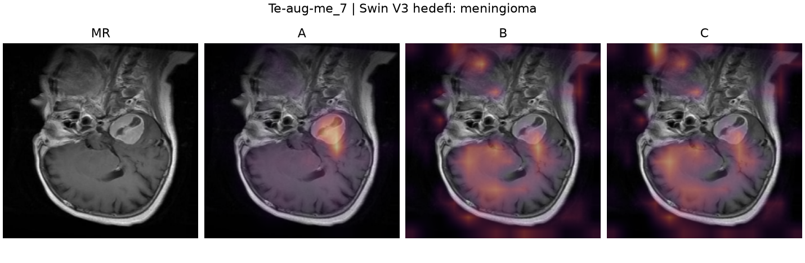
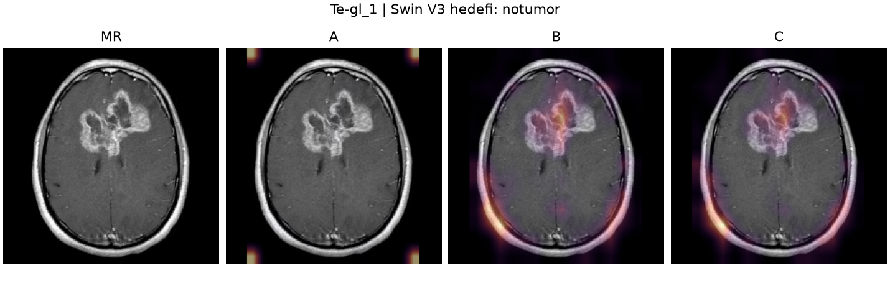
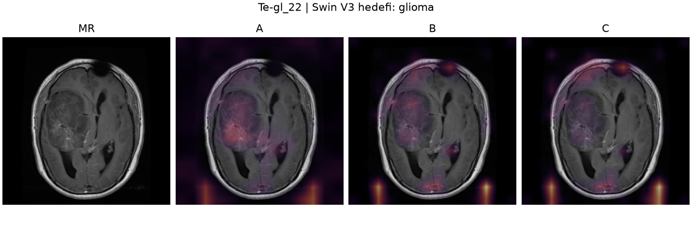
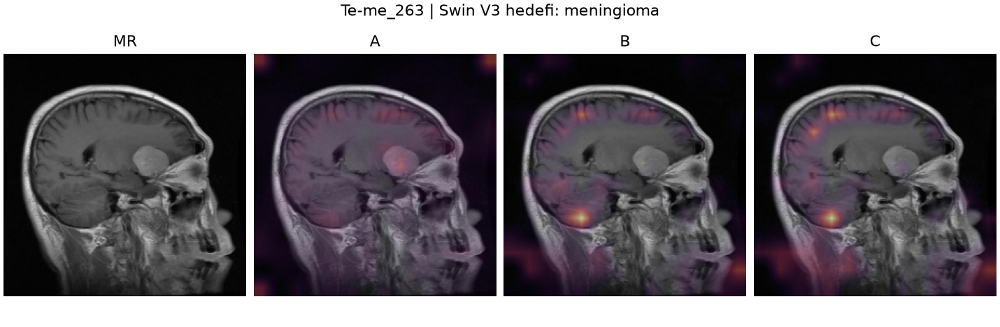
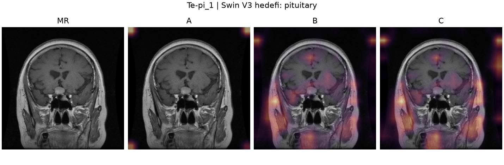

# Swin V3 Aşama 3 hedef katmanı karşılaştırması

## Geçmiş ve diff

Yerel GitHub checkout’unda kayıtlı 46847fa revizyonu norm1 ve yumuşatmasız çağrıyı içeriyor. Ana dalın canlı sürümü doğrulanmadı. Swin notebook hücre 19 aynı norm1 hedefini kullanıyor. Yerel yedeklerin hepsinde aşama çıkışı zaten vardı. Dolayısıyla yedekler arasındaki geçişin kesin tarihi doğrulanmadı.

| Yedek | Aşama 3 | SHA-256 (ilk 12) |
|---|---|---|
| asama3-20261120 | layers[2] | 9db2286ec025 |
| final-20261119-232306 | layers[2] | 9db2286ec025 |
| gradcam-diagnostics-20261120 | layers[2] | 9db2286ec025 |
| gradcam-ek-20261120 | layers[2] | 9db2286ec025 |
| project-20261119-140621 | layers[2] | 3d4c27d743eb |
| review-20261119-142627 | layers[2] | 218420ac9624 |
| ui-20261119-235851 | layers[2] | 9db2286ec025 |

En erken numaralı proje yedeği project-20261119-140621. Ayrı .venv/gradcam-sam-before-audit kopyasında da aynı hedef ve yumuşatma var. O dosyanın yerel son yazım zamanı 19 Kasım 2026 13:08:44. Bu zaman, değişikliğin commit zamanı olarak doğrulanmadı.

Kaynak yorumu Aşama 3’ün, Aşama 4’e aktarılan özellik ızgarasının tamamını açıklaması için seçildiğini söylüyor. Önceki denetim raporu 14×14×384 aktivasyon geometrisini belgeliyor. Geçişi tek başına gerekçelendiren karşılaştırmalı karar kaydı bulunamadı.

[Arşivlenen GitHub revizyonu](https://github.com/saglamkubra/Brain-Tumor-MRI-Classification-Segmentation/blob/46847fad8dcd0d97b4f09fa7178c96ea5fce99ce/backend/segmentation.py) · [Önceki denetim raporu](../swin_v3/gradcam_sam_audit/README.md)

Aşağıdaki diff, eski kayıt ile en erken proje yedeğinin hedef seçimi ve Grad-CAM çağrısına odaklanır.

```diff
- with GradCAM(model=model, target_layers=[model.layers[stage - 1].blocks[-1].norm1],
-              reshape_transform=swin_reshape) as cam:
-     heatmap = cam(input_tensor=device_input, targets=[ClassifierOutputTarget(index)])[0]
+ swin_stage = model.layers[stage - 1]
+ # Stage 3 explains the full feature grid passed to stage 4.
+ target_layer = swin_stage if stage == 3 else swin_stage.blocks[-1].norm1
+ with GradCAM(model=model, target_layers=[target_layer], reshape_transform=swin_reshape) as cam:
+     heatmap = cam(input_tensor=device_input, targets=[ClassifierOutputTarget(index)], aug_smooth=True)[0]
```

## Ölçüm komutu ve kapsam

```powershell
$env:OPENBLAS_NUM_THREADS='1'
$env:OMP_NUM_THREADS='1'
.venv/Scripts/python.exe -B -u .venv/backups/asama3-20261120/run_asama3.py
.venv/Scripts/python.exe -B .venv/backups/asama3-20261120/report_asama3.py
```

RTX 3050 Laptop GPU üzerinde önceki örneklemin 40 RGB piksel hash’i ve hedef sınıfı doğrulandı. Üç varyant aynı Swin V3 checkpoint’ini ve üretim Models.tensor ön işlemesini kullandı. A ve B karşılaştırması katman etkisini, B ve C karşılaştırması aynı hedef katmanda aug_smooth etkisini ölçer. Panel için seçilen beş bilinen görüntü toplu istatistiklere ayrı kayıt olarak eklenmedi.

- A · layers[2], aug_smooth açık
- B · layers[2].blocks[-1].norm1, aug_smooth açık
- C · layers[2].blocks[-1].norm1, aug_smooth kapalı

Enerji ve sadakat dolgusuz 224×224 girdi uzayında ölçüldü. Kafa ön planı üretim foreground_region, alt bant son 56 satırdır. Deletion/insertion CAM sırası, ortalama kanal dolgusu, %0–100 arası 11 ölçüm ve trapez AUC ile hesaplandı. Ortak uç noktalar özgün ve ortalama girdi skorlarından geldi. Marj, özgün hedef logitinden hedef dışı en yüksek logitin çıkarılmasıdır. Daha düşük deletion ve daha yüksek insertion AUC lehine okunur.

Kutu için üretimdeki önizleme projeksiyonu, kafa ön planı ve değişmemiş box_diagnostic kullanıldı. Kutu alanında uç noktalar dahildir. Sadakat ve kutu sonuçları hedef katmana duyarlılığı ölçer. Anatomik doğruluk ve hasta düzeyinde bağımsızlık doğrulanmadı.

## Enerji, sadakat ve kutu

| Varyant | Kafa dışı enerji | Alt bant enerji | Silme softmax AUC | Ekleme softmax AUC | Silme marj AUC | Ekleme marj AUC | Kutu / n | Alan (px) |
|---|---:|---:|---:|---:|---:|---:|---:|---:|
| A | 0.468 ± 0.253 (n=40) | 0.294 ± 0.135 (n=40) | 0.503 ± 0.263 (n=40) | 0.784 ± 0.183 (n=40) | 0.859 ± 2.548 (n=40) | 4.215 ± 2.199 (n=40) | 21/40 | 2458.000 ± 2420.277 (n=21) |
| B | 0.326 ± 0.197 (n=40) | 0.242 ± 0.088 (n=40) | 0.480 ± 0.227 (n=40) | 0.794 ± 0.161 (n=40) | 0.768 ± 2.165 (n=40) | 4.242 ± 2.034 (n=40) | 25/40 | 2697.680 ± 2334.785 (n=25) |
| C | 0.333 ± 0.217 (n=40) | 0.239 ± 0.090 (n=40) | 0.497 ± 0.234 (n=40) | 0.785 ± 0.174 (n=40) | 0.931 ± 2.286 (n=40) | 4.286 ± 2.265 (n=40) | 24/40 | 2366.208 ± 1811.355 (n=24) |

## Kümülatif rastgeleleştirme

Sınıflandırıcıdan girişe doğru aynı tohumla başlatılan yeni Swin ağırlıkları sırayla devreye alındı. Hedef sınıf sabit kaldı. Standart Grad-CAM her grup ve varyant için yeniden üretildi. Tüm öğrenilebilir ağırlıkların kapsandığı doğrulandı. Düz haritalarda Spearman tanımsızdır.

| Varyant | Son rastgele grup | Spearman | SSIM | Düz harita / n |
|---|---|---:|---:|---:|
| A | head | -0.144 ± 0.268 (n=40) | 0.281 ± 0.117 (n=40) | 0/40 |
| A | norm+stage4 | 0.113 ± 0.269 (n=40) | 0.297 ± 0.175 (n=40) | 0/40 |
| A | stage3 | 0.107 ± 0.226 (n=40) | 0.323 ± 0.097 (n=40) | 0/40 |
| A | stage2 | 0.012 ± 0.199 (n=40) | 0.327 ± 0.101 (n=40) | 0/40 |
| A | stage1 | -0.136 ± 0.269 (n=40) | 0.276 ± 0.093 (n=40) | 0/40 |
| A | patch_embed | 0.102 ± 0.285 (n=40) | 0.319 ± 0.129 (n=40) | 0/40 |
| B | head | -0.170 ± 0.228 (n=40) | 0.201 ± 0.081 (n=40) | 0/40 |
| B | norm+stage4 | 0.099 ± 0.289 (n=40) | 0.287 ± 0.101 (n=40) | 0/40 |
| B | stage3 | 0.051 ± 0.297 (n=40) | 0.211 ± 0.126 (n=40) | 0/40 |
| B | stage2 | 0.089 ± 0.284 (n=33) | 0.242 ± 0.145 (n=40) | 7/40 |
| B | stage1 | 0.204 ± 0.260 (n=40) | 0.275 ± 0.104 (n=40) | 0/40 |
| B | patch_embed | 0.072 ± 0.246 (n=40) | 0.227 ± 0.135 (n=40) | 0/40 |
| C | head | -0.161 ± 0.205 (n=40) | 0.171 ± 0.079 (n=40) | 0/40 |
| C | norm+stage4 | 0.092 ± 0.287 (n=40) | 0.251 ± 0.103 (n=40) | 0/40 |
| C | stage3 | 0.047 ± 0.233 (n=40) | 0.188 ± 0.118 (n=40) | 0/40 |
| C | stage2 | 0.066 ± 0.262 (n=32) | 0.233 ± 0.143 (n=40) | 8/40 |
| C | stage1 | 0.156 ± 0.246 (n=40) | 0.233 ± 0.099 (n=40) | 0/40 |
| C | patch_embed | 0.037 ± 0.214 (n=40) | 0.207 ± 0.128 (n=40) | 0/40 |

## Varyantlar arası uyum

IoU, kafa ön planında her haritanın kendi tepesinin %70’ine ulaşan pozitif odakların kesişim/birleşim oranı. İki odak kümesinin birleşimi boşsa oran tanımsızdır. Spearman ve SSIM, 224×224 ham CAM üzerinde hesaplandı.

| Çift | Spearman | SSIM | Ortak odak IoU |
|---|---:|---:|---:|
| AB | 0.483 ± 0.230 (n=40) | 0.386 ± 0.165 (n=40) | 0.097 ± 0.161 (n=40) |
| AC | 0.454 ± 0.228 (n=40) | 0.356 ± 0.141 (n=40) | 0.091 ± 0.149 (n=39) |
| BC | 0.929 ± 0.048 (n=40) | 0.854 ± 0.067 (n=40) | 0.498 ± 0.220 (n=39) |

## Eşleşmiş farklar ve ödünleşimler

Aşağıdaki farklar ikinci varyant eksi birinci varyant şeklindedir. Aynı 40 görüntüden örnekleme ile %95 yüzdelik bootstrap aralıkları hesaplandı. Aralıklar betimseldir ve çoklu karşılaştırma düzeltmesi içermez.

| Çift | Ölçüm | Ortalama fark [%95 aralık] |
|---|---|---:|
| AB | outside | -0.142 [-0.207; -0.080] |
| AB | bottom | -0.053 [-0.085; -0.022] |
| AB | deletion_softmax_auc | -0.023 [-0.055; +0.009] |
| AB | insertion_softmax_auc | +0.009 [-0.026; +0.046] |
| AB | deletion_margin_auc | -0.091 [-0.369; +0.187] |
| AB | insertion_margin_auc | +0.027 [-0.368; +0.415] |
| AB | accepted | +0.100 [-0.125; +0.325] |
| BC | outside | +0.007 [-0.008; +0.022] |
| BC | bottom | -0.003 [-0.011; +0.004] |
| BC | deletion_softmax_auc | +0.017 [-0.002; +0.034] |
| BC | insertion_softmax_auc | -0.009 [-0.025; +0.004] |
| BC | deletion_margin_auc | +0.163 [+0.021; +0.301] |
| BC | insertion_margin_auc | +0.044 [-0.121; +0.202] |
| BC | accepted | -0.025 [-0.125; +0.075] |

### Ölçümlerin yorumu

- **Katman farkı belirgin.** Yumuşatma aynıyken A/B haritalarının Spearman değeri 0,483, güçlü odak IoU’su 0,097. B’de kafa dışı enerji 14,2, alt bant enerjisi 5,3 yüzde puan daha düşük. Bu iki eşleşmiş güven aralığı sıfırı dışlıyor.
- **Yumuşatma farkı daha küçük ve ölçüme bağlı.** Aynı norm1 katmanında B/C Spearman 0,929, odak IoU’su 0,498. B/C enerji ve kutu oranlarında tutarlı fark görülmedi. Ölçülen dört sadakat farkından C’nin silme logit marjı AUC’sindeki artışın betimsel aralığı sıfırı dışladı. Diğer üç aralık sıfırı kapsadı.
- **Sadakat ve kutu oranı açısından A/B’de tutarlı fark doğrulanmadı.** B daha sık kutu üretti (25/40 ve 21/40), ancak eşleşmiş oran farkı aralığı sıfırı kapsadı. C 24/40 kutu üretti. B’de üretilen kutuların ortalama alanı en büyük, C’de en küçük çıktı. Alanlar farklı kabul edilen görüntü gruplarında hesaplandı.
- **Rastgeleleştirme.** Tam rastgeleleştirmeden sonra ortalama Spearman A/B/C için 0,102/0,072/0,037, SSIM 0,319/0,227/0,207. Üçünde de eğitilmiş haritayla sıra benzerliği düşük. B ve C’de bir ara rastgeleleştirme adımında düz haritalar görüldü.
- **Seçeneklerin ödünleşimi.** A aşamanın çıkışını açıklar ve daha fazla kafa dışı enerji gösterdi. B aynı yumuşatmayı koruyup norm1’i açıklar. Bu örneklemde kafa dışı enerji azaldı ve kabul edilen kutular ortalamada daha büyüktü. C notebook davranışını korur. B’ye göre odakların bir kısmı yer değiştirdi ve silme logit marjı AUC’si daha yüksek çıktı. Bu çalışma bir varsayılan seçmez.

## Görsel paneller







## Dosyalar ve doğrulama

120 varyant kaydı, 120 çift kaydı, 720 rastgeleleştirme kaydı ve beş PNG doğrulandı. 46 üretim/model dosyasının SHA-256 değerleri önce ve sonra eşleşti. Kayıtlar metrics_asama3.csv içinde. Yedekle karşılaştırılan önceki rapor ve sonuç dosyalarının hash’leri eşleşti. Üretim varsayılanına karar verilmedi ve GitHub’a push yapılmadı.

Eklenenler summary_asama3.md, metrics_asama3.csv ve beş panel_asama3_*.png. Koşu ve rapor betikleri yerel yedekte run_asama3.py ve report_asama3.py olarak saklandı.
